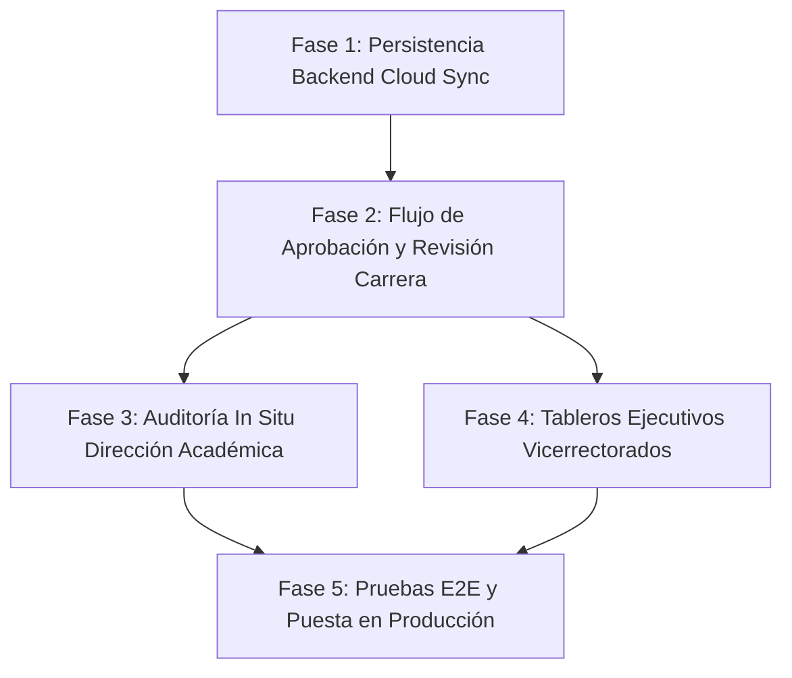

# SISA 2.0 — Sistema Integral de Seguimiento Académico
## Estado Actual del Sistema y Roadmap de Fases Restantes

**Fecha de actualización:** Septiembre 2026  
**Institución:** Universidad Privada Abierta Latinoamericana (UNITEPC)  
**Sistema:** SISA (Sistema Integral de Seguimiento Académico)  
**Enfoque:** Documentación pedagógica, Carpeta Docente oficial y seguimiento académico curricular. *(No gestiona exámenes ni evaluaciones estudiantiles)*.

---

## 1. Identidad y Misión del Sistema

SISA 2.0 es la plataforma institucional concebida para digitalizar, estructurar y supervisar el ciclo académico docente en UNITEPC. Su propósito central es garantizar la elaboración, aprobación, seguimiento y archivo oficial de la **Carpeta Docente** en todas las sedes y carreras de la universidad, eliminando la dispersión de archivos y asegurando el cumplimiento curricular.

### Ecosistema e Integraciones
- **Gateway SEA (Sistema de Educación Académica)**: Sincronización bidireccional en tiempo real de Sedes (Cochabamba, La Paz, El Alto, Cobija), Carreras, Cátedras/Asignaturas, Grupos/Comisiones (teoría y práctica) y Docentes oficiales.

---

## 2. Arquitectura Tecnológica Operativa

| Capa | Tecnologías | Estado |
| :--- | :--- | :--- |
| **Backend** | Spring Boot 3, Java 21, Spring Security (JWT), Spring Data JPA, PostgreSQL 15, Flyway, Apache POI | 100% Operativo en Docker (`sisa-backend:8080`) |
| **Frontend** | Angular 15, Tailwind CSS, Lucide Icons, SCSS, Design System `sea-portal-ui` (`unitepc-pro`) | 100% Operativo en Docker (`sisa-frontend:4200`) |
| **Persistencia** | PostgreSQL con migraciones versionadas Flyway (V1 a V6) | 100% Operativo en Docker (`sisa-postgres:5432`) |
| **Exportación** | Motores Apache POI para Word (`.docx`), Excel (`.xlsx`) y CSS Print Paged Media (`PDF`) | 100% Operativo |

---

## 3. Estado Actual: Módulos y Funcionalidades 100% Implementadas

### A. Autenticación y Control de Accesos (IAM)
- **Login Institucional Dividido**: Pantalla dividida (split-screen) con identidad gráfica UNITEPC Pro, brand institucional y acceso mediante CI o Usuario.
- **Flujo de Primer Ingreso**: Forzado de cambio obligatorio de contraseña en el primer inicio de sesión (la contraseña inicial es el CI).
- **6 Roles Jerárquicos Configurados**:
  1. `ROLE_DOCENTE`: Docente de aula y cátedra.
  2. `ROLE_DIR_CARRERA`: Director de Carrera (revisión y aprobación curricular).
  3. `ROLE_DIR_ACADEMICA`: Director Académico de Sede (auditoría in situ y calidad).
  4. `ROLE_VICERRECTOR_SEDE`: Vicerrector de Sede (supervisión regional).
  5. `ROLE_VICERRECTOR_NACIONAL`: Vicerrector Nacional (tablero ejecutivo nacional).
  6. `ROLE_ADMIN`: Administrador del sistema.
- **Gestión Administrativa de Usuarios**: Panel completo para dar de alta usuarios con asignaciones académicas compuestas (*Sede ➔ Carrera ➔ Asignatura*), restablecimiento de contraseña a CI y activación/desactivación.

### B. Shell Institucional y UX Adaptativa por Rol
- **Topbar Oficial (64px)**: Indicador de gestión activa (*II-2026*), estado *SEA Live*, selector de docentes (visible exclusivamente para directores y administradores) y menú de perfil.
- **Sidebar Global (240px / 76px rail colapsable)**: Filtrado estricto por rol. El docente solo ve los módulos pertinentes a su función (*Dashboard* y *Carpeta Docente*).
- **Diseño Fluido de Pantalla Completa**: Eliminación de restricciones de ancho (`max-w-7xl`) y normalización de márgenes para aprovechar monitores panorámicos.

### C. Dashboard Adaptativo
- **Dashboard Docente (`#dashboard-docente`)**:
  - Banner personalizado con bienvenida, sede asignada y gestión activa.
  - Perfil del docente autenticado (CI, correo institucional, cátedras asignadas).
  - 4 KPIs Personales: Total de Asignaturas, Carga Horaria Semanal (hrs/sem), Grupos a Cargo y Documentos Pedagógicos.
  - Grilla interactiva de **Mis Asignaturas Asignadas**, con códigos oficiales, turnos y estado de los 4 documentos.
  - Accesos directos a los 4 documentos pedagógicos reglamentarios.
  - Formatos oficiales de descarga y recomendaciones de entrega.
- **Dashboard Institucional (`#dashboard-admin`)**:
  - Tablero consolidado para Directores, Vicerrectores y Administradores con métricas globales universitarias.

### D. Carpeta Docente (Módulo Core)
- **Sub-riel Contextual**: Muestra las materias y cátedras asignadas al docente, vinculando automáticamente teoría y práctica o comisiones comunes del SEA.
- **Los 4 Documentos Reglamentarios**:
  1. **1. Programa Analítico**: Datos de la asignatura, competencias, unidades de aprendizaje, metodología y bibliografía base.
  2. **2. Plan de Aprendizaje Cuantitativo (PAC)**: Matriz completa de 20 semanas con ponderaciones, criterios de desempeño e instrumentos de evaluación.
  3. **3. Cronograma Semanal**: Planificación clase a clase de contenidos, avance temático y fechas clave.
  4. **4. Planes de Clase (4 Fases)**: Desarrollo didáctico en Fase Diagnóstica, Formativa, Sumativa y Evaluación Final.
- **Centro de Exportación Oficial**: Descarga instantánea de la carpeta en Word (`.docx`), Excel (`.xlsx`) y generación de PDF oficial para archivo físico institucional.

---

## 4. Fases Faltantes y Roadmap para la Finalización del Sistema

### Fase 1: Persistencia Backend Integral de la Carpeta Docente (Cloud Sync)
* **Problema actual**: El avance de los 4 documentos se almacena en el `localStorage` del navegador. Si el docente cambia de computadora, su borrador no se traslada automáticamente.
* **Entregables**:
  1. Migración Flyway con tablas de persistencia: `carpeta_docente_documentos`, `programa_analitico_data`, `pac_matrix_data`, `cronograma_data`, `planes_clase_data` asociadas a `usuario_asignaciones_academicas`.
  2. Servicios y controladores REST en Spring Boot (`GET/POST/PUT /api/v1/carpeta-docente/{asignacionId}`).
  3. Sincronización transparente en frontend: carga automática desde la nube al iniciar sesión y guardado automático (*auto-save*) con indicador de estado sincronizado.

### Fase 2: Flujo de Aprobación y Dictamen Curricular (Workflow Docente ➔ Carrera)
* **Objetivo**: Establecer el circuito oficial de entrega, revisión y visto bueno de la Carpeta Docente.
* **Entregables**:
  1. **Máquina de Estados de la Carpeta**:
     - `BORRADOR`: En elaboración por el docente.
     - `PRESENTADA`: Enviada formalmente para revisión.
     - `OBSERVADA`: Devuelta por Dirección de Carrera con comentarios puntuales para ajuste.
     - `APROBADA`: Con visto bueno formal de Dirección de Carrera.
  2. **Acción del Docente**: Botón "*Presentar Carpeta a Dirección de Carrera*" con confirmación y bloqueo de edición durante la revisión.
  3. **Panel de Dirección de Carrera (`view2`)**: Bandeja de entrada con filtros por semestre, visualización comparativa de avance, formulario de observaciones y botón de aprobación digital.

### Fase 3: Módulo de Auditoría In Situ (`view3` - Dirección Académica)
* **Objetivo**: Permitir a la Dirección Académica y Jefaturas de Enseñanza fiscalizar el cumplimiento del avance temático en aula física.
* **Entregables**:
  1. Conexión de la vista `view3` con las asignaciones académicas y horarios reales del SEA.
  2. Registro de bitácora in situ: fecha, aula, tema planificado en cronograma vs. tema realmente impartido por el docente.
  3. Reporte de concordancia y desviaciones curriculares.

### Fase 4: Tableros Ejecutivos de Vicerrectorado (`view4` Regional / `view5` Nacional)
* **Objetivo**: Proveer visibilidad estratégica en tiempo real del cumplimiento docente.
* **Entregables**:
  1. Conexión de `view4` (Vicerrectorado Sede): Indicadores consolidados de presentación y aprobación de carpetas de todas las carreras de la sede.
  2. Conexión de `view5` (Vicerrectorado Nacional): Comparativa intersedes (Cochabamba, La Paz, El Alto, Cobija), índices de cumplimiento curricular y exportación de reportes ejecutivos para acreditación universitaria.

### Fase 5: Verificación End-to-End, TDD y Despliegue en Producción
* **Objetivo**: Asegurar estabilidad, seguridad y rendimiento institucional.
* **Entregables**:
  1. Suite completa de pruebas automatizadas (Spring Boot Test + JUnit 5 para backend).
  2. Auditoría de seguridad en endpoints administrativos (`@PreAuthorize`).
  3. Documentación final de usuario para docentes y directores de carrera.
  4. Configuración de entorno de producción con backups automáticos de PostgreSQL.

---

## 5. Matriz de Priorización Sugerida

| Orden | Fase | Impacto | Dependencias |
| :---: | :--- | :--- | :--- |
| **1°** | **Fase 1: Persistencia Cloud Backend** | **Crítico**: Garantiza que ningún docente pierda su trabajo y permite centralizar la información. | Ninguna |
| **2°** | **Fase 2: Flujo de Aprobación de Carrera** | **Alto**: Cierra el ciclo de entrega y revisión formal de las carpetas. | Fase 1 |
| **3°** | **Fase 3: Auditoría In Situ (Dir. Académica)** | **Medio-Alto**: Asegura el control pedagógico en aula. | Fase 1 y 2 |
| **4°** | **Fase 4: Tableros Vicerrectorados** | **Estratégico**: Consolida reportes gerenciales para las autoridades. | Fase 2 |
| **5°** | **Fase 5: Hardening y Producción** | **Crítico**: Puesta en marcha definitiva. | Todas |
