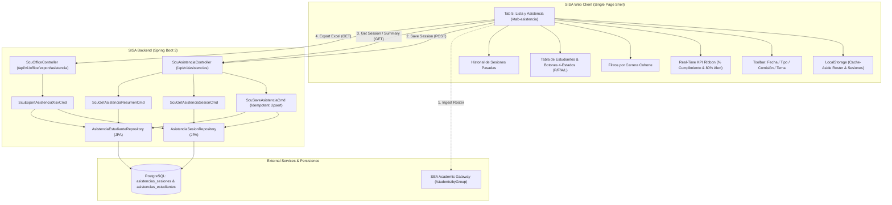
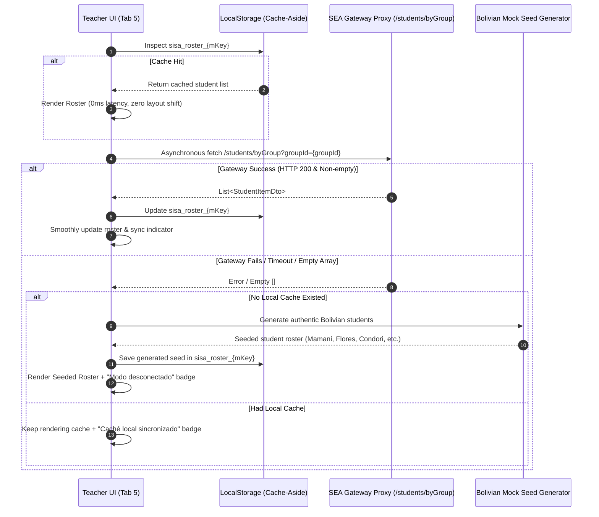
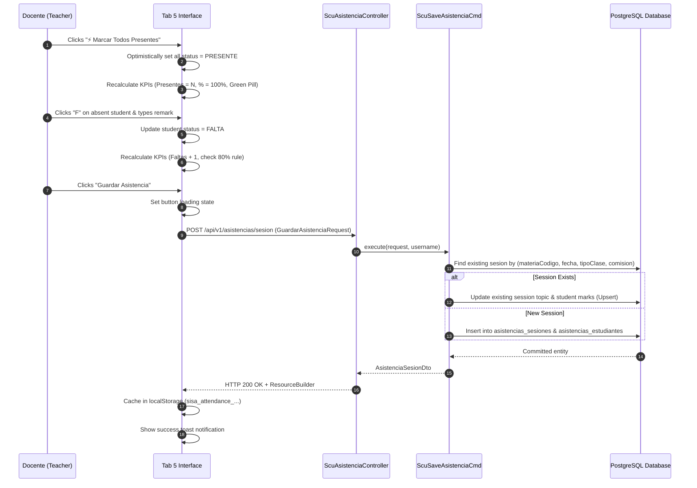

# Technical Design: 12-student-attendance-and-career-grouping

## 1. Overview & Architectural Decisions

This document details the technical design for the **Student Roster & Attendance Tracking Module with Cross-Career Grouping** within the SISA platform for Universidad Técnica Privada Cosmos (UNITEPC). The module integrates as **Tab 5: "5. Lista y Asistencia"** inside the teacher workspace ([`view1`](file:///c:/PROYECTOS/SISA/sisa-frontend/src/app/app.component.html#L1100-L2370)), providing persistent, institutionally audited tracking of student presence in compliance with the UNITEPC **80% minimum attendance rule**.

### 1.1 Architecture Decision Records (ADRs)

#### ADR-01: Full-Stack Integrated Architecture with 3-Tier Offline Resilience
- **Context**: Teachers take attendance in classrooms with variable network connectivity. Relying solely on client `localStorage` causes data loss across devices, while relying solely on synchronous backend calls can block roll call during network hiccups.
- **Decision**: Adopt a **Full-Stack Integrated Hybrid Architecture**:
  1. Primary persistence in PostgreSQL via Spring Data JPA and Flyway migration [`V7__student_attendance_tracking.sql`](file:///c:/PROYECTOS/SISA/sisa-backend/src/main/resources/db/migration/V7__student_attendance_tracking.sql).
  2. Client-side **Cache-Aside pattern**: Cache rosters (`sisa_roster_${mKey}`) and recorded sessions (`sisa_attendance_${mKey}_...`) in `localStorage` for 0ms immediate render.
  3. **3-Tier Ingestion Fallback**: (1) Live SEA Gateway fetch $\rightarrow$ (2) `localStorage` cached roster $\rightarrow$ (3) High-fidelity Bolivian student mock seeds if gateway is unreachable or returns empty arrays.
- **Consequences**: Teachers can take attendance anytime without delay, while institutional directors retain permanent, centralized audit visibility across devices.

#### ADR-02: 4-State Attendance Domain Model & 80% Rule Compliance Formula
- **Context**: Bolivian university regulations distinguish between unexcused absences, late arrivals, and officially justified medical/administrative leave.
- **Decision**: Implement the domain enum [`EstadoAsistencia`](file:///c:/PROYECTOS/SISA/sisa-backend/src/main/java/bo/edu/unitepc/sisa/domain/enums/EstadoAsistencia.java) with 4 states:
  - `PRESENTE` (P): On-time presence (Weight = 1.0).
  - `FALTA` (F): Unexcused absence (Weight = 0.0).
  - `ATRASO` (A): Late arrival (Weight = 0.5 for attendance compliance).
  - `LICENCIA` (L): Justified leave (Weight = 1.0; does not penalize student).
  - **Compliance Formula**:
    $$\text{\% Cumplimiento} = \frac{\text{Presentes} + (0.5 \times \text{Atrasos}) + \text{Licencias}}{\text{Total Evaluados}} \times 100$$
  - Threshold: $\ge 80\%$ is `HABILITADO` (Green); $< 80\%$ triggers visual alerts and is `INHABILITADO` (Red/Amber).
- **Consequences**: Accurate reflection of UNITEPC academic regulations and transparent qualification for final examinations.

#### ADR-03: Cross-Career Cohort Partitioning for Common Subjects
- **Context**: In common subjects (e.g. `SIS-213 Programación III` taken by both *Ingeniería de Sistemas* and *Ingeniería de Telecomunicaciones*), rendering a flat list causes confusion over career enrollment and accreditation reporting.
- **Decision**: Partition student rosters into **distinct Career Cohorts**:
  - Detect common subjects via `isCommon === true` or multi-career groups in `materiasData[mKey].groups`.
  - Associate each student with their specific enrollment career (`carreraCodigo`, `carreraNombre`).
  - Render separate cohort sections with institutional banners and individual career sub-totals.
  - Provide career filter pills (`"Todas las Carreras"`, `"Ing. de Sistemas"`, `"Ing. de Telecomunicaciones"`).
- **Consequences**: Clean separation of student records, allowing both unified class roll call and career-specific administrative audits.

#### ADR-04: Multi-Commission Granularity & Idempotent Session Upsert
- **Context**: A course card often contains theoretical lectures (`TA-01`) attended by all students and multiple practical laboratory commissions (`PL-01`, `PL-02`) attended by subsets. Furthermore, network retries must not duplicate session records.
- **Decision**:
  - Granularity: Keyed by `(materia_codigo, fecha, tipo_clase, comision)` with a database unique constraint.
  - Implement idempotent upsert semantics in [`ScuSaveAsistenciaCmd`](file:///c:/PROYECTOS/SISA/sisa-backend/src/main/java/bo/edu/unitepc/sisa/service/command/ScuSaveAsistenciaCmd.java). If a session exists for that combination, update session topic and child student marks rather than inserting duplicates.
- **Consequences**: Safe concurrent saves, error-free retries, and accurate tracking of laboratory vs theoretical attendance.

#### ADR-05: Institutional Excel Report Generation with Apache POI
- **Context**: UNITEPC regulations require archival physical or digital spreadsheets of attendance signed by the teacher and career director.
- **Decision**: Implement [`ScuExportAsistenciaXlsxCmd`](file:///c:/PROYECTOS/SISA/sisa-backend/src/main/java/bo/edu/unitepc/sisa/service/command/ScuExportAsistenciaXlsxCmd.java) using Apache POI (`org.apache.poi:poi-ooxml`):
  - Builds an institutional workbook with UNITEPC branding, subject metadata, career sections, session dates matrix (P/F/A/L), summary statistics, 80% rule compliance tags, and signature lines.
  - Exposes endpoint `GET /api/v1/office/export/asistencia` in [`ScuOfficeController`](file:///c:/PROYECTOS/SISA/sisa-backend/src/main/java/bo/edu/unitepc/sisa/api/controller/ScuOfficeController.java).
- **Consequences**: Exact match to UNITEPC institutional standards, ready for accreditation audits.

---

## 2. Component Architecture & System Context

### 2.1 System Context Diagram



### 2.2 Sequence: Roster Ingestion with 3-Tier Offline Resilience



### 2.3 Sequence: Attendance Taking, Live KPIs & Idempotent Save



---

## 3. Database Schema & Flyway Migration

### 3.1 Migration File: `V7__student_attendance_tracking.sql`

```sql
-- ============================================================================
-- Flyway Migration: V7__student_attendance_tracking.sql
-- Module: Student Roster & Attendance Tracking with Cross-Career Grouping
-- ============================================================================

-- 1. Class Attendance Sessions Table
CREATE TABLE IF NOT EXISTS asistencias_sesiones (
    id BIGSERIAL PRIMARY KEY,
    materia_codigo VARCHAR(30) NOT NULL,
    materia_nombre VARCHAR(255) NOT NULL,
    gestion_codigo VARCHAR(20) NOT NULL DEFAULT '2-2026',
    fecha DATE NOT NULL,
    tipo_clase VARCHAR(20) NOT NULL DEFAULT 'TEORICA',
    comision VARCHAR(20) NOT NULL DEFAULT 'TA-01',
    tema VARCHAR(500),
    observaciones TEXT,
    registrado_por VARCHAR(100) NOT NULL,
    creado_en TIMESTAMP WITH TIME ZONE NOT NULL DEFAULT CURRENT_TIMESTAMP,
    actualizado_en TIMESTAMP WITH TIME ZONE NOT NULL DEFAULT CURRENT_TIMESTAMP,
    CONSTRAINT chk_tipo_clase CHECK (tipo_clase IN ('TEORICA', 'PRACTICA', 'LABORATORIO', 'CLINICA')),
    CONSTRAINT uq_sesion_asistencia UNIQUE (materia_codigo, fecha, tipo_clase, comision)
);

CREATE INDEX IF NOT EXISTS idx_asistencias_sesiones_materia ON asistencias_sesiones(materia_codigo);
CREATE INDEX IF NOT EXISTS idx_asistencias_sesiones_fecha ON asistencias_sesiones(fecha);
CREATE INDEX IF NOT EXISTS idx_asistencias_sesiones_gestion ON asistencias_sesiones(gestion_codigo);

-- 2. Student Attendance Marks Table
CREATE TABLE IF NOT EXISTS asistencias_estudiantes (
    id BIGSERIAL PRIMARY KEY,
    sesion_id BIGINT NOT NULL REFERENCES asistencias_sesiones(id) ON DELETE CASCADE,
    estudiante_codigo VARCHAR(50) NOT NULL,
    estudiante_nombre VARCHAR(255) NOT NULL,
    carrera_codigo VARCHAR(30) NOT NULL DEFAULT 'CARSIS',
    carrera_nombre VARCHAR(255) NOT NULL DEFAULT 'Ingeniería de Sistemas',
    estado VARCHAR(20) NOT NULL DEFAULT 'PRESENTE',
    observacion VARCHAR(500),
    creado_en TIMESTAMP WITH TIME ZONE NOT NULL DEFAULT CURRENT_TIMESTAMP,
    actualizado_en TIMESTAMP WITH TIME ZONE NOT NULL DEFAULT CURRENT_TIMESTAMP,
    CONSTRAINT chk_estado_asistencia CHECK (estado IN ('PRESENTE', 'FALTA', 'ATRASO', 'LICENCIA')),
    CONSTRAINT uq_estudiante_sesion UNIQUE (sesion_id, estudiante_codigo)
);

CREATE INDEX IF NOT EXISTS idx_asistencias_est_sesion ON asistencias_estudiantes(sesion_id);
CREATE INDEX IF NOT EXISTS idx_asistencias_est_codigo ON asistencias_estudiantes(estudiante_codigo);
CREATE INDEX IF NOT EXISTS idx_asistencias_est_carrera ON asistencias_estudiantes(carrera_codigo);
CREATE INDEX IF NOT EXISTS idx_asistencias_est_estado ON asistencias_estudiantes(estado);
```

### 3.2 Rollback Script

```sql
DROP TABLE IF EXISTS asistencias_estudiantes;
DROP TABLE IF EXISTS asistencias_sesiones;
DELETE FROM flyway_schema_history WHERE version = '7';
```

---

## 4. Domain Entities, Repositories & Data Structures

### 4.1 Enum: `EstadoAsistencia.java`

```java
package bo.edu.unitepc.sisa.domain.enums;

public enum EstadoAsistencia {
    PRESENTE("P", "Presente", 1.0),
    FALTA("F", "Falta", 0.0),
    ATRASO("A", "Atraso", 0.5),
    LICENCIA("L", "Licencia", 1.0);

    private final String codigo;
    private final String descripcion;
    private final double peso;

    EstadoAsistencia(String codigo, String descripcion, double peso) {
        this.codigo = codigo;
        this.descripcion = descripcion;
        this.peso = peso;
    }

    public String getCodigo() { return codigo; }
    public String getDescripcion() { return descripcion; }
    public double getPeso() { return peso; }
}
```

### 4.2 Entity: `AsistenciaSesion.java`

```java
package bo.edu.unitepc.sisa.domain.model;

import jakarta.persistence.*;
import lombok.Getter;
import lombok.NoArgsConstructor;
import lombok.Setter;

import java.time.LocalDate;
import java.time.OffsetDateTime;
import java.util.ArrayList;
import java.util.List;

@Entity
@Table(name = "asistencias_sesiones")
@Getter
@Setter
@NoArgsConstructor
public class AsistenciaSesion {

    @Id
    @GeneratedValue(strategy = GenerationType.IDENTITY)
    private Long id;

    @Column(name = "materia_codigo", nullable = false, length = 30)
    private String materiaCodigo;

    @Column(name = "materia_nombre", nullable = false, length = 255)
    private String materiaNombre;

    @Column(name = "gestion_codigo", nullable = false, length = 20)
    private String gestionCodigo = "2-2026";

    @Column(nullable = false)
    private LocalDate fecha;

    @Column(name = "tipo_clase", nullable = false, length = 20)
    private String tipoClase = "TEORICA";

    @Column(nullable = false, length = 20)
    private String comision = "TA-01";

    @Column(length = 500)
    private String tema;

    @Column(columnDefinition = "TEXT")
    private String observaciones;

    @Column(name = "registrado_por", nullable = false, length = 100)
    private String registradoPor;

    @Column(name = "creado_en", nullable = false)
    private OffsetDateTime creadoEn = OffsetDateTime.now();

    @Column(name = "actualizado_en", nullable = false)
    private OffsetDateTime actualizadoEn = OffsetDateTime.now();

    @OneToMany(mappedBy = "sesion", cascade = CascadeType.ALL, orphanRemoval = true, fetch = FetchType.LAZY)
    private List<AsistenciaEstudiante> estudiantes = new ArrayList<>();

    public void addEstudiante(AsistenciaEstudiante estudiante) {
        estudiantes.add(estudiante);
        estudiante.setSesion(this);
    }
}
```

### 4.3 Entity: `AsistenciaEstudiante.java`

```java
package bo.edu.unitepc.sisa.domain.model;

import bo.edu.unitepc.sisa.domain.enums.EstadoAsistencia;
import jakarta.persistence.*;
import lombok.Getter;
import lombok.NoArgsConstructor;
import lombok.Setter;

import java.time.OffsetDateTime;

@Entity
@Table(name = "asistencias_estudiantes")
@Getter
@Setter
@NoArgsConstructor
public class AsistenciaEstudiante {

    @Id
    @GeneratedValue(strategy = GenerationType.IDENTITY)
    private Long id;

    @ManyToOne(fetch = FetchType.LAZY)
    @JoinColumn(name = "sesion_id", nullable = false)
    private AsistenciaSesion sesion;

    @Column(name = "estudiante_codigo", nullable = false, length = 50)
    private String estudianteCodigo;

    @Column(name = "estudiante_nombre", nullable = false, length = 255)
    private String estudianteNombre;

    @Column(name = "carrera_codigo", nullable = false, length = 30)
    private String carreraCodigo = "CARSIS";

    @Column(name = "carrera_nombre", nullable = false, length = 255)
    private String carreraNombre = "Ingeniería de Sistemas";

    @Enumerated(EnumType.STRING)
    @Column(nullable = false, length = 20)
    private EstadoAsistencia estado = EstadoAsistencia.PRESENTE;

    @Column(length = 500)
    private String observacion;

    @Column(name = "creado_en", nullable = false)
    private OffsetDateTime creadoEn = OffsetDateTime.now();

    @Column(name = "actualizado_en", nullable = false)
    private OffsetDateTime actualizadoEn = OffsetDateTime.now();
}
```

### 4.4 Repositories: `AsistenciaSesionRepository` and `AsistenciaEstudianteRepository`

```java
package bo.edu.unitepc.sisa.domain.repository;

import bo.edu.unitepc.sisa.domain.model.AsistenciaSesion;
import org.springframework.data.jpa.repository.JpaRepository;
import org.springframework.data.jpa.repository.Query;
import org.springframework.data.repository.query.Param;
import org.springframework.stereotype.Repository;

import java.time.LocalDate;
import java.util.List;
import java.util.Optional;

@Repository
public interface AsistenciaSesionRepository extends JpaRepository<AsistenciaSesion, Long> {

    Optional<AsistenciaSesion> findByMateriaCodigoAndFechaAndTipoClaseAndComision(
            String materiaCodigo, LocalDate fecha, String tipoClase, String comision);

    List<AsistenciaSesion> findByMateriaCodigoAndGestionCodigoOrderByFechaDesc(
            String materiaCodigo, String gestionCodigo);

    @Query("SELECT DISTINCT s FROM AsistenciaSesion s LEFT JOIN FETCH s.estudiantes WHERE s.id = :id")
    Optional<AsistenciaSesion> findByIdWithEstudiantes(@Param("id") Long id);
}
```

```java
package bo.edu.unitepc.sisa.domain.repository;

import bo.edu.unitepc.sisa.domain.model.AsistenciaEstudiante;
import org.springframework.data.jpa.repository.JpaRepository;
import org.springframework.data.jpa.repository.Query;
import org.springframework.data.repository.query.Param;
import org.springframework.stereotype.Repository;

import java.util.List;

@Repository
public interface AsistenciaEstudianteRepository extends JpaRepository<AsistenciaEstudiante, Long> {

    List<AsistenciaEstudiante> findBySesionId(Long sesionId);

    @Query("SELECT ae FROM AsistenciaEstudiante ae JOIN ae.sesion s " +
           "WHERE s.materiaCodigo = :materiaCodigo AND s.gestionCodigo = :gestionCodigo")
    List<AsistenciaEstudiante> findByMateriaAndGestion(
            @Param("materiaCodigo") String materiaCodigo,
            @Param("gestionCodigo") String gestionCodigo);
}
```

### 4.5 DTO Contracts & Payloads

```java
package bo.edu.unitepc.sisa.api.request;

import jakarta.validation.constraints.NotBlank;
import jakarta.validation.constraints.NotEmpty;
import jakarta.validation.constraints.NotNull;
import java.time.LocalDate;
import java.util.List;

public record GuardarAsistenciaRequest(
        @NotBlank String materiaCodigo,
        @NotBlank String materiaNombre,
        String gestionCodigo,
        @NotNull LocalDate fecha,
        @NotBlank String tipoClase,
        @NotBlank String comision,
        String tema,
        String observaciones,
        @NotEmpty List<AsistenciaEstudianteRequest> estudiantes
) {}

public record AsistenciaEstudianteRequest(
        @NotBlank String estudianteCodigo,
        @NotBlank String estudianteNombre,
        String carreraCodigo,
        String carreraNombre,
        @NotBlank String estado,
        String observacion
) {}
```

```java
package bo.edu.unitepc.sisa.api.dto;

import java.time.LocalDate;
import java.time.OffsetDateTime;
import java.util.List;

public record AsistenciaSesionDto(
        Long id,
        String materiaCodigo,
        String materiaNombre,
        String gestionCodigo,
        LocalDate fecha,
        String tipoClase,
        String comision,
        String tema,
        String observaciones,
        String registradoPor,
        OffsetDateTime creadoEn,
        OffsetDateTime actualizadoEn,
        List<AsistenciaEstudianteDto> estudiantes
) {}

public record AsistenciaEstudianteDto(
        Long id,
        String estudianteCodigo,
        String estudianteNombre,
        String carreraCodigo,
        String carreraNombre,
        String estado,
        String observacion
) {}

public record AsistenciaResumenDto(
        String materiaCodigo,
        String materiaNombre,
        String gestionCodigo,
        int totalSesionesRegistradas,
        int totalEstudiantesInscritos,
        double porcentajeAsistenciaGlobal,
        int estudiantesEnRiesgoCount,
        List<AsistenciaEstudianteResumenDto> estudiantesResumen
) {}

public record AsistenciaEstudianteResumenDto(
        String estudianteCodigo,
        String estudianteNombre,
        String carreraCodigo,
        String carreraNombre,
        int totalSesiones,
        int presentes,
        int faltas,
        int atrasos,
        int licencias,
        double porcentajeAsistencia,
        boolean cumpleNormativa80Pct
) {}
```

---

## 5. REST API Contracts & Endpoints

### 5.1 Endpoints Specification

| Method | Path | Security Roles | Description |
|:---|:---|:---|:---|
| `POST` | `/api/v1/asistencias/sesion` | `ROLE_DOCENTE`, `ROLE_DIR_CARRERA`, `ROLE_ADMIN` | Atomic upsert of session and student marks |
| `GET` | `/api/v1/asistencias/sesion` | `ROLE_DOCENTE`, `ROLE_DIR_CARRERA`, `ROLE_ADMIN` | Load session by `materiaCodigo`, `fecha`, `tipoClase`, `comision` |
| `GET` | `/api/v1/asistencias/sesiones/{materiaCodigo}` | `ROLE_DOCENTE`, `ROLE_DIR_CARRERA`, `ROLE_ADMIN` | List historical sessions for subject in active term |
| `GET` | `/api/v1/asistencias/resumen/{materiaCodigo}` | `ROLE_DOCENTE`, `ROLE_DIR_CARRERA`, `ROLE_DIR_ACADEMICA`, `ROLE_ADMIN` | Get cumulative semester attendance metrics & 80% rule audit |
| `GET` | `/api/v1/office/export/asistencia` | `ROLE_DOCENTE`, `ROLE_DIR_CARRERA`, `ROLE_ADMIN` | Stream institutional Apache POI Excel workbook (`.xlsx`) |

### 5.2 Payload Samples

#### `POST /api/v1/asistencias/sesion` (Request)
```json
{
  "materiaCodigo": "SIS-213",
  "materiaNombre": "Programación III",
  "gestionCodigo": "2-2026",
  "fecha": "2026-10-21",
  "tipoClase": "TEORICA",
  "comision": "TA-01",
  "tema": "Patrones Arquitectónicos: Clean Architecture y Event-Driven Design",
  "observaciones": "Sesión desarrollada con normalidad. 2 estudiantes con licencia médica.",
  "estudiantes": [
    {
      "estudianteCodigo": "SIS-2024-001",
      "estudianteNombre": "Mamani Flores Kevin",
      "carreraCodigo": "CARSIS",
      "carreraNombre": "Ingeniería de Sistemas",
      "estado": "PRESENTE",
      "observacion": null
    },
    {
      "estudianteCodigo": "TEL-2024-015",
      "estudianteNombre": "Condori Quispe Marisol",
      "carreraCodigo": "CARELE",
      "carreraNombre": "Ingeniería de Telecomunicaciones",
      "estado": "LICENCIA",
      "observacion": "Permiso de Bienestar Estudiantil #BE-481"
    }
  ]
}
```

#### `GET /api/v1/asistencias/resumen/{materiaCodigo}` (Response)
```json
{
  "status": 200,
  "message": "Resumen de asistencia obtenido exitosamente",
  "data": {
    "materiaCodigo": "SIS-213",
    "materiaNombre": "Programación III",
    "gestionCodigo": "2-2026",
    "totalSesionesRegistradas": 16,
    "totalEstudiantesInscritos": 32,
    "porcentajeAsistenciaGlobal": 84.5,
    "estudiantesEnRiesgoCount": 3,
    "estudiantesResumen": [
      {
        "estudianteCodigo": "SIS-2024-001",
        "estudianteNombre": "Mamani Flores Kevin",
        "carreraCodigo": "CARSIS",
        "carreraNombre": "Ingeniería de Sistemas",
        "totalSesiones": 16,
        "presentes": 15,
        "faltas": 1,
        "atrasos": 0,
        "licencias": 0,
        "porcentajeAsistencia": 93.75,
        "cumpleNormativa80Pct": true
      },
      {
        "estudianteCodigo": "SIS-2024-022",
        "estudianteNombre": "Torrico Mendoza Ramiro",
        "carreraCodigo": "CARSIS",
        "carreraNombre": "Ingeniería de Sistemas",
        "totalSesiones": 16,
        "presentes": 11,
        "faltas": 5,
        "atrasos": 0,
        "licencias": 0,
        "porcentajeAsistencia": 68.75,
        "cumpleNormativa80Pct": false
      }
    ]
  }
}
```

---

## 6. Frontend Architecture, DOM Structure & State Transitions

### 6.1 DOM Integration in `app.component.html`

The following DOM elements are integrated into the teacher workspace (`view1`):

1. **Top Segmented Tab Button** (Inside `#doc-sec-asignaturas` tabs container):
   ```html
   <!-- TAB 5: LISTA Y ASISTENCIA -->
   <button onclick="window.switchDocMainTab('tab-asistencia')" data-doc-main-tab="tab-asistencia" id="btn-tab-asistencia" class="doc-main-tab-btn px-4 py-2 rounded-xl text-xs flex items-center gap-2 cursor-pointer transition-all duration-200 bg-transparent hover:bg-white/60 dark:hover:bg-slate-800/60 text-slate-600 dark:text-slate-400 font-semibold border border-transparent">
     <span class="w-6 h-6 rounded-lg bg-teal-100 dark:bg-teal-950/90 text-teal-600 dark:text-teal-400 flex items-center justify-center font-bold text-xs shadow-xs">
       <i data-lucide="clipboard-check" class="w-3.5 h-3.5"></i>
     </span>
     <span class="whitespace-nowrap">5. Lista y Asistencia</span>
     <span class="text-[10px] px-2 py-0.5 rounded-full font-bold bg-teal-600 text-white shadow-xs">Nómina Oficial</span>
   </button>
   ```

2. **Sidebar Contextual Item** (Under *"Documentos de la Carpeta"*):
   ```html
   <button type="button" id="sidebar-tab-asistencia" onclick="window.switchDocMainTab('tab-asistencia')" class="sidebar-tab-nav w-full flex items-center gap-2.5 px-2.5 py-1.5 rounded-lg text-slate-700 dark:text-slate-400 hover:bg-slate-100 dark:hover:bg-slate-800/80 font-medium text-xs text-left cursor-pointer transition-all">
     <i data-lucide="clipboard-check" class="w-4 h-4 text-teal-600 dark:text-teal-400"></i>
     <span>5. Lista y Asistencia</span>
   </button>
   ```

3. **Tab 5 Container Structure (`#tab-asistencia`)**:
   - **Header & Session Configuration Bar**:
     - `#asistencia-fecha-input`: Date picker.
     - `#asistencia-tipo-clase`: Switch `TEORICA` / `PRACTICA`.
     - `#asistencia-comision-select`: Dropdown for commissions.
     - `#asistencia-tema-input`: Text input for session topic.
     - `#btn-marcar-todos-presentes`: Quick action `⚡ Marcar Todos Presentes`.
     - `#btn-guardar-asistencia`: Save action `💾 Guardar Asistencia`.
     - `#btn-exportar-asistencia-xlsx`: Download `.xlsx` spreadsheet.
   - **Real-Time KPI Ribbon**:
     - `#asistencia-kpi-total`: Total Enrolled.
     - `#asistencia-kpi-presentes`: Present Count.
     - `#asistencia-kpi-faltas`: Absent Count.
     - `#asistencia-kpi-atrasos`: Tardy Count.
     - `#asistencia-kpi-licencias`: Excused Count.
     - `#asistencia-kpi-porcentaje`: Overall % and 80% compliance badge.
   - **Career Cohort Filter Bar**:
     - Container `#asistencia-career-filters`: Dynamically populated pills.
   - **Student Roster Table**:
     - Container `#asistencia-roster-container`: Renders career section headers and student rows.
     - Per student: Code, Full Name, Career Tag, 4-Way Toggle (`P` green, `F` red, `A` amber, `L` sky blue), Remarks Input, Cumulative 80% Rule Status Pill.
   - **Historical Sessions Accordion**:
     - `#asistencia-historial-accordion`: Collapsible drawer listing past class dates with attendance summaries.

### 6.2 Frontend Controller Architecture (`app-controller.js`)

#### State Variables
```javascript
let currentAttendanceSession = {
  fecha: new Date().toISOString().split('T')[0],
  tipoClase: 'TEORICA',
  comision: 'TA-01',
  tema: '',
  observaciones: '',
  estudiantes: {} // Map: studentCode -> { status, observacion, name, careerCode, careerName }
};
let activeAttendanceCareerFilter = 'ALL';
let activeRosterStudents = [];
```

#### Core Functions
1. `window.initAttendanceTab()`: Initializes DOM listeners, date bounds, and commissions dropdown.
2. `window.loadAttendanceForCurrentSelection()`: Coordinates roster ingestion and existing session lookup.
3. `window.loadSubjectRoster(mKey)`: Ingests students with 3-tier fallback (Gateway $\rightarrow$ Cache $\rightarrow$ Bolivian Seed).
4. `window.renderAttendanceRoster()`: Partitions students by career and renders banners, rows, and toggles.
5. `window.setStudentAttendanceStatus(studentCode, status)`: Optimistically toggles student state and triggers live KPI update.
6. `window.markAllStudentsPresent()`: Sets all visible students to `PRESENTE`.
7. `window.updateAttendanceLiveKPIs()`: Evaluates session attendance formula and 80% threshold badge.
8. `window.filterAttendanceByCareer(careerCode)`: Filters display by selected career cohort.
9. `window.saveAttendanceSession()`: Dispatches `POST /api/v1/asistencias/sesion` and saves to `localStorage`.
10. `window.loadAttendanceForDate(date)`: Fetches session records for chosen date from backend/cache.
11. `window.loadAttendanceHistory()`: Populates the historical sessions accordion.
12. `window.exportAttendanceExcel()`: Dispatches download of the official `.xlsx` spreadsheet.

### 6.3 Authentic Bolivian Student Mock Generator Specification

To guarantee 100% resilience when disconnected from the central SEA Gateway, the generator creates a realistic class roster conforming to Bolivian university demographics:

- **Paternal Surnames**: Mamani, Condori, Quispe, Flores, Rodriguez, Choque, Vargas, Mendoza, Torrico, Fernandez, Lopez, Gutierrez, Morales, Rojas, Colque, Huanca, Alarcon, Villarroel, Claros, Camacho.
- **Maternal Surnames**: Perez, Cruz, Sanchez, Gomez, Chavez, Rios, Mercado, Soliz, Claure, Pinto, Beltran, Miranda, Guzman, Aguilar, Ortiz, Suarez, Arteaga, Arnez, Ledezma, Zurita.
- **First Names**: Kevin, Marisol, Alejandro, Daniela, Rodrigo, Valeria, Brandon, Camila, Alvaro, Gabriela, Jhonatan, Andrea, Cristian, Paola, Sebastian, Natalia, Mauricio, Luciana, Diego, Sofia.
- **Student Code Format**: `{CAR_PREFIX}-202{3|4|5}-{SEQ:001..099}` (e.g. `SIS-2024-012`, `TEL-2024-045`).
- **Career Allocation**: Derived directly from the active cátedra's `carrerasResolved` array, ensuring accurate proportional distribution across enrolled degree programs.

---

## 7. Security, Auditability & Performance Considerations

### 7.1 Security & Authorization Matrix

| Operation | Docente Titular | Director de Carrera | Dirección Académica / Vicerrector | Admin |
|:---|:---:|:---:|:---:|:---:|
| Take / Save Attendance | ✅ Assigned Subjects | ✅ Department Subjects | ❌ Read Only | ✅ Full |
| Edit Past Sessions | ✅ Own Subjects | ✅ Department Subjects | ❌ Read Only | ✅ Full |
| View Attendance History | ✅ Own Subjects | ✅ Department Subjects | ✅ Campus-wide | ✅ Full |
| Audit 80% Rule Compliance | ✅ Own Subjects | ✅ Department Subjects | ✅ Campus-wide | ✅ Full |
| Export Official Excel | ✅ Own Subjects | ✅ Department Subjects | ✅ Campus-wide | ✅ Full |

### 7.2 Auditability
- Tables `asistencias_sesiones` and `asistencias_estudiantes` maintain `creado_en`, `actualizado_en`, and `registrado_por` columns.
- The backend resolves the authenticated user via Spring Security's `SecurityContext` / `TenantContext`, preventing identity spoofing.

### 7.3 Performance & Caching
- **0ms Render**: Cached rosters in `localStorage` render instantaneously upon tab selection without waiting for network I/O.
- **DB Indexing**: Composite indexes on `(materia_codigo, fecha, tipo_clase, comision)` and `(sesion_id, estudiante_codigo)` guarantee $O(1)$ lookup times.
- **Batched Persistence**: Student marks are saved in a single database transaction via JPA cascade lifecycle.
