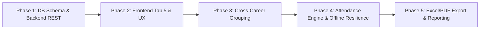

# Proposal: 12-student-attendance-and-career-grouping

## Intent
Establish an institutional, fully auditable, and offline-resilient **Student Roster and Attendance Tracking Module** within the SISA platform teacher workspace ([`view1`](file:///c:/PROYECTOS/SISA/sisa-frontend/src/app/app.component.html#L1100-L2370)). The new module completes the academic folder lifecycle as **Tab 5: "5. Lista y Asistencia"**, operating alongside the four existing pedagogical documents (Programa Analítico, PAC Pedagógico, Cronograma de 20 Semanas, and Planes de Clase).

Under UNITEPC academic regulations, students must maintain a minimum of **80% class attendance** to qualify for final evaluations. Currently, teachers record attendance externally on paper or spreadsheets, leaving career directors and academic authorities without centralized, timely visibility into student absenteeism and cross-career attendance compliance. 

This change introduces:
1. A durable relational schema in PostgreSQL (via Flyway migration [`V7__student_attendance_tracking.sql`](file:///c:/PROYECTOS/SISA/sisa-backend/src/main/resources/db/migration/V7__student_attendance_tracking.sql)) and REST endpoints under `/api/v1/asistencias`.
2. Integration with the SEA Gateway group roster service ([`GET /api/v1/catalogo-academico/students/byGroup`](file:///c:/PROYECTOS/SISA/sisa-backend/src/main/java/bo/edu/unitepc/sisa/api/controller/CatalogoAcademicoController.java#L432-L442)) with a 0ms Cache-Aside strategy and Bolivian student seed fallback.
3. Dedicated **cross-career cohort grouping** for common subjects (`groupLinkId`), clearly separating students into distinct career banners with individual sub-totals.
4. An interactive attendance taking interface featuring 4-state marking (`PRESENTE`, `FALTA`, `ATRASO`, `LICENCIA`), quick batch marking ("⚡ Marcar Todos Presentes"), and real-time compliance KPI badges.
5. Production-grade institutional **Excel (.xlsx)** export via Apache POI and print-ready **PDF** reporting with teacher and director signature blocks.

---

## Scope

### In Scope

- **Phase 1: DB Schema & Backend REST Services**:
  - Flyway migration [`V7__student_attendance_tracking.sql`](file:///c:/PROYECTOS/SISA/sisa-backend/src/main/resources/db/migration/V7__student_attendance_tracking.sql) creating:
    - `asistencias_sesiones`: Stores class session date, subject code (`materia_codigo`), academic term (`gestion_codigo`), class type (`tipo_clase`: `TEORICA`, `PRACTICA`), commission (`comision`), pedagogical topic/observations, teacher username, and audit timestamps.
    - `asistencias_estudiantes`: Stores student code (`estudiante_codigo`), full name, career code/name, attendance state (`PRESENTE`, `FALTA`, `ATRASO`, `LICENCIA`), and optional remarks.
    - Constraints: Unique constraint on `(materia_codigo, fecha, tipo_clase, comision)` for session idempotency and unique constraint on `(sesion_id, estudiante_codigo)`.
  - JPA Domain Entities & Enums:
    - [`AsistenciaSesion.java`](file:///c:/PROYECTOS/SISA/sisa-backend/src/main/java/bo/edu/unitepc/sisa/domain/entity/AsistenciaSesion.java) and [`AsistenciaEstudiante.java`](file:///c:/PROYECTOS/SISA/sisa-backend/src/main/java/bo/edu/unitepc/sisa/domain/entity/AsistenciaEstudiante.java) with cascade lifecycle.
    - [`EstadoAsistencia.java`](file:///c:/PROYECTOS/SISA/sisa-backend/src/main/java/bo/edu/unitepc/sisa/domain/enums/EstadoAsistencia.java) enum (`PRESENTE`, `FALTA`, `ATRASO`, `LICENCIA`).
  - Repositories:
    - [`AsistenciaSesionRepository.java`](file:///c:/PROYECTOS/SISA/sisa-backend/src/main/java/bo/edu/unitepc/sisa/domain/repository/AsistenciaSesionRepository.java) for session lookups by subject, date, class type, and commission.
    - [`AsistenciaEstudianteRepository.java`](file:///c:/PROYECTOS/SISA/sisa-backend/src/main/java/bo/edu/unitepc/sisa/domain/repository/AsistenciaEstudianteRepository.java) for attendance counts and semester compliance calculation.
  - Commands & Services:
    - [`ScuSaveAsistenciaCmd.java`](file:///c:/PROYECTOS/SISA/sisa-backend/src/main/java/bo/edu/unitepc/sisa/service/command/ScuSaveAsistenciaCmd.java): Atomic upsert of session and student marks with audit logging.
    - [`ScuGetAsistenciaSesionCmd.java`](file:///c:/PROYECTOS/SISA/sisa-backend/src/main/java/bo/edu/unitepc/sisa/service/command/ScuGetAsistenciaSesionCmd.java): Retrieves existing attendance session for a subject, date, type, and commission.
    - [`ScuGetAsistenciaResumenCmd.java`](file:///c:/PROYECTOS/SISA/sisa-backend/src/main/java/bo/edu/unitepc/sisa/service/command/ScuGetAsistenciaResumenCmd.java): Computes cumulative student attendance percentage and flags students at risk (< 80%).
    - [`ScuExportAsistenciaXlsxCmd.java`](file:///c:/PROYECTOS/SISA/sisa-backend/src/main/java/bo/edu/unitepc/sisa/service/command/ScuExportAsistenciaXlsxCmd.java): Generates official UNITEPC Excel attendance spreadsheet.
  - REST Controllers:
    - [`ScuAsistenciaController.java`](file:///c:/PROYECTOS/SISA/sisa-backend/src/main/java/bo/edu/unitepc/sisa/api/controller/ScuAsistenciaController.java): Endpoints `GET /api/v1/asistencias/sesion`, `POST /api/v1/asistencias/sesion`, `GET /api/v1/asistencias/resumen/{materiaCodigo}` secured with `@PreAuthorize("hasAnyRole('ROLE_DOCENTE', 'ROLE_DIR_CARRERA', 'ROLE_ADMIN')")`.
    - [`ScuOfficeController.java`](file:///c:/PROYECTOS/SISA/sisa-backend/src/main/java/bo/edu/unitepc/sisa/api/controller/ScuOfficeController.java): Exposes `GET /api/v1/office/export/asistencia` for `.xlsx` download.

- **Phase 2: Frontend Tab 5 Navigation, Layout & UX**:
  - Segmented tab pill `#btn-tab-asistencia` added to [`app.component.html`](file:///c:/PROYECTOS/SISA/sisa-frontend/src/app/app.component.html) with `clipboard-check` icon and badge `"5. Lista y Asistencia"`.
  - Contextual sidebar navigation sub-panel `#sidebar-tab-asistencia` under *"Documentos de la Carpeta"* and entry in the Direct Export Center.
  - Tab 5 container `#tab-asistencia` with session header bar:
    - Date picker input defaulting to current date within active term II-2026.
    - Class type segmented switch (*Teórica* / *Práctica*).
    - Commission selector (`TA-01`, `PL-01`, etc.).
    - Session topic / observation input.
  - Tab orchestration in [`app-controller.js`](file:///c:/PROYECTOS/SISA/sisa-frontend/src/assets/app-controller.js): Updating [`window.switchDocMainTab`](file:///c:/PROYECTOS/SISA/sisa-frontend/src/assets/app-controller.js#L277-L325) with active ring styling (`ring-teal-500/20`), sidebar sync, and title updates.

- **Phase 3: Cross-Career Grouping & Common Subjects Segregation**:
  - Ingestion of student rosters from `/api/v1/catalogo-academico/students/byGroup` for each linked group in `materiasData[mKey].groups`.
  - Association of each student with their specific enrollment career (`carreraCodigo`, `carreraNombre`).
  - Institutional roster layout partitioned into career cohort sections with distinct visual banner headers, student counts, and sub-totals.
  - Career cohort filter pills (`"Todas las Carreras"`, `"Ing. de Sistemas"`, `"Ing. de Telecomunicaciones"`) enabling teachers to view the unified class or isolate a specific career.

- **Phase 4: Attendance Marking Engine, Live KPIs & Offline Resilience**:
  - 4-way segmented toggle buttons per student: `PRESENTE` (P - green), `FALTA` (F - red), `ATRASO` (A - amber), `LICENCIA` (L - blue).
  - Quick action toolbar: `"⚡ Marcar Todos Presentes"` button for one-click initial marking.
  - Real-Time KPI Ribbon: Live dynamic counts for *Total Inscritos*, *Presentes (P)*, *Faltas (F)*, *Atrasos (A)*, *Licencias (L)*, and *% Cumplimiento Global*.
  - Visual 80% rule compliance indicators: Green pill for $\ge 80\%$ and Red/Amber warning badge for $< 80\%$.
  - Resilient Cache-Aside storage in `localStorage` (`sisa_roster_${mKey}`, `sisa_attendance_${mKey}_${date}_${type}_${comision}`).
  - Institutional mock student seed generator with authentic Bolivian names and career allocations providing immediate fallback if SEA Gateway is unreachable or returns empty arrays.
  - Collapsible historical sessions summary drawer / accordion displaying past class sessions held during the term.

- **Phase 5: Excel (.xlsx) & PDF Export and Administrative Reporting**:
  - Official UNITEPC Excel export (`.xlsx`) via [`ScuExportAsistenciaXlsxCmd.java`](file:///c:/PROYECTOS/SISA/sisa-backend/src/main/java/bo/edu/unitepc/sisa/service/command/ScuExportAsistenciaXlsxCmd.java) formatting career headers, student codes, attendance matrix, summary statistics, and signature lines.
  - Direct download button in Tab 5 toolbar and sidebar Direct Export Center.
  - Integration into the PDF print compilation modal (`window.openPdfPrintModal`) with clean `@media print` rules hiding interactive UI controls and rendering formal institutional grids.

### Out of Scope

- Direct write operations or schema migrations on the external SEA Core database (all attendance persistence is maintained within SISA PostgreSQL).
- Hardware integrations for biometric fingerprint or RFID card readers.
- Automated external student notification dispatches (e.g., automated WhatsApp or SMS messages upon absence).
- Historical migration of attendance records prior to gestion II-2026.

---

## Approach

We adopt **Approach 2: Full-Stack Integrated Module (JPA + Flyway V7 + REST Endpoints + Hybrid Offline Cache)** from the exploration report. This approach guarantees institutional data durability, auditable career compliance, multi-device synchronization for teachers, and uninterrupted offline resilience.

Execution is structured across five sequential phases:



### Phase 1: DB Schema & Backend REST
- Author Flyway migration [`V7__student_attendance_tracking.sql`](file:///c:/PROYECTOS/SISA/sisa-backend/src/main/resources/db/migration/V7__student_attendance_tracking.sql) defining tables `asistencias_sesiones` and `asistencias_estudiantes` with foreign keys, indexes, and unique constraints.
- Implement domain entities [`AsistenciaSesion.java`](file:///c:/PROYECTOS/SISA/sisa-backend/src/main/java/bo/edu/unitepc/sisa/domain/entity/AsistenciaSesion.java), [`AsistenciaEstudiante.java`](file:///c:/PROYECTOS/SISA/sisa-backend/src/main/java/bo/edu/unitepc/sisa/domain/entity/AsistenciaEstudiante.java), and enum [`EstadoAsistencia.java`](file:///c:/PROYECTOS/SISA/sisa-backend/src/main/java/bo/edu/unitepc/sisa/domain/enums/EstadoAsistencia.java).
- Implement Spring Data JPA repositories [`AsistenciaSesionRepository.java`](file:///c:/PROYECTOS/SISA/sisa-backend/src/main/java/bo/edu/unitepc/sisa/domain/repository/AsistenciaSesionRepository.java) and [`AsistenciaEstudianteRepository.java`](file:///c:/PROYECTOS/SISA/sisa-backend/src/main/java/bo/edu/unitepc/sisa/domain/repository/AsistenciaEstudianteRepository.java).
- Build command classes [`ScuSaveAsistenciaCmd.java`](file:///c:/PROYECTOS/SISA/sisa-backend/src/main/java/bo/edu/unitepc/sisa/service/command/ScuSaveAsistenciaCmd.java), [`ScuGetAsistenciaSesionCmd.java`](file:///c:/PROYECTOS/SISA/sisa-backend/src/main/java/bo/edu/unitepc/sisa/service/command/ScuGetAsistenciaSesionCmd.java), and [`ScuGetAsistenciaResumenCmd.java`](file:///c:/PROYECTOS/SISA/sisa-backend/src/main/java/bo/edu/unitepc/sisa/service/command/ScuGetAsistenciaResumenCmd.java).
- Expose REST controller [`ScuAsistenciaController.java`](file:///c:/PROYECTOS/SISA/sisa-backend/src/main/java/bo/edu/unitepc/sisa/api/controller/ScuAsistenciaController.java) under `/api/v1/asistencias`.
- Update [`scu-api.constant.ts`](file:///c:/PROYECTOS/SISA/sisa-frontend/src/app/shared/constants/scu-api.constant.ts) with the new endpoints.

### Phase 2: Frontend Tab 5 Navigation, Layout & UX
- Integrate Tab 5 pill button `#btn-tab-asistencia` into the top segmented navigation bar of [`app.component.html`](file:///c:/PROYECTOS/SISA/sisa-frontend/src/app/app.component.html).
- Add `#sidebar-tab-asistencia` in the contextual sidebar under *"Documentos de la Carpeta"* and register attendance export in the Direct Export Center.
- Construct the `#tab-asistencia` container with session parameters bar (date picker, class type toggle, commission selector, session topic input).
- Update [`window.switchDocMainTab`](file:///c:/PROYECTOS/SISA/sisa-frontend/src/assets/app-controller.js#L277-L325) to activate `tab-asistencia`, apply teal glow styles, update sidebar navigation, and trigger roster loading.

### Phase 3: Cross-Career Grouping & Common Subjects Segregation
- Implement `window.loadSubjectRoster(mKey)` in [`app-controller.js`](file:///c:/PROYECTOS/SISA/sisa-frontend/src/assets/app-controller.js) querying `/api/v1/catalogo-academico/students/byGroup` for all groups in the course cluster.
- Aggregate and attribute each student to their corresponding career (`carreraCodigo`, `carreraNombre`).
- Render career section banners with student tallies and sub-totals.
- Add career filter pills enabling instant switching between unified and career-isolated roster views.

### Phase 4: Attendance Marking Engine, Live KPIs & Offline Resilience
- Render institutional student rows with 4-way segmented buttons (P / F / A / L) and observation text inputs.
- Implement `window.setStudentAttendanceStatus(studentCode, status)` with instant optimistic UI feedback.
- Implement `window.markAllStudentsPresent()` for instant bulk population.
- Implement `window.updateAttendanceLiveKPIs()` computing total enrolled, P, F, A, L counts, and overall % compliance with 80% rule alert thresholds.
- Implement hybrid persistence: local browser caching in `localStorage` followed by asynchronous `POST /api/v1/asistencias/sesion` synchronization.
- Implement realistic Bolivian student seed generator as fallback when network/gateway is disconnected.
- Build historical session summary accordion showing past dates recorded for the cátedra.

### Phase 5: Excel (.xlsx) & PDF Export and Administrative Reporting
- Implement [`ScuExportAsistenciaXlsxCmd.java`](file:///c:/PROYECTOS/SISA/sisa-backend/src/main/java/bo/edu/unitepc/sisa/service/command/ScuExportAsistenciaXlsxCmd.java) leveraging Apache POI to generate institutional spreadsheets with official UNITEPC header, career sections, session dates, totals, and signatures.
- Expose `GET /api/v1/office/export/asistencia` in [`ScuOfficeController.java`](file:///c:/PROYECTOS/SISA/sisa-backend/src/main/java/bo/edu/unitepc/sisa/api/controller/ScuOfficeController.java).
- Wire frontend download triggers in Tab 5 toolbar and sidebar export center.
- Format print stylesheet in `app.component.html` and update `window.openPdfPrintModal()` to include attendance grids in institutional PDF dossiers.

---

## Affected Areas

### Backend
- **Database / Flyway**:
  - [`V7__student_attendance_tracking.sql`](file:///c:/PROYECTOS/SISA/sisa-backend/src/main/resources/db/migration/V7__student_attendance_tracking.sql): New migration defining `asistencias_sesiones` and `asistencias_estudiantes`.
- **Domain Entities & Enums**:
  - [`AsistenciaSesion.java`](file:///c:/PROYECTOS/SISA/sisa-backend/src/main/java/bo/edu/unitepc/sisa/domain/entity/AsistenciaSesion.java): Root entity for class sessions.
  - [`AsistenciaEstudiante.java`](file:///c:/PROYECTOS/SISA/sisa-backend/src/main/java/bo/edu/unitepc/sisa/domain/entity/AsistenciaEstudiante.java): Child entity for individual student attendance marks.
  - [`EstadoAsistencia.java`](file:///c:/PROYECTOS/SISA/sisa-backend/src/main/java/bo/edu/unitepc/sisa/domain/enums/EstadoAsistencia.java): Enum (`PRESENTE`, `FALTA`, `ATRASO`, `LICENCIA`).
- **Repositories**:
  - [`AsistenciaSesionRepository.java`](file:///c:/PROYECTOS/SISA/sisa-backend/src/main/java/bo/edu/unitepc/sisa/domain/repository/AsistenciaSesionRepository.java): Lookups by subject code, date, commission, and academic term.
  - [`AsistenciaEstudianteRepository.java`](file:///c:/PROYECTOS/SISA/sisa-backend/src/main/java/bo/edu/unitepc/sisa/domain/repository/AsistenciaEstudianteRepository.java): Marks aggregation and cumulative statistics.
- **DTOs**:
  - `AsistenciaSesionDto.java`: Full session payload with student mark details.
  - `AsistenciaEstudianteDto.java`: Individual mark record.
  - `GuardarAsistenciaRequest.java`: Command payload for atomic session submission.
  - `AsistenciaResumenDto.java`: Course-level cumulative metrics and 80% rule compliance alerts.
- **Commands & Business Logic**:
  - [`ScuSaveAsistenciaCmd.java`](file:///c:/PROYECTOS/SISA/sisa-backend/src/main/java/bo/edu/unitepc/sisa/service/command/ScuSaveAsistenciaCmd.java): Transactional save/upsert with audit trail.
  - [`ScuGetAsistenciaSesionCmd.java`](file:///c:/PROYECTOS/SISA/sisa-backend/src/main/java/bo/edu/unitepc/sisa/service/command/ScuGetAsistenciaSesionCmd.java): Read existing session attendance.
  - [`ScuGetAsistenciaResumenCmd.java`](file:///c:/PROYECTOS/SISA/sisa-backend/src/main/java/bo/edu/unitepc/sisa/service/command/ScuGetAsistenciaResumenCmd.java): Calculate student attendance percentages across sessions.
  - [`ScuExportAsistenciaXlsxCmd.java`](file:///c:/PROYECTOS/SISA/sisa-backend/src/main/java/bo/edu/unitepc/sisa/service/command/ScuExportAsistenciaXlsxCmd.java): Official Apache POI Excel workbook generation.
- **Controllers**:
  - [`ScuAsistenciaController.java`](file:///c:/PROYECTOS/SISA/sisa-backend/src/main/java/bo/edu/unitepc/sisa/api/controller/ScuAsistenciaController.java): REST endpoints under `/api/v1/asistencias`.
  - [`ScuOfficeController.java`](file:///c:/PROYECTOS/SISA/sisa-backend/src/main/java/bo/edu/unitepc/sisa/api/controller/ScuOfficeController.java): Endpoint `/api/v1/office/export/asistencia`.

### Frontend
- **Layout & Structure ([`app.component.html`](file:///c:/PROYECTOS/SISA/sisa-frontend/src/app/app.component.html))**:
  - Top bar navigation pill `#btn-tab-asistencia`.
  - Contextual sidebar navigation item `#sidebar-tab-asistencia`.
  - Direct Export Center download action for attendance sheet.
  - Full Tab 5 container `#tab-asistencia`:
    - Session parameters toolbar (Date, Type, Commission, Topic).
    - Quick actions ("⚡ Marcar Todos Presentes", "Guardar Asistencia").
    - Real-Time KPI Ribbon (Inscritos, P, F, A, L, % Cumplimiento).
    - Career Cohort Filter Pills.
    - Career-grouped student roster table with segmented 4-way buttons.
    - Historical session summary accordion.
- **Controller Logic ([`app-controller.js`](file:///c:/PROYECTOS/SISA/sisa-frontend/src/assets/app-controller.js))**:
  - Update `window.switchDocMainTab` for `tab-asistencia`.
  - `window.loadAttendanceForDate`: Load session from backend with fallback.
  - `window.setStudentAttendanceStatus`: Interactive toggle of student states.
  - `window.markAllStudentsPresent`: Batch present marking.
  - `window.updateAttendanceLiveKPIs`: Recalculate summary badges and 80% compliance pill.
  - `window.filterAttendanceByCareer`: Filter table rows by selected career cohort.
  - `window.saveAttendanceSession`: Hybrid persistence (POST + LocalStorage backup).
  - `window.exportAttendanceExcel`: Trigger institutional Excel download.
  - PDF modal update: Include attendance records in print dossier.
- **Constants**:
  - [`scu-api.constant.ts`](file:///c:/PROYECTOS/SISA/sisa-frontend/src/app/shared/constants/scu-api.constant.ts): Declare `/api/v1/asistencias` endpoints.

---

## Risks and Mitigations

| Risk | Impact | Mitigation Strategy |
|:---|:---|:---|
| **SEA Gateway Unreachable or Returns Empty Roster** | High | Implement a 3-tier fallback architecture: (1) Live SEA Gateway fetch $\rightarrow$ (2) `localStorage` cached roster $\rightarrow$ (3) High-fidelity institutional Bolivian seed mock roster with realistic student codes and career tags. Teachers can take attendance without interruption. |
| **Common Subject Multi-Commission Complexity** | Medium | A course cluster may combine theoretical lectures (`TA-01`) and multiple practical laboratory commissions (`PL-01`, `PL-02`). Provide a dedicated Commission selector in the session toolbar to record attendance per specific laboratory group or collectively for theoretical classes. |
| **Concurrent Attendance Saves on Same Session** | Low | Enforce database uniqueness constraint on `(materia_codigo, fecha, tipo_clase, comision)`. `ScuSaveAsistenciaCmd` executes an atomic upsert that updates existing student marks rather than inserting duplicate records. |
| **Cross-Career Student Misattribution in Common Subjects** | Medium | Map each enrolled student to the specific `careerCode` and `careerName` of their SEA group. The UI visually segregates students into distinct career cohort blocks with dedicated headers and sub-totals, preventing confusion. |
| **Print & PDF Layout Overcrowding** | Low | Implement clean `@media print` rules: suppress interactive buttons, segmented pills, and inputs, replacing them with a crisp institutional grid formatted for standard letter paper with signature blocks. |

---

## Rollback Plan

1. **Source Code Reversion**:
   - Revert frontend additions in [`app.component.html`](file:///c:/PROYECTOS/SISA/sisa-frontend/src/app/app.component.html), [`app-controller.js`](file:///c:/PROYECTOS/SISA/sisa-frontend/src/assets/app-controller.js), and [`scu-api.constant.ts`](file:///c:/PROYECTOS/SISA/sisa-frontend/src/app/shared/constants/scu-api.constant.ts).
   - Remove backend controllers, commands, repositories, and entities under `bo.edu.unitepc.sisa`.
2. **Database Reversion**:
   - Execute SQL rollback script to remove tables and clean Flyway migration history:
     ```sql
     DROP TABLE IF EXISTS asistencias_estudiantes;
     DROP TABLE IF EXISTS asistencias_sesiones;
     DELETE FROM flyway_schema_history WHERE version = '7';
     ```
3. **Client Cache Reset**:
   - Clear browser `localStorage` keys matching `sisa_roster_*` and `sisa_attendance_*`.

---

## Dependencies

- **Spring Boot Backend**: Java 17+, Spring Boot 3.3+, Spring Data JPA, and PostgreSQL 15+.
- **Database Migrations**: Flyway migration framework for sequential execution of `V7__student_attendance_tracking.sql`.
- **Apache POI**: `org.apache.poi:poi-ooxml` dependency in `pom.xml` for binary Excel (`.xlsx`) generation.
- **SEA Academic Gateway**: Functional REST proxy [`/api/v1/catalogo-academico/students/byGroup`](file:///c:/PROYECTOS/SISA/sisa-backend/src/main/java/bo/edu/unitepc/sisa/api/controller/CatalogoAcademicoController.java#L432-L442).
- **Frontend Architecture**: Angular 18 portal shell with Tailwind CSS and FontAwesome icon suite.
- **Security & Authorization**: Spring Security JWT filter and roles `ROLE_DOCENTE`, `ROLE_DIR_CARRERA`, and `ROLE_ADMIN`.

---

## Success Criteria

1. **Tab 5 Navigation & Workspace Aesthetics**:
   - The teacher workspace (`view1`) displays the fifth tab button `"5. Lista y Asistencia"` (`#btn-tab-asistencia`). Clicking it switches active tab visibility, illuminates the teal glow indicator, and synchronizes the sidebar navigation.
2. **Catalog & Student Roster Ingestion**:
   - Selecting a subject fetches student rosters from `/api/v1/catalogo-academico/students/byGroup` for all linked groups, caching the list in `localStorage` for 0ms subsequent renders.
   - If the Gateway is unreachable, the system transparently loads high-fidelity Bolivian student seed data without blocking the teacher.
3. **Cross-Career Visual Segregation**:
   - For common subjects with multiple careers, students are visually grouped under distinct career banners (e.g. *Ingeniería de Sistemas* vs *Ingeniería de Telecomunicaciones*) with individual sub-totals.
   - Career filter pills allow filtering by specific career or displaying all careers simultaneously.
4. **Attendance Marking & 80% Rule Compliance**:
   - Each student row displays 4-way segmented buttons (P, F, A, L) and an observation input.
   - Clicking `"⚡ Marcar Todos Presentes"` sets all students to `PRESENTE` instantaneously.
   - The Real-Time KPI Ribbon accurately tallies enrolled, P, F, A, L counts, and computes the global compliance percentage. Students or groups with $< 80\%$ attendance trigger visual warning alerts.
5. **Persistence & Idempotency**:
   - Clicking `"Guardar Asistencia"` saves the session via `POST /api/v1/asistencias/sesion` to PostgreSQL and updates local cache.
   - Changing the session date reloads previously saved attendance marks for that date, commission, and subject.
6. **Institutional Excel & PDF Export**:
   - Clicking `"Exportar Asistencia (.xlsx)"` downloads a professionally styled Excel workbook matching UNITEPC institutional standards with career groupings, summary statistics, and signature lines.
   - Opening the PDF modal or printing renders an institutional attendance grid cleanly formatted for physical review and archiving.
