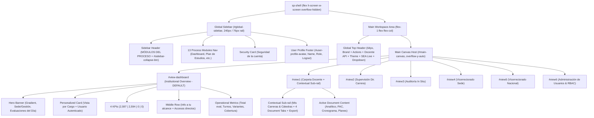

# Technical Design: 09 Portal Shell Layout Restructure

**Change ID**: `09-portal-shell-layout-restructure`  
**Topic**: Canonical UNITEPC SEA Portal Shell Architecture (`sea-portal-ui` / `unitepc-pro`)  
**Status**: Ready for Implementation  
**Artifact Mode**: Hybrid (`openspec` markdown + Engram memory persistence)  
**Reference Design**: `media_1788880414905.png` (`planificacion.unitepc.edu.bo/dashboard`)

---

## 1. Shell Architecture & Component Hierarchy

### 1.1 Architectural Overview
The current layout embeds duplicate sidebars inside individual views and relies on an experimental top navigation bar (`btn-view1` through `btn-view6`). 

The canonical architecture lifts navigation into a persistent outer layout shell composed of:
1. **Persistent Global Left Sidebar (`#global-sidebar`)**: 240px default width (`w-60`), collapsible to 76px rail (`w-20`), containing 13 process modules, account security notice, and authenticated user footer.
2. **Persistent Global Top Header (`header.sp-topbar`)**: 64px fixed height (`h-16`), containing institutional identity, parameter action, gestión dropdown, docente API selector, theme toggle, SEA gateway status, and user profile menu.
3. **Scrollable Main Canvas Container (`#main-canvas`)**: Vertically scrollable workspace hosting all views (`#view-dashboard`, `#view1`, `#view2`, `#view3`, `#view4`, `#view5`, `#view6`).
4. **Root Institutional Dashboard (`#view-dashboard`)**: Dedicated landing canvas matching `media_1788880414905.png` with Hero Banner, personalized role card, 4 KPI stats, middle section, and operational cards.
5. **Decoupled Carpeta Docente (`#view1`)**: Stripped of redundant global headers, retaining an internal contextual sub-rail (`Mis Carreras & Cátedras`, 4 document tabs, and direct export actions).

### 1.2 Layout Hierarchy Diagram



---

## 2. DOM Structure Specifications (`app.component.html`)

### 2.1 Outer Shell & Container Setup
The root container replaces the current body wrapping. The prototype header (`header.w-full.bg-slate-900`) is removed.

```html
<div class="sp-shell flex h-screen w-screen bg-[var(--sp-bg)] text-[var(--sp-ink)] overflow-hidden font-sans select-none">
  
  <!-- ========================================================================= -->
  <!-- 1. PERSISTENT GLOBAL LEFT SIDEBAR                                         -->
  <!-- ========================================================================= -->
  <aside id="global-sidebar" class="w-60 bg-[var(--sp-surface)] border-r border-[var(--sp-border)] flex flex-col justify-between flex-shrink-0 z-30 transition-all duration-250 ease-out no-print">
    ...
  </aside>

  <!-- ========================================================================= -->
  <!-- 2. MAIN WORKSPACE CONTAINER                                               -->
  <!-- ========================================================================= -->
  <div class="flex-1 flex flex-col h-full overflow-hidden">
    
    <!-- Canonical Top Header -->
    <header class="sp-topbar h-16 bg-[var(--sp-surface)] border-b border-[var(--sp-border)] px-6 flex items-center justify-between flex-shrink-0 z-20 no-print">
      ...
    </header>

    <!-- Main Canvas Viewport -->
    <main id="main-canvas" class="flex-1 overflow-y-auto bg-[var(--sp-bg)] p-6 space-y-6 custom-scrollbar">
      ...
    </main>

  </div>
</div>
```

---

### 2.2 Global Sidebar Markup (`#global-sidebar`)

```html
<aside id="global-sidebar" class="w-60 bg-[var(--sp-surface)] border-r border-[var(--sp-border)] flex flex-col justify-between flex-shrink-0 z-30 transition-all duration-250 ease-out no-print">
  
  <div class="flex-1 flex flex-col overflow-y-auto custom-scrollbar p-3 space-y-3">
    
    <!-- Sidebar Header & Rail Collapse Toggle -->
    <div class="flex items-center justify-between px-2 py-1.5 border-b border-[var(--sp-border)]">
      <div class="flex items-center gap-2.5 overflow-hidden">
        <div class="w-8 h-8 rounded-lg bg-[var(--sp-purple)] text-white flex items-center justify-center font-bold font-display shadow-sm flex-shrink-0">
          <i data-lucide="layers" class="w-4 h-4"></i>
        </div>
        <div class="sidebar-label-wrap">
          <span class="text-[10px] font-extrabold uppercase tracking-wider text-[var(--sp-ink-4)] block">MÓDULOS DEL PROCESO</span>
          <span class="text-xs font-bold text-[var(--sp-ink)] truncate block font-display">SISA 2.0</span>
        </div>
      </div>
      <button id="sidebar-collapse-btn" onclick="window.toggleSidebarCollapse()" class="p-1.5 rounded-lg text-[var(--sp-ink-3)] hover:text-[var(--sp-purple)] hover:bg-[var(--sp-surface-hover)] transition-colors cursor-pointer" title="Colapsar menú">
        <i id="sidebar-collapse-icon" data-lucide="chevrons-left" class="w-4 h-4"></i>
      </button>
    </div>

    <!-- 13 Canonical Process Module Navigation Buttons -->
    <nav class="space-y-0.5" id="global-sidebar-nav">
      
      <!-- 1. Dashboard -->
      <button onclick="window.switchView('view-dashboard')" id="nav-item-dashboard" class="global-nav-btn active w-full flex items-center gap-3 px-3 py-2 rounded-xl text-xs font-semibold transition-all">
        <i data-lucide="layout-dashboard" class="w-4 h-4 flex-shrink-0"></i>
        <span class="sidebar-item-label truncate">Dashboard</span>
      </button>

      <!-- 2. Plan de Estudios (Carpeta Docente) -->
      <button onclick="window.switchView('view1')" id="nav-item-view1" class="global-nav-btn w-full flex items-center gap-3 px-3 py-2 rounded-xl text-xs font-medium text-[var(--sp-ink-2)] hover:bg-[var(--sp-surface-hover)] transition-all">
        <i data-lucide="book-open" class="w-4 h-4 flex-shrink-0"></i>
        <span class="sidebar-item-label truncate">Plan de Estudios</span>
      </button>

      <!-- 3. Banco de Preguntas -->
      <button onclick="window.showToast('Módulo Banco de Preguntas en preparación')" id="nav-item-banco" class="global-nav-btn w-full flex items-center gap-3 px-3 py-2 rounded-xl text-xs font-medium text-[var(--sp-ink-2)] hover:bg-[var(--sp-surface-hover)] transition-all">
        <i data-lucide="database" class="w-4 h-4 flex-shrink-0"></i>
        <span class="sidebar-item-label truncate">Banco de Preguntas</span>
      </button>

      <!-- 4. Lista de Evaluaciones -->
      <button onclick="window.showToast('Módulo Lista de Evaluaciones')" id="nav-item-evaluaciones" class="global-nav-btn w-full flex items-center gap-3 px-3 py-2 rounded-xl text-xs font-medium text-[var(--sp-ink-2)] hover:bg-[var(--sp-surface-hover)] transition-all">
        <i data-lucide="list-ordered" class="w-4 h-4 flex-shrink-0"></i>
        <span class="sidebar-item-label truncate">Lista de Evaluaciones</span>
      </button>

      <!-- 5. Rol de Exámenes -->
      <button onclick="window.showToast('Módulo Rol de Exámenes')" id="nav-item-rol" class="global-nav-btn w-full flex items-center gap-3 px-3 py-2 rounded-xl text-xs font-medium text-[var(--sp-ink-2)] hover:bg-[var(--sp-surface-hover)] transition-all">
        <i data-lucide="calendar-days" class="w-4 h-4 flex-shrink-0"></i>
        <span class="sidebar-item-label truncate">Rol de Exámenes</span>
      </button>

      <!-- 6. Servicios Académicos (with Live badge) -->
      <button onclick="window.toggleSeaGatewaySimulation()" id="nav-item-servicios" class="global-nav-btn w-full flex items-center justify-between px-3 py-2 rounded-xl text-xs font-medium text-[var(--sp-ink-2)] hover:bg-[var(--sp-surface-hover)] transition-all">
        <div class="flex items-center gap-3 overflow-hidden">
          <i data-lucide="cpu" class="w-4 h-4 flex-shrink-0"></i>
          <span class="sidebar-item-label truncate">Servicios Académicos</span>
        </div>
        <span id="sidebar-sea-badge" class="sidebar-badge-wrap px-1.5 py-0.5 rounded text-[10px] font-extrabold bg-emerald-500/15 text-emerald-600 dark:text-emerald-400 border border-emerald-500/30">
          <span id="sidebar-sea-text">Live</span>
        </span>
      </button>

      <!-- 7. Salas Virtuales -->
      <button onclick="window.showToast('Salas Virtuales activas')" id="nav-item-salas" class="global-nav-btn w-full flex items-center gap-3 px-3 py-2 rounded-xl text-xs font-medium text-[var(--sp-ink-2)] hover:bg-[var(--sp-surface-hover)] transition-all">
        <i data-lucide="monitor-play" class="w-4 h-4 flex-shrink-0"></i>
        <span class="sidebar-item-label truncate">Salas Virtuales</span>
      </button>

      <!-- 8. Calificación OMR -->
      <button onclick="window.showToast('Calificación OMR')" id="nav-item-omr" class="global-nav-btn w-full flex items-center gap-3 px-3 py-2 rounded-xl text-xs font-medium text-[var(--sp-ink-2)] hover:bg-[var(--sp-surface-hover)] transition-all">
        <i data-lucide="scan-line" class="w-4 h-4 flex-shrink-0"></i>
        <span class="sidebar-item-label truncate">Calificación OMR</span>
      </button>

      <!-- 9. Administración de Evaluaciones -->
      <button onclick="window.switchView('view2')" id="nav-item-admin-eval" class="global-nav-btn w-full flex items-center gap-3 px-3 py-2 rounded-xl text-xs font-medium text-[var(--sp-ink-2)] hover:bg-[var(--sp-surface-hover)] transition-all">
        <i data-lucide="sliders-horizontal" class="w-4 h-4 flex-shrink-0"></i>
        <span class="sidebar-item-label truncate">Administración de Evaluaciones</span>
      </button>

      <!-- 10. Auditoría & Bitácora -->
      <button onclick="window.switchView('view3')" id="nav-item-view3" class="global-nav-btn w-full flex items-center gap-3 px-3 py-2 rounded-xl text-xs font-medium text-[var(--sp-ink-2)] hover:bg-[var(--sp-surface-hover)] transition-all">
        <i data-lucide="scroll-text" class="w-4 h-4 flex-shrink-0"></i>
        <span class="sidebar-item-label truncate">Auditoría & Bitácora</span>
      </button>

      <!-- 11. Respaldos y contingencias -->
      <button onclick="window.showToast('Respaldos y contingencias')" id="nav-item-respaldos" class="global-nav-btn w-full flex items-center gap-3 px-3 py-2 rounded-xl text-xs font-medium text-[var(--sp-ink-2)] hover:bg-[var(--sp-surface-hover)] transition-all">
        <i data-lucide="hard-drive-download" class="w-4 h-4 flex-shrink-0"></i>
        <span class="sidebar-item-label truncate">Respaldos y contingencias</span>
      </button>

      <!-- 12. Reporte de Evaluaciones -->
      <button onclick="window.switchView('view4')" id="nav-item-reportes" class="global-nav-btn w-full flex items-center gap-3 px-3 py-2 rounded-xl text-xs font-medium text-[var(--sp-ink-2)] hover:bg-[var(--sp-surface-hover)] transition-all">
        <i data-lucide="file-spreadsheet" class="w-4 h-4 flex-shrink-0"></i>
        <span class="sidebar-item-label truncate">Reporte de Evaluaciones</span>
      </button>

      <!-- 13. Usuarios y accesos -->
      <button onclick="window.switchView('view6')" id="nav-item-view6" class="global-nav-btn w-full flex items-center gap-3 px-3 py-2 rounded-xl text-xs font-medium text-[var(--sp-ink-2)] hover:bg-[var(--sp-surface-hover)] transition-all">
        <i data-lucide="user-cog" class="w-4 h-4 flex-shrink-0"></i>
        <span class="sidebar-item-label truncate">Usuarios y accesos</span>
      </button>
    </nav>

    <!-- Bottom Security Card -->
    <div class="sidebar-security-card p-3 rounded-xl bg-[var(--sp-surface-2)] border border-[var(--sp-border)] text-xs space-y-1 cursor-pointer transition-colors hover:border-[var(--sp-purple)]/40" onclick="window.openModal('Seguridad de la cuenta', '<p>Por políticas de seguridad institucional de UNITEPC, recuerda actualizar tu contraseña periódicamente y no compartirla.</p>')">
      <div class="flex items-center gap-2 font-bold text-[var(--sp-ink)]">
        <i data-lucide="shield-check" class="w-4 h-4 text-[var(--sp-purple)] flex-shrink-0"></i>
        <span class="sidebar-item-label">Seguridad de la cuenta</span>
      </div>
      <p class="sidebar-item-label text-[11px] text-[var(--sp-ink-3)] leading-relaxed">Por seguridad, cambia periódicamente tu contraseña y no la compartas.</p>
    </div>

  </div>

  <!-- Bottom User Profile Bar (Preserves legacy IDs for controller synchronization) -->
  <div class="p-3 border-t border-[var(--sp-border)] flex items-center justify-between flex-shrink-0 bg-[var(--sp-surface)]">
    <div class="flex items-center gap-2.5 overflow-hidden">
      <div id="user-profile-avatar" class="w-8 h-8 rounded-full bg-[var(--sp-purple-soft)] text-[var(--sp-purple-dark)] font-bold flex items-center justify-center text-xs border border-[var(--sp-purple)]/20 flex-shrink-0 font-display">HM</div>
      <div class="sidebar-label-wrap overflow-hidden">
        <div id="user-profile-name" class="text-xs font-bold text-[var(--sp-ink)] truncate font-display">Harold Marco Antonio Rojas Torres</div>
        <div id="user-profile-info" class="text-[10px] font-medium text-[var(--sp-ink-3)] truncate">Administrador • Sede Central</div>
      </div>
    </div>
    <button onclick="window.logoutUser()" title="Cerrar sesión" class="p-1.5 rounded-lg text-[var(--sp-ink-3)] hover:text-red-600 hover:bg-red-500/10 transition-colors cursor-pointer flex-shrink-0">
      <i data-lucide="log-out" class="w-4 h-4"></i>
    </button>
  </div>

</aside>
```

---

### 2.3 Global Top Header Markup (`header.sp-topbar`)

```html
<header class="sp-topbar h-16 bg-[var(--sp-surface)] border-b border-[var(--sp-border)] px-6 flex items-center justify-between flex-shrink-0 z-20 no-print">
  
  <!-- Brand / Institutional Title -->
  <div class="flex items-center gap-3">
    <div class="w-9 h-9 rounded-xl bg-[var(--sp-purple)] flex items-center justify-center text-white shadow-sm font-bold font-display">
      <i data-lucide="graduation-cap" class="w-5 h-5"></i>
    </div>
    <div>
      <h1 class="text-sm font-bold text-[var(--sp-ink)] font-display tracking-tight leading-none">Sistema de Evaluaciones</h1>
      <p class="text-[10px] font-extrabold uppercase tracking-wider text-[var(--sp-ink-3)] mt-0.5">GESTIÓN INTEGRAL DEL PROCESO DE EVALUACIONES ACADÉMICAS</p>
    </div>
  </div>

  <!-- Right Header Controls Cluster -->
  <div class="flex items-center gap-3">
    
    <!-- + Parametrizar Vista Action -->
    <button onclick="window.showToast('Configurador de parámetros de vista')" class="px-3 py-1.5 rounded-xl border border-[var(--sp-border)] hover:bg-[var(--sp-surface-hover)] text-xs font-semibold text-[var(--sp-ink)] flex items-center gap-1.5 transition-colors cursor-pointer">
      <i data-lucide="plus" class="w-3.5 h-3.5 text-[var(--sp-purple)]"></i>
      <span>Parametrizar vista</span>
    </button>

    <!-- GESTIÓN II-2026 Pill Dropdown -->
    <div class="flex items-center gap-1.5 px-3 py-1.5 rounded-xl bg-[var(--sp-purple-soft)] border border-[var(--sp-purple)]/20 text-[var(--sp-purple-dark)] text-xs font-bold cursor-pointer hover:opacity-90 transition-opacity">
      <i data-lucide="calendar" class="w-3.5 h-3.5 text-[var(--sp-purple)]"></i>
      <span>GESTIÓN: II-2026 (Activa)</span>
      <i data-lucide="chevron-down" class="w-3 h-3 opacity-60"></i>
    </div>

    <!-- Docente API Selector (SEA Gateway Ingestion) -->
    <div class="hidden md:flex items-center gap-2 bg-[var(--sp-surface-2)] px-2.5 py-1 rounded-xl border border-[var(--sp-border)]">
      <i data-lucide="user-check" class="w-3.5 h-3.5 text-[var(--sp-purple)]"></i>
      <label for="docente-api-selector" class="sr-only">Docente API</label>
      <select id="docente-api-selector" (change)="onDocenteSelectorChange($event)" class="bg-transparent border-none text-xs text-[var(--sp-ink)] font-medium focus:outline-none cursor-pointer pr-1">
        <optgroup label="DOCENTES OFICIALES SEA - SEDE COCHABAMBA">
          <option value="3065087" selected>ROSMERY LUIZAGA SALINAS (3065087)</option>
          <option value="6600808">WALTER JOSE CAZAS CASTRO (6600808)</option>
          <option value="4421998">MARTIN XAVIER SANCHEZ FLORES (4421998)</option>
          <option value="7906983">RUBEN SERGIO VELASQUEZ ADRIAZOLA (7906983)</option>
        </optgroup>
      </select>
    </div>

    <!-- Theme Switcher Button -->
    <button id="theme-toggle-btn" onclick="window.toggleTheme()" class="p-2 rounded-xl border border-[var(--sp-border)] text-[var(--sp-ink-3)] hover:text-[var(--sp-ink)] hover:bg-[var(--sp-surface-hover)] transition-colors cursor-pointer" title="Alternar tema claro/oscuro">
      <i id="theme-icon" data-lucide="sun" class="w-4 h-4 text-amber-500"></i>
    </button>

    <!-- SEA Gateway Status Indicator -->
    <div id="sea-gateway-status-container" class="cursor-pointer" onclick="window.toggleSeaGatewaySimulation()" title="Click para simular estado Gateway Online/Offline">
      <span id="sea-status-badge" class="px-2.5 py-1 rounded-full text-xs font-semibold bg-emerald-500/15 text-emerald-600 dark:text-emerald-400 border border-emerald-500/30 flex items-center gap-1.5">
        <span id="sea-status-dot" class="w-1.5 h-1.5 rounded-full bg-emerald-500 animate-pulse"></span>
        <span id="sea-status-text">SEA Live</span>
      </span>
    </div>

    <!-- User Profile Header Dropdown -->
    <div class="relative" id="user-profile-header-dropdown">
      <button id="user-dropdown-btn" onclick="window.toggleUserDropdown(event)" class="flex items-center gap-2 p-1 rounded-xl hover:bg-[var(--sp-surface-hover)] transition-colors cursor-pointer">
        <div id="header-user-avatar" class="w-8 h-8 rounded-full bg-[var(--sp-purple)] text-white font-bold text-xs flex items-center justify-center font-display">HM</div>
        <i data-lucide="chevron-down" class="w-3.5 h-3.5 text-[var(--sp-ink-3)]"></i>
      </button>
      <div id="user-dropdown-menu" class="hidden absolute right-0 mt-2 w-64 bg-[var(--sp-surface)] rounded-2xl shadow-2xl border border-[var(--sp-border)] p-3 z-50 animate-in fade-in zoom-in-95 duration-150 space-y-3 text-xs">
        <div class="border-b border-[var(--sp-border)] pb-2">
          <div id="menu-user-fullname" class="font-bold text-[var(--sp-ink)] truncate font-display">Harold Marco Antonio Rojas Torres</div>
          <div id="menu-user-email" class="text-[11px] text-[var(--sp-ink-3)] truncate">admin@unitepc.edu.bo</div>
          <div class="mt-1 flex items-center gap-1.5">
            <span id="menu-user-badge" class="px-2 py-0.5 rounded-full text-[10px] font-bold bg-[var(--sp-purple-soft)] text-[var(--sp-purple-dark)]">ROLE_ADMIN</span>
            <span id="menu-user-ci" class="text-[10px] text-[var(--sp-ink-3)] font-mono">CI: 3065087</span>
          </div>
        </div>
        <button onclick="window.switchView('view6'); window.toggleUserDropdown();" class="w-full text-left px-2.5 py-1.5 rounded-lg hover:bg-[var(--sp-surface-hover)] text-[var(--sp-ink)] flex items-center gap-2 cursor-pointer font-medium">
          <i data-lucide="user-cog" class="w-3.5 h-3.5 text-[var(--sp-purple)]"></i>
          <span>Administración de Usuarios</span>
        </button>
        <button onclick="window.logoutUser()" class="w-full text-left px-2.5 py-1.5 rounded-lg hover:bg-red-500/10 text-red-600 dark:text-red-400 flex items-center gap-2 cursor-pointer font-semibold border-t border-[var(--sp-border)] pt-2">
          <i data-lucide="log-out" class="w-3.5 h-3.5 text-red-600"></i>
          <span>Cerrar sesión</span>
        </button>
      </div>
    </div>

  </div>
</header>
```

---

### 2.4 Main Canvas: Root Dashboard (`view-dashboard`)

```html
<div id="view-dashboard" class="frame-view space-y-6 max-w-7xl mx-auto">
  
  <!-- 1. Hero Banner (Indigo/Purple Gradient) -->
  <section class="rounded-2xl p-6 text-white shadow-lg relative overflow-hidden bg-gradient-to-r from-[#1E1139] via-[#3B1F6A] to-[#4F2686] border border-purple-500/20">
    <div class="relative z-10 flex flex-col md:flex-row md:items-center justify-between gap-6">
      <div class="space-y-1.5 max-w-2xl">
        <span class="text-[10px] font-extrabold uppercase tracking-widest text-purple-300 block font-display">PANEL INSTITUCIONAL • UNITEPC</span>
        <h2 class="text-2xl font-bold font-display tracking-tight text-white">Resumen institucional completo</h2>
        <p class="text-xs text-purple-200/90 leading-relaxed">Monitoreo del ciclo académico, cobertura curricular y avance de evaluaciones en tiempo real.</p>
      </div>
      
      <!-- Sede & Gestión Selectors + Action Button -->
      <div class="flex flex-wrap items-center gap-3">
        <div class="bg-black/30 backdrop-blur-md rounded-xl px-3 py-2 border border-white/10 text-xs">
          <label class="text-[10px] text-purple-300 font-bold block uppercase tracking-wider">SEDE</label>
          <select class="bg-transparent text-white text-xs font-semibold focus:outline-none cursor-pointer">
            <option value="CBB" class="bg-[#1E1139] text-white">Sede Central Cochabamba</option>
            <option value="LPZ" class="bg-[#1E1139] text-white">Sede La Paz</option>
            <option value="EAL" class="bg-[#1E1139] text-white">Sede El Alto</option>
            <option value="COB" class="bg-[#1E1139] text-white">Sede Cobija</option>
          </select>
        </div>

        <div class="bg-black/30 backdrop-blur-md rounded-xl px-3 py-2 border border-white/10 text-xs">
          <label class="text-[10px] text-purple-300 font-bold block uppercase tracking-wider">GESTIÓN</label>
          <span class="text-white text-xs font-semibold">II-2026 (Activa)</span>
        </div>

        <button onclick="window.showToast('Acceso a Evaluaciones del Día')" class="px-4 py-3 rounded-xl bg-gradient-to-r from-purple-500 to-indigo-600 hover:from-purple-600 hover:to-indigo-700 text-white font-bold text-xs shadow-md shadow-purple-900/40 flex items-center gap-2 transition-all cursor-pointer">
          <i data-lucide="calendar-check" class="w-4 h-4"></i>
          <span>Evaluaciones del Día</span>
        </button>
      </div>
    </div>
  </section>

  <!-- 2. Sub-header Card: Role Context & Authenticated User -->
  <section class="grid grid-cols-1 md:grid-cols-2 gap-4">
    <!-- Left: Vista personalizada por cargo -->
    <div class="bg-[var(--sp-surface)] rounded-2xl p-5 border border-[var(--sp-border)] flex items-start justify-between">
      <div class="space-y-1">
        <div class="text-[10px] font-extrabold uppercase tracking-wider text-[var(--sp-ink-3)]">VISTA PERSONALIZADA POR CARGO</div>
        <div class="flex items-center gap-2 pt-1">
          <span class="px-2.5 py-0.5 rounded-full text-[11px] font-bold bg-[var(--sp-purple-soft)] text-[var(--sp-purple-dark)] border border-[var(--sp-purple)]/20">ROL ADMINISTRADOR</span>
          <span class="text-xs text-[var(--sp-ink-2)] font-medium">• Acceso total y supervisión</span>
        </div>
        <p class="text-xs text-[var(--sp-ink-3)] pt-1">Visualizando todas las sedes, carreras y docentes asignados en la gestión activa.</p>
      </div>
      <div class="w-10 h-10 rounded-xl bg-[var(--sp-purple-soft)] text-[var(--sp-purple-dark)] flex items-center justify-center flex-shrink-0">
        <i data-lucide="shield" class="w-5 h-5"></i>
      </div>
    </div>

    <!-- Right: Usuario Autenticado -->
    <div class="bg-[var(--sp-surface)] rounded-2xl p-5 border border-[var(--sp-border)] flex items-start justify-between">
      <div class="space-y-1">
        <div class="text-[10px] font-extrabold uppercase tracking-wider text-[var(--sp-ink-3)]">USUARIO AUTENTICADO</div>
        <div class="text-sm font-bold text-[var(--sp-ink)] font-display pt-1">Harold Marco Antonio Rojas Torres</div>
        <div class="flex items-center gap-2 text-xs text-[var(--sp-ink-3)]">
          <span>CI: 3065087</span>
          <span>•</span>
          <span>admin@unitepc.edu.bo</span>
          <span>•</span>
          <span class="text-emerald-600 dark:text-emerald-400 font-semibold">Sesión activa</span>
        </div>
      </div>
      <div class="w-10 h-10 rounded-xl bg-emerald-500/15 text-emerald-600 dark:text-emerald-400 flex items-center justify-center flex-shrink-0">
        <i data-lucide="user-check" class="w-5 h-5"></i>
      </div>
    </div>
  </section>

  <!-- 3. KPI Grid (4 Stat Cards with accent top bars) -->
  <section class="grid grid-cols-1 sm:grid-cols-2 lg:grid-cols-4 gap-4">
    <!-- Stat 1: Roles visibles -->
    <div class="bg-[var(--sp-surface)] rounded-2xl p-5 border border-[var(--sp-border)] relative overflow-hidden">
      <span class="absolute top-0 left-0 right-0 h-1 bg-[var(--sp-purple)]"></span>
      <div class="text-[10px] font-extrabold uppercase tracking-wider text-[var(--sp-ink-3)]">Roles Visibles</div>
      <div class="text-3xl font-black text-[var(--sp-ink)] font-display mt-2">2,597</div>
      <div class="text-[11px] text-[var(--sp-ink-3)] mt-1 flex items-center gap-1">
        <i data-lucide="users" class="w-3.5 h-3.5 text-[var(--sp-purple)]"></i>
        <span>Total de asignaciones de rol</span>
      </div>
    </div>

    <!-- Stat 2: En planificación -->
    <div class="bg-[var(--sp-surface)] rounded-2xl p-5 border border-[var(--sp-border)] relative overflow-hidden">
      <span class="absolute top-0 left-0 right-0 h-1 bg-[var(--sp-teal)]"></span>
      <div class="text-[10px] font-extrabold uppercase tracking-wider text-[var(--sp-ink-3)]">En Planificación</div>
      <div class="text-3xl font-black text-[var(--sp-teal-dark)] dark:text-[var(--sp-teal)] font-display mt-2">2,594</div>
      <div class="text-[11px] text-[var(--sp-ink-3)] mt-1 flex items-center gap-1">
        <i data-lucide="clock" class="w-3.5 h-3.5 text-[var(--sp-teal)]"></i>
        <span>Carpetas en elaboración</span>
      </div>
    </div>

    <!-- Stat 3: En proceso -->
    <div class="bg-[var(--sp-surface)] rounded-2xl p-5 border border-[var(--sp-border)] relative overflow-hidden">
      <span class="absolute top-0 left-0 right-0 h-1 bg-amber-500"></span>
      <div class="text-[10px] font-extrabold uppercase tracking-wider text-[var(--sp-ink-3)]">En Proceso</div>
      <div class="text-3xl font-black text-amber-600 dark:text-amber-400 font-display mt-2">0</div>
      <div class="text-[11px] text-[var(--sp-ink-3)] mt-1 flex items-center gap-1">
        <i data-lucide="play-circle" class="w-3.5 h-3.5 text-amber-500"></i>
        <span>Evaluaciones en ejecución</span>
      </div>
    </div>

    <!-- Stat 4: Calificadas -->
    <div class="bg-[var(--sp-surface)] rounded-2xl p-5 border border-[var(--sp-border)] relative overflow-hidden">
      <span class="absolute top-0 left-0 right-0 h-1 bg-emerald-500"></span>
      <div class="text-[10px] font-extrabold uppercase tracking-wider text-[var(--sp-ink-3)]">Calificadas</div>
      <div class="text-3xl font-black text-emerald-600 dark:text-emerald-400 font-display mt-2">0</div>
      <div class="text-[11px] text-[var(--sp-ink-3)] mt-1 flex items-center gap-1">
        <i data-lucide="check-circle" class="w-3.5 h-3.5 text-emerald-500"></i>
        <span>Actas cerradas y consolidadas</span>
      </div>
    </div>
  </section>

  <!-- 4. Middle Row: Information & Direct Action Shortcuts -->
  <section class="grid grid-cols-1 lg:grid-cols-2 gap-4">
    <!-- Col 1: Información a tu alcance -->
    <div class="bg-[var(--sp-surface)] rounded-2xl p-6 border border-[var(--sp-border)] space-y-4">
      <div class="flex items-center justify-between border-b border-[var(--sp-border)] pb-3">
        <h3 class="text-sm font-bold text-[var(--sp-ink)] font-display flex items-center gap-2">
          <i data-lucide="bell" class="w-4 h-4 text-[var(--sp-purple)]"></i>
          <span>INFORMACIÓN A TU ALCANCE</span>
        </h3>
        <span class="text-[10px] uppercase font-bold text-purple-600 dark:text-purple-400 bg-[var(--sp-purple-soft)] px-2 py-0.5 rounded">Hitos II-2026</span>
      </div>
      <div class="space-y-3 text-xs">
        <div class="p-3 rounded-xl bg-[var(--sp-surface-2)] border border-[var(--sp-border)] flex items-start gap-3">
          <div class="w-7 h-7 rounded-lg bg-emerald-500/15 text-emerald-600 flex items-center justify-center flex-shrink-0">
            <i data-lucide="check" class="w-4 h-4"></i>
          </div>
          <div>
            <div class="font-bold text-[var(--sp-ink)]">Conexión con Gateway SEA Operativa</div>
            <div class="text-[11px] text-[var(--sp-ink-3)] mt-0.5">Sincronización activa con sedes Cochabamba, La Paz, El Alto y Cobija.</div>
          </div>
        </div>
        <div class="p-3 rounded-xl bg-[var(--sp-surface-2)] border border-[var(--sp-border)] flex items-start gap-3">
          <div class="w-7 h-7 rounded-lg bg-purple-500/15 text-purple-600 flex items-center justify-center flex-shrink-0">
            <i data-lucide="calendar" class="w-4 h-4"></i>
          </div>
          <div>
            <div class="font-bold text-[var(--sp-ink)]">Cierre de Planificación Curricular</div>
            <div class="text-[11px] text-[var(--sp-ink-3)] mt-0.5">Presentación oficial de carpetas pedagógicas y programas analíticos habilitada.</div>
          </div>
        </div>
      </div>
    </div>

    <!-- Col 2: Accesos Directos de tu Cargo -->
    <div class="bg-[var(--sp-surface)] rounded-2xl p-6 border border-[var(--sp-border)] space-y-4">
      <div class="flex items-center justify-between border-b border-[var(--sp-border)] pb-3">
        <h3 class="text-sm font-bold text-[var(--sp-ink)] font-display flex items-center gap-2">
          <i data-lucide="compass" class="w-4 h-4 text-[var(--sp-purple)]"></i>
          <span>ACCESOS DIRECTOS DE TU CARGO</span>
        </h3>
        <span class="text-[10px] uppercase font-bold text-[var(--sp-ink-3)]">Módulos habilitados</span>
      </div>
      <div class="grid grid-cols-2 gap-3">
        <button onclick="window.switchView('view1')" class="p-4 rounded-xl bg-[var(--sp-surface-2)] hover:bg-[var(--sp-purple-soft)] border border-[var(--sp-border)] hover:border-[var(--sp-purple)]/30 text-left transition-all group cursor-pointer">
          <i data-lucide="book-open" class="w-5 h-5 text-[var(--sp-purple)] mb-2"></i>
          <div class="text-xs font-bold text-[var(--sp-ink)] group-hover:text-[var(--sp-purple-dark)]">Carpeta Docente</div>
          <div class="text-[10px] text-[var(--sp-ink-3)] mt-0.5">Planificación y 4 documentos</div>
        </button>
        <button onclick="window.switchView('view2')" class="p-4 rounded-xl bg-[var(--sp-surface-2)] hover:bg-[var(--sp-purple-soft)] border border-[var(--sp-border)] hover:border-[var(--sp-purple)]/30 text-left transition-all group cursor-pointer">
          <i data-lucide="sliders-horizontal" class="w-5 h-5 text-[var(--sp-teal)] mb-2"></i>
          <div class="text-xs font-bold text-[var(--sp-ink)] group-hover:text-[var(--sp-teal-dark)]">Supervisión Carrera</div>
          <div class="text-[10px] text-[var(--sp-ink-3)] mt-0.5">Avance y firmas digitales</div>
        </button>
        <button onclick="window.switchView('view3')" class="p-4 rounded-xl bg-[var(--sp-surface-2)] hover:bg-[var(--sp-purple-soft)] border border-[var(--sp-border)] hover:border-[var(--sp-purple)]/30 text-left transition-all group cursor-pointer">
          <i data-lucide="scroll-text" class="w-5 h-5 text-amber-500 mb-2"></i>
          <div class="text-xs font-bold text-[var(--sp-ink)] group-hover:text-amber-700 dark:group-hover:text-amber-300">Auditoría In Situ</div>
          <div class="text-[10px] text-[var(--sp-ink-3)] mt-0.5">Bitácora de fiscalización</div>
        </button>
        <button onclick="window.switchView('view6')" class="p-4 rounded-xl bg-[var(--sp-surface-2)] hover:bg-[var(--sp-purple-soft)] border border-[var(--sp-border)] hover:border-[var(--sp-purple)]/30 text-left transition-all group cursor-pointer">
          <i data-lucide="user-cog" class="w-5 h-5 text-indigo-500 mb-2"></i>
          <div class="text-xs font-bold text-[var(--sp-ink)] group-hover:text-indigo-700 dark:group-hover:text-indigo-300">Usuarios y RBAC</div>
          <div class="text-[10px] text-[var(--sp-ink-3)] mt-0.5">Gestión de cuentas y roles</div>
        </button>
      </div>
    </div>
  </section>

  <!-- 5. Bottom Operational Metrics (4 cards) -->
  <section class="grid grid-cols-1 sm:grid-cols-2 lg:grid-cols-4 gap-4">
    <div class="bg-[var(--sp-surface)] rounded-2xl p-4 border border-[var(--sp-border)]">
      <div class="text-[10px] font-bold text-[var(--sp-ink-3)] uppercase">Total Evaluaciones</div>
      <div class="text-xl font-black text-[var(--sp-ink)] font-display mt-1">0</div>
      <div class="text-[10px] text-[var(--sp-ink-4)] mt-0.5">Programadas en el ciclo</div>
    </div>
    <div class="bg-[var(--sp-surface)] rounded-2xl p-4 border border-[var(--sp-border)]">
      <div class="text-[10px] font-bold text-[var(--sp-ink-3)] uppercase">Turnos Hoy</div>
      <div class="text-xl font-black text-[var(--sp-ink)] font-display mt-1">0</div>
      <div class="text-[10px] text-[var(--sp-ink-4)] mt-0.5">Turnos activos para fecha</div>
    </div>
    <div class="bg-[var(--sp-surface)] rounded-2xl p-4 border border-[var(--sp-border)]">
      <div class="text-[10px] font-bold text-[var(--sp-ink-3)] uppercase">Variantes del Examen</div>
      <div class="text-xl font-black text-[var(--sp-ink)] font-display mt-1">0</div>
      <div class="text-[10px] text-[var(--sp-ink-4)] mt-0.5">Generadas en OMR</div>
    </div>
    <div class="bg-[var(--sp-surface)] rounded-2xl p-4 border border-[var(--sp-border)]">
      <div class="text-[10px] font-bold text-[var(--sp-ink-3)] uppercase">Cobertura de Bancos</div>
      <div class="text-xl font-black text-emerald-600 dark:text-emerald-400 font-display mt-1">100%</div>
      <div class="text-[10px] text-[var(--sp-ink-4)] mt-0.5">Preguntas auditadas</div>
    </div>
  </section>

</div>
```

---

### 2.5 Refactored Carpeta Docente Contextual Rail (`view1`)
In `view1`, the outer frame removes the duplicate brand banner (`SISA ACADÉMICO`) and user profile footer, transforming into a clean contextual course/document sidebar:

```html
<div id="view1" class="frame-view hidden max-w-7xl mx-auto flex gap-6 min-h-[920px]">
  
  <!-- CONTEXTUAL SUB-RAIL: MIS CARRERAS & DOCUMENTOS -->
  <aside class="w-[280px] bg-[var(--sp-surface)] rounded-2xl border border-[var(--sp-border)] flex flex-col justify-between p-4 flex-shrink-0 no-print shadow-sm">
    <div class="space-y-4 flex-1 overflow-y-auto custom-scrollbar pr-1">
      
      <!-- Section Header -->
      <div class="flex items-center justify-between px-1 pb-2 border-b border-[var(--sp-border)]">
        <div class="flex items-center gap-2">
          <i data-lucide="book-marked" class="w-4 h-4 text-[var(--sp-purple)]"></i>
          <span class="text-xs font-bold text-[var(--sp-ink)] font-display">CARPETA DOCENTE</span>
        </div>
        <span id="sidebar-summary-hours" class="text-[10px] font-bold text-[var(--sp-purple-dark)] bg-[var(--sp-purple-soft)] px-1.5 py-0.5 rounded border border-[var(--sp-purple)]/20">3 Carreras • 16h</span>
      </div>

      <!-- Section: CARPETAS ORGANIZADAS POR CARRERA & MATERIA (DYNAMIC VIA API) -->
      <div id="sidebar-materias-container" class="space-y-2">
        <div class="px-1 text-[10px] font-bold uppercase tracking-wider text-[var(--sp-ink-3)]">Mis Carreras & Cátedras</div>
        
        <!-- Dynamic Subjects Skeleton (Replaced upon API response) -->
        <div id="sidebar-materias-skeleton" class="space-y-2 p-1 animate-pulse">
          <div class="h-12 bg-[var(--sp-surface-2)] rounded-xl"></div>
          <div class="h-12 bg-[var(--sp-surface-2)] rounded-xl"></div>
          <div class="h-12 bg-[var(--sp-surface-2)] rounded-xl"></div>
        </div>
      </div>

      <!-- Section: PESTAÑAS DE LA CARPETA ACTIVA (4 Tabs) -->
      <div class="space-y-1 pt-3 border-t border-[var(--sp-border)]">
        <div class="text-[10px] font-bold uppercase tracking-wider text-[var(--sp-ink-3)] px-1 mb-1.5">Documentos de la Carpeta</div>
        
        <button onclick="window.switchDocMainTab('tab-analitico')" id="sidebar-tab-analitico" class="sidebar-tab-nav w-full flex items-center gap-2.5 px-2.5 py-2 rounded-xl bg-[var(--sp-purple-soft)] text-[var(--sp-purple-dark)] border border-[var(--sp-purple)]/30 font-bold text-xs text-left cursor-pointer transition-all">
          <i data-lucide="file-text" class="w-3.5 h-3.5 text-blue-600 dark:text-blue-400 flex-shrink-0"></i>
          <span class="truncate">1. Prog. Analítico (.docx)</span>
        </button>

        <button onclick="window.switchDocMainTab('tab-pac-matrix')" id="sidebar-tab-pac-matrix" class="sidebar-tab-nav w-full flex items-center gap-2.5 px-2.5 py-2 rounded-xl text-[var(--sp-ink-2)] hover:bg-[var(--sp-surface-hover)] font-medium text-xs text-left cursor-pointer transition-all">
          <i data-lucide="file-spreadsheet" class="w-3.5 h-3.5 text-emerald-600 dark:text-emerald-400 flex-shrink-0"></i>
          <span class="truncate">2. PAC Pedagógico (1-14)</span>
        </button>

        <button onclick="window.switchDocMainTab('tab-cronograma-semanas')" id="sidebar-tab-cronograma-semanas" class="sidebar-tab-nav w-full flex items-center gap-2.5 px-2.5 py-2 rounded-xl text-[var(--sp-ink-2)] hover:bg-[var(--sp-surface-hover)] font-medium text-xs text-left cursor-pointer transition-all">
          <i data-lucide="calendar" class="w-3.5 h-3.5 text-amber-600 dark:text-amber-400 flex-shrink-0"></i>
          <span class="truncate">3. Cronograma (20 Sem)</span>
        </button>

        <button onclick="window.switchDocMainTab('tab-cronograma-planes')" id="sidebar-tab-cronograma-planes" class="sidebar-tab-nav w-full flex items-center gap-2.5 px-2.5 py-2 rounded-xl text-[var(--sp-ink-2)] hover:bg-[var(--sp-surface-hover)] font-medium text-xs text-left cursor-pointer transition-all">
          <i data-lucide="calendar-range" class="w-3.5 h-3.5 text-purple-600 dark:text-purple-400 flex-shrink-0"></i>
          <span class="truncate">4. Planes de Clase (.xlsx)</span>
        </button>
      </div>

      <!-- Direct Export Center -->
      <div class="space-y-1.5 p-3 rounded-xl bg-[var(--sp-surface-2)] border border-[var(--sp-border)] text-[11px]">
        <div class="font-bold text-[var(--sp-ink)] mb-1 flex items-center gap-1.5">
          <i data-lucide="download" class="w-3.5 h-3.5 text-[var(--sp-purple)]"></i>
          <span>Exportar Carpeta Activa:</span>
        </div>
        <button onclick="window.exportExactFile('docx')" class="w-full text-left py-1 text-blue-600 dark:text-blue-400 font-semibold hover:underline flex items-center gap-1.5 truncate cursor-pointer">
          <i data-lucide="file-text" class="w-3 h-3 flex-shrink-0"></i> 1. Analítico (.docx)
        </button>
        <button onclick="window.exportExactFile('pac_cronograma_xlsx')" class="w-full text-left py-1 text-emerald-600 dark:text-emerald-400 font-semibold hover:underline flex items-center gap-1.5 truncate cursor-pointer">
          <i data-lucide="table" class="w-3 h-3 flex-shrink-0"></i> 2 y 3. PAC + Cronograma (.xlsx)
        </button>
        <button onclick="window.exportExactFile('planes_xlsx')" class="w-full text-left py-1 text-purple-600 dark:text-purple-400 font-semibold hover:underline flex items-center gap-1.5 truncate cursor-pointer">
          <i data-lucide="calendar-range" class="w-3 h-3 flex-shrink-0"></i> 4. Planes de Clase (.xlsx)
        </button>
        <button onclick="window.openPdfPrintModal()" class="w-full text-left py-1 text-red-600 dark:text-red-400 font-bold hover:underline flex items-center gap-1.5 pt-1.5 border-t border-[var(--sp-border)] truncate cursor-pointer">
          <i data-lucide="printer" class="w-3 h-3 flex-shrink-0"></i> 📄 Imprimir en PDF
        </button>
      </div>

    </div>
  </aside>

  <!-- MAIN DOCUMENT EDITING BODY (Tab panels 1..4) -->
  <div class="flex-1 bg-[var(--sp-surface)] rounded-2xl border border-[var(--sp-border)] shadow-sm flex flex-col overflow-hidden">
    <!-- Existing Doc Header, Tab Switchers, and Tab Panels -->
    ...
  </div>

</div>
```

---

## 3. Controller Architecture Modifications (`app-controller.js`)

### 3.1 Extended `switchView(viewId)` & Active Link Management
The `switchView` method is updated to handle `view-dashboard` as the root view, manage the active state on `.global-nav-btn` in `#global-sidebar`, and maintain backward compatibility:

```javascript
// Mapping of viewId to sidebar navigation button ID
const VIEW_TO_NAV_ITEM = {
  'view-dashboard': 'nav-item-dashboard',
  'view1': 'nav-item-view1',
  'view2': 'nav-item-admin-eval',
  'view3': 'nav-item-view3',
  'view4': 'nav-item-reportes',
  'view5': 'nav-item-reportes',
  'view6': 'nav-item-view6'
};

window.switchView = function(viewId) {
  if (!viewId) viewId = 'view-dashboard';

  // 1. Hide all views and reveal target
  document.querySelectorAll('.frame-view').forEach(view => view.classList.add('hidden'));
  const target = document.getElementById(viewId);
  if (target) target.classList.remove('hidden');

  // 2. Update Global Sidebar Nav active highlight
  document.querySelectorAll('.global-nav-btn').forEach(btn => {
    btn.classList.remove('active', 'bg-[var(--sp-purple-soft)]', 'text-[var(--sp-purple-dark)]', 'font-semibold');
    btn.classList.add('text-[var(--sp-ink-2)]', 'font-medium');
  });

  const activeNavId = VIEW_TO_NAV_ITEM[viewId];
  if (activeNavId) {
    const activeNavBtn = document.getElementById(activeNavId);
    if (activeNavBtn) {
      activeNavBtn.classList.add('active', 'bg-[var(--sp-purple-soft)]', 'text-[var(--sp-purple-dark)]', 'font-semibold');
      activeNavBtn.classList.remove('text-[var(--sp-ink-2)]', 'font-medium');
    }
  }

  // 3. Backward-compatibility for prototype tabs if present
  document.querySelectorAll('.view-tab-btn').forEach(btn => {
    btn.classList.remove('bg-brand-600', 'text-white', 'shadow-sm');
    btn.classList.add('text-slate-300');
  });
  const activeProtoBtn = document.getElementById('btn-' + viewId);
  if (activeProtoBtn) {
    activeProtoBtn.classList.remove('text-slate-300');
    activeProtoBtn.classList.add('bg-brand-600', 'text-white', 'shadow-sm');
  }

  // 4. View-specific lifecycle hooks
  if (viewId === 'view6' && typeof window.loadAdminUsers === 'function') {
    window.loadAdminUsers();
  }

  if (window.lucide) window.lucide.createIcons();
};
```

---

### 3.2 Sidebar Rail Collapse Engine (`toggleSidebarCollapse`)

```javascript
window.toggleSidebarCollapse = function() {
  const sidebar = document.getElementById('global-sidebar');
  const icon = document.getElementById('sidebar-collapse-icon');
  if (!sidebar) return;

  const isCollapsed = sidebar.classList.toggle('sidebar-collapsed');
  
  if (isCollapsed) {
    sidebar.classList.remove('w-60');
    sidebar.classList.add('w-20');
    if (icon) icon.setAttribute('data-lucide', 'chevrons-right');
  } else {
    sidebar.classList.remove('w-20');
    sidebar.classList.add('w-60');
    if (icon) icon.setAttribute('data-lucide', 'chevrons-left');
  }

  localStorage.setItem('sp.sidebar.collapsed', isCollapsed ? 'true' : 'false');
  if (window.lucide) window.lucide.createIcons();
};

// Auto-restore persisted collapse state on controller initialization
(function initSidebarState() {
  const savedState = localStorage.getItem('sp.sidebar.collapsed');
  if (savedState === 'true') {
    const sidebar = document.getElementById('global-sidebar');
    const icon = document.getElementById('sidebar-collapse-icon');
    if (sidebar) {
      sidebar.classList.add('sidebar-collapsed', 'w-20');
      sidebar.classList.remove('w-60');
    }
    if (icon) icon.setAttribute('data-lucide', 'chevrons-right');
  }
})();
```

---

### 3.3 User Profile Synchronization
In `updateUserProfileUi()`, the authenticated user's credentials are synchronized across both Top Header and Sidebar footer:

```javascript
window.updateUserProfileUi = function() {
  const user = window.getCurrentUser();
  if (!user) return;

  const initials = window.getUserInitials(user.nombreCompleto || user.username);

  // Top Header elements
  const headerAvatar = document.getElementById('header-user-avatar');
  const headerName = document.getElementById('header-user-name');
  const headerRole = document.getElementById('header-user-role');
  if (headerAvatar) headerAvatar.innerText = initials;
  if (headerName) headerName.innerText = user.nombreCompleto || user.username;
  if (headerRole) headerRole.innerText = window.formatRoleLabel(user.role);

  // Global Sidebar footer elements (retains legacy IDs for 100% backward-compatibility)
  const sideAvatar = document.getElementById('user-profile-avatar');
  const sideName = document.getElementById('user-profile-name');
  const sideInfo = document.getElementById('user-profile-info');
  if (sideAvatar) sideAvatar.innerText = initials;
  if (sideName) sideName.innerText = user.nombreCompleto || user.username;
  if (sideInfo) sideInfo.innerText = window.formatRoleScope(user);

  // User dropdown menu items
  const menuFullname = document.getElementById('menu-user-fullname');
  const menuEmail = document.getElementById('menu-user-email');
  const menuBadge = document.getElementById('menu-user-badge');
  const menuCi = document.getElementById('menu-user-ci');
  if (menuFullname) menuFullname.innerText = user.nombreCompleto || user.username;
  if (menuEmail) menuEmail.innerText = user.email || (user.username + '@unitepc.edu.bo');
  if (menuBadge) menuBadge.innerText = user.role || 'ROLE_DOCENTE';
  if (menuCi) menuCi.innerText = 'CI: ' + (user.ci || user.username || 'S/N');

  if (window.lucide) window.lucide.createIcons();
};
```

---

## 4. CSS / SCSS Design System Tokens Alignment (`styles.scss`)

### 4.1 Token Declarations & Sidebar Rail Transition Rules

```scss
/* ========================================================================= */
/* UNITEPC SEA PORTAL DESIGN SYSTEM TOKENS (sea-portal-ui)                   */
/* ========================================================================= */

:root {
  --sp-bg: #FAFAF9;
  --sp-surface: #FFFFFF;
  --sp-surface-2: #F4F4F2;
  --sp-surface-hover: #F7F6FA;
  
  --sp-ink: #18171C;
  --sp-ink-2: #3A3A41;
  --sp-ink-3: #6B6873;
  --sp-ink-4: #A3A0AA;
  
  --sp-border: #E6E5E8;
  --sp-border-strong: #D4D2D9;
  
  --sp-purple: #7B47B8;
  --sp-purple-dark: #5C2E94;
  --sp-purple-soft: #F0E9F8;
  --sp-purple-tint: rgba(123, 71, 184, 0.08);

  --sp-teal: #1F9FAD;
  --sp-teal-dark: #157985;
  --sp-teal-soft: #E0F2F4;
  --sp-teal-tint: rgba(31, 159, 173, 0.08);

  --sidebar-width: 240px;
  --sidebar-collapsed-width: 76px;
  --topbar-height: 64px;
}

.dark {
  --sp-bg: #0F0E14;
  --sp-surface: #1A1922;
  --sp-surface-2: #1F1E28;
  --sp-surface-hover: #252430;

  --sp-ink: #F2F0F5;
  --sp-ink-2: #C5C2CC;
  --sp-ink-3: #888592;
  --sp-ink-4: #56535E;

  --sp-border: #2A2935;
  --sp-border-strong: #3A3845;

  --sp-purple: #9B6FD0;
  --sp-purple-dark: #B58BE3;
  --sp-purple-soft: rgba(155, 111, 208, 0.18);
  --sp-purple-tint: rgba(155, 111, 208, 0.10);

  --sp-teal: #4FBCC8;
  --sp-teal-dark: #6CCBD5;
  --sp-teal-soft: rgba(79, 188, 200, 0.18);
  --sp-teal-tint: rgba(79, 188, 200, 0.10);
}

/* ========================================================================= */
/* GLOBAL SIDEBAR RAIL COLLAPSE MECHANISM                                    */
/* ========================================================================= */

#global-sidebar {
  transition: width 250ms cubic-bezier(0.16, 0.84, 0.44, 1);

  &.sidebar-collapsed {
    width: var(--sidebar-collapsed-width) !important;

    .sidebar-item-label,
    .sidebar-label-wrap,
    .sidebar-badge-wrap,
    .sidebar-security-card {
      display: none !important;
    }

    .global-nav-btn {
      justify-content: center !important;
      padding-left: 0 !important;
      padding-right: 0 !important;

      i {
        margin: 0 auto;
      }
    }

    #sidebar-collapse-btn {
      margin: 0 auto;
    }
  }
}

.global-nav-btn.active {
  background-color: var(--sp-purple-soft) !important;
  color: var(--sp-purple-dark) !important;
}

/* ========================================================================= */
/* PRINT ISOLATION RULES                                                     */
/* ========================================================================= */

@media print {
  /* Strictly hide all application shell elements */
  .sp-shell > aside,
  #global-sidebar,
  .sp-topbar,
  header,
  .no-print,
  #toast-container,
  #modal-container,
  #view-dashboard,
  #view1,
  #view2,
  #view3,
  #view4,
  #view5,
  #view6 {
    display: none !important;
  }

  main, #main-canvas {
    display: block !important;
    padding: 0 !important;
    margin: 0 !important;
    border: none !important;
    background: transparent !important;
    width: 100% !important;
  }

  #print-official-folder-container {
    display: block !important;
    visibility: visible !important;
    width: 100% !important;
    margin: 0 !important;
    padding: 0 !important;
  }
}
```

---

## 5. Migration & Verification Strategy

1. **Step 1: Outer Shell Ingestion**:
   - Wrap the main application structure inside `<div class="sp-shell ...">` in `app.component.html`.
   - Remove experimental top header (`header.w-full.bg-slate-900`).
   - Insert `#global-sidebar` with the 13 navigation modules, security card, and user footer.
   - Insert `header.sp-topbar` with institutional branding and action cluster.

2. **Step 2: Dashboard Canvas Injection (`view-dashboard`)**:
   - Prepend `<div id="view-dashboard" class="frame-view ...">` inside `#main-canvas`.
   - Build Hero banner, Cargo/User personalization card, 4 KPI stats, middle section, and operational cards.

3. **Step 3: Contextual Sub-Rail Conversion (`view1`)**:
   - Strip redundant global title and footer from `view1`'s internal sidebar.
   - Retain `#sidebar-materias-container`, `#sidebar-summary-hours`, `#sidebar-tab-*`, and export buttons inside `view1`'s contextual rail.

4. **Step 4: Script Controller Updates (`app-controller.js`)**:
   - Implement `toggleSidebarCollapse()`, attach `localStorage` persistence, and auto-initialize.
   - Extend `switchView(viewId)` to handle `view-dashboard` as default.
   - Connect active link class toggles.

5. **Step 5: Automated & Manual Verification**:
   - Verify initial load renders `view-dashboard` matching `media_1788880414905.png`.
   - Test switching between `view-dashboard`, `view1`, and `view6`.
   - Verify rail collapse (240px -> 76px) and persistence after refresh.
   - Verify DOCX, Excel PAC, and PDF exports execute without regression.
