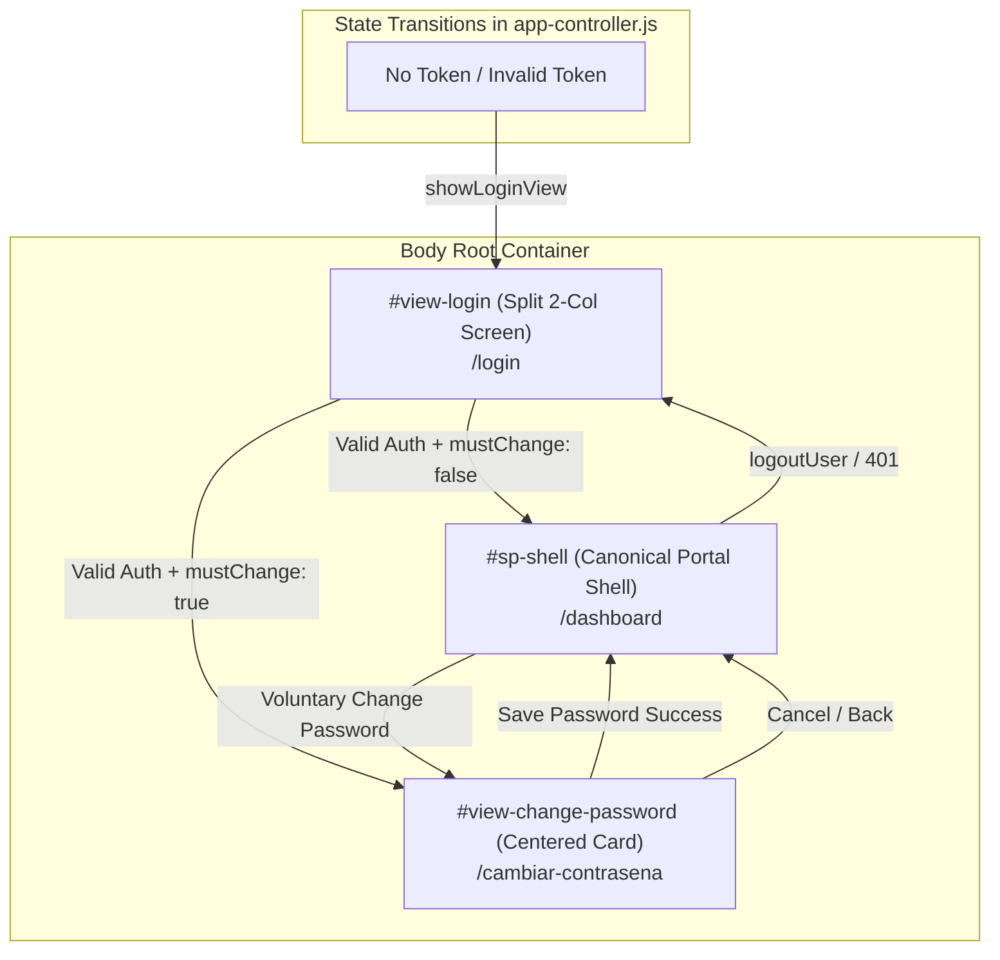
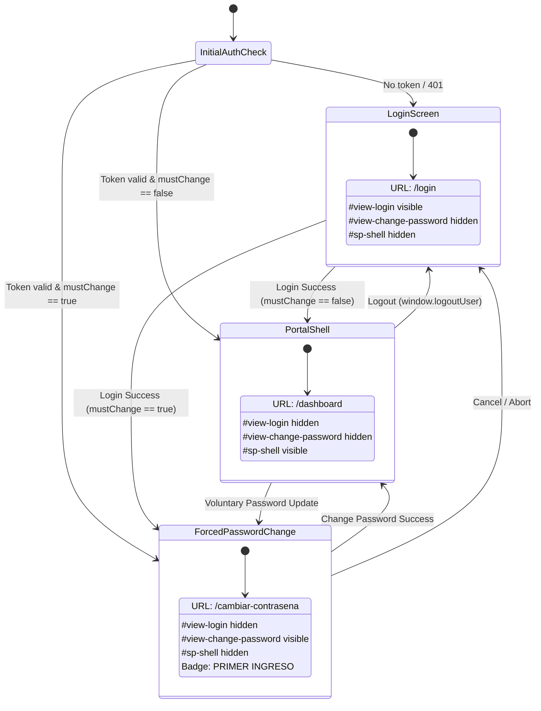

# Technical Design: 10 Institutional Login & Password Change Full-Page Screens

**Change ID**: `10-institutional-login-and-password-change-pages`  
**Topic**: Full-Page Institutional Login Screen (Split 2-Column) and Password Change Screen (Centered Card Canvas)  
**Status**: Ready for Implementation  
**Artifact Mode**: Hybrid (`openspec` markdown + Engram memory persistence)  
**Reference Designs**: 
- `media_1788886485919.png` (`planificacion.unitepc.edu.bo/login`)
- `media_1788886509503.png` (`planificacion.unitepc.edu.bo/cambiar-contrasena`)  
**Design System**: `sea-portal-ui` (`c:\PROYECTOS\SISA\.agent\skills\sea-portal-ui\SKILL.md`)  
**Engram Topic Key**: `sdd/10-institutional-login-and-password-change-pages/design`

---

## 1. System Architecture & Root View Hierarchy

### 1.1 Architectural Overview
The legacy implementation overlaid authentication forms inside modal dialogs (`#sisa-login-modal`, `#modal-forced-password-change`) using a dark backdrop blur (`backdrop-blur-md`). This left the main portal shell (`.sp-shell`) mounted behind the overlay, visible in an unauthenticated state.

The canonical architecture transforms the top-level DOM into three mutually exclusive sibling root views:
1. **`#view-login`**: Full-page institutional split-screen view matching `media_1788886485919.png` (URL `/login`).
2. **`#view-change-password`**: Full-page centered card view matching `media_1788886509503.png` (URL `/cambiar-contrasena`).
3. **`#sp-shell`**: Canonical authenticated portal shell (URL `/dashboard`).



### 1.2 State Machine & History Routing



---

## 2. Exact HTML Markup Specifications

### 2.1 Full-Page Login View (`#view-login`)
*Location: Sibling element placed immediately before `#view-change-password` and `#sp-shell` in `sisa-frontend/src/app/app.component.html`.*

```html
<!-- ========================================================================= -->
<!-- 1. ROOT VIEW: INSTITUTIONAL LOGIN (SPLIT 2-COLUMN FULL-SCREEN)             -->
<!-- Matches Reference: media_1788886485919.png (/login)                        -->
<!-- ========================================================================= -->
<div id="view-login" class="min-h-screen w-screen flex flex-col lg:flex-row bg-white dark:bg-slate-900 transition-all duration-300">
  
  <!-- LEFT COLUMN: Institutional Branding, Value Proposition & Feature Pills -->
  <div class="lg:w-1/2 flex flex-col justify-between p-8 sm:p-14 lg:p-20 relative overflow-hidden bg-white dark:bg-slate-900 border-b lg:border-b-0 lg:border-r border-slate-100 dark:border-slate-800 select-none">
    
    <!-- Decorative Lavender Concentric Arc Graphic (SVG) -->
    <svg class="absolute -bottom-24 -right-24 w-[500px] h-[500px] pointer-events-none opacity-40 dark:opacity-10 z-0" viewBox="0 0 500 500" fill="none" aria-hidden="true">
      <circle cx="250" cy="250" r="220" stroke="#7B47B8" stroke-width="44" stroke-opacity="0.12" />
      <circle cx="250" cy="250" r="140" stroke="#7B47B8" stroke-width="32" stroke-opacity="0.08" />
      <circle cx="250" cy="250" r="70" stroke="#1F9FAD" stroke-width="20" stroke-opacity="0.06" />
    </svg>

    <!-- Top Institutional Wordmark -->
    <div class="flex items-center gap-2.5 z-10">
      <div>
        <div class="text-3xl sm:text-4xl font-black tracking-tight flex items-center font-display">
          <span class="text-[#5B3E96] dark:text-[#9B6FD0]">UNITE</span><span class="text-[#1F9FAD] dark:text-[#4FBCC8]">PC</span>
        </div>
        <div class="text-[9px] sm:text-[10px] font-bold tracking-[0.25em] text-[#1F9FAD] dark:text-[#4FBCC8] -mt-1 uppercase">
          UNIVERSIDAD PRIVADA
        </div>
      </div>
    </div>

    <!-- Main Academic Message & Value Proposition Cards -->
    <div class="my-10 lg:my-auto max-w-lg z-10 space-y-6">
      <div class="text-xs font-bold uppercase tracking-widest text-[#7B47B8] dark:text-[#9B6FD0] font-display">
        PLATAFORMA INSTITUCIONAL
      </div>
      <h1 class="text-4xl lg:text-5xl font-black font-display tracking-tight text-[#18171C] dark:text-white leading-[1.15]">
        Gestión integral<br>de evaluaciones<br>académicas.
      </h1>
      <p class="text-sm lg:text-base text-[#6B6873] dark:text-slate-400 leading-relaxed max-w-md">
        Un espacio seguro para planificar, generar, imprimir y calificar las evaluaciones de la Universidad.
      </p>

      <!-- 2 Feature Pills / Value Highlights -->
      <div class="space-y-4 pt-2">
        <div class="flex items-center gap-4">
          <div class="w-12 h-12 rounded-2xl bg-[#F0E9F8] dark:bg-purple-950/60 text-[#7B47B8] dark:text-[#B58BE3] flex items-center justify-center flex-shrink-0 shadow-sm">
            <i data-lucide="shield" class="w-6 h-6"></i>
          </div>
          <div>
            <div class="font-bold text-sm text-[#18171C] dark:text-white">Acceso por roles</div>
            <div class="text-xs text-[#6B6873] dark:text-slate-400">Cada usuario visualiza únicamente lo que necesita.</div>
          </div>
        </div>

        <div class="flex items-center gap-4">
          <div class="w-12 h-12 rounded-2xl bg-[#E0F2F4] dark:bg-teal-950/60 text-[#1F9FAD] dark:text-[#6CCBD5] flex items-center justify-center flex-shrink-0 shadow-sm">
            <i data-lucide="check-square" class="w-6 h-6"></i>
          </div>
          <div>
            <div class="font-bold text-sm text-[#18171C] dark:text-white">Proceso trazable</div>
            <div class="text-xs text-[#6B6873] dark:text-slate-400">Evaluaciones controladas desde su configuración hasta el resultado.</div>
          </div>
        </div>
      </div>
    </div>

    <!-- Empty Spacer for desktop alignment -->
    <div class="hidden lg:block z-10"></div>
  </div>

  <!-- RIGHT COLUMN: Authentication Card Canvas -->
  <div class="lg:w-1/2 flex flex-col justify-between items-center bg-[#F8FAFC] dark:bg-slate-950 p-6 sm:p-10 relative">
    <div class="w-full flex-1 flex items-center justify-center py-6 sm:py-0">
      <div class="bg-white dark:bg-slate-900 rounded-[28px] shadow-[0_20px_50px_rgba(0,0,0,0.05)] dark:shadow-[0_20px_50px_rgba(0,0,0,0.25)] border border-slate-100 dark:border-slate-800 p-8 sm:p-10 w-full max-w-[430px] relative text-center">
        
        <!-- Top Purple Check Squircle Badge -->
        <div class="w-12 h-12 rounded-2xl bg-[#6E56CF] text-white flex items-center justify-center shadow-md shadow-purple-500/20 mx-auto">
          <i data-lucide="check" class="w-6 h-6 stroke-[2.5]"></i>
        </div>

        <!-- Institutional Tag -->
        <div class="text-[11px] font-extrabold uppercase tracking-wider text-[#6E56CF] dark:text-purple-400 mt-4 mb-1">
          ACCESO INTERNO
        </div>
        <h2 class="text-2xl sm:text-3xl font-extrabold text-[#18171C] dark:text-white font-display tracking-tight">
          Bienvenido
        </h2>
        <p class="text-xs text-slate-500 dark:text-slate-400 mt-1 mb-6">
          Ingresa con tu usuario y contraseña del sistema.
        </p>

        <!-- Login Form -->
        <form id="sisa-login-form" onsubmit="window.handleLoginSubmit(event)" class="space-y-4 text-left">
          <!-- Error Notification Container -->
          <div id="login-error-container" class="hidden p-3 rounded-xl bg-red-50 dark:bg-red-950/60 border border-red-200 dark:border-red-800 text-xs text-red-600 dark:text-red-300 flex items-start gap-2">
            <i data-lucide="alert-circle" class="w-4 h-4 flex-shrink-0 mt-0.5"></i>
            <span id="login-error-msg">Credenciales incorrectas o cuenta inactiva.</span>
          </div>

          <!-- Input: Usuario -->
          <div class="space-y-1.5">
            <label for="login-username" class="text-[10px] font-bold uppercase tracking-wider text-slate-600 dark:text-slate-400 block">USUARIO</label>
            <div class="bg-[#EDF2F9] dark:bg-slate-800/80 rounded-xl px-3.5 py-2.5 flex items-center gap-2.5 border border-transparent focus-within:border-[#9079ED] focus-within:bg-white dark:focus-within:bg-slate-800 transition-all">
              <i data-lucide="user" class="w-4 h-4 text-slate-400 flex-shrink-0"></i>
              <input id="login-username" type="text" required placeholder="78311416" class="w-full bg-transparent border-none outline-none text-xs text-slate-900 dark:text-white placeholder-slate-400">
            </div>
          </div>

          <!-- Input: Contraseña -->
          <div class="space-y-1.5">
            <label for="login-password" class="text-[10px] font-bold uppercase tracking-wider text-slate-600 dark:text-slate-400 block">CONTRASEÑA</label>
            <div class="bg-[#EDF2F9] dark:bg-slate-800/80 rounded-xl px-3.5 py-2.5 flex items-center gap-2.5 border border-transparent focus-within:border-[#9079ED] focus-within:bg-white dark:focus-within:bg-slate-800 transition-all">
              <i data-lucide="lock" class="w-4 h-4 text-slate-400 flex-shrink-0"></i>
              <input id="login-password" type="password" required placeholder="••••••••" class="w-full bg-transparent border-none outline-none text-xs text-slate-900 dark:text-white placeholder-slate-400">
              <button type="button" onclick="window.toggleLoginPasswordVisibility()" class="text-slate-400 hover:text-slate-600 dark:hover:text-slate-200 p-0.5 cursor-pointer">
                <i id="login-pwd-eye" data-lucide="eye" class="w-4 h-4"></i>
              </button>
            </div>
          </div>

          <!-- Submit Button -->
          <button id="btn-do-login" type="submit" class="w-full py-3 px-4 rounded-xl bg-[#9079ED] hover:bg-[#8064E8] text-white font-semibold text-xs tracking-wide shadow-md shadow-[#9079ED]/25 flex items-center justify-center gap-2 transition-all mt-6 cursor-pointer">
            <span>Ingresar al sistema</span>
            <i data-lucide="arrow-right" class="w-4 h-4"></i>
          </button>
        </form>

        <!-- Protected Session Footer Badge -->
        <div class="mt-5 flex items-center justify-center gap-1.5 text-[11px] text-slate-500 dark:text-slate-400">
          <i data-lucide="lock" class="w-3.5 h-3.5 text-[#1F9FAD]"></i>
          <span>Sesión protegida para usuarios autorizados.</span>
        </div>

        <!-- Development Demo Quick-Fill Shortcuts -->
        <div class="mt-4 pt-4 border-t border-slate-100 dark:border-slate-800 flex items-center justify-center gap-2">
          <span class="text-[10px] text-slate-400">Acceso rápido demo:</span>
          <button type="button" onclick="window.fillDemoLogin('admin', 'Unitepc2026!')" class="text-[10px] font-bold px-2 py-0.5 rounded bg-slate-100 dark:bg-slate-800 text-purple-700 dark:text-purple-300 hover:bg-purple-100 cursor-pointer">Admin</button>
          <button type="button" onclick="window.fillDemoLogin('docente.cbb', 'Unitepc2026!')" class="text-[10px] font-bold px-2 py-0.5 rounded bg-slate-100 dark:bg-slate-800 text-emerald-700 dark:text-emerald-300 hover:bg-emerald-100 cursor-pointer">Docente</button>
        </div>
      </div>
    </div>

    <!-- Bottom Page Bar -->
    <div class="w-full flex items-center justify-between text-[10px] font-medium tracking-wider text-slate-400 uppercase pt-4 px-2">
      <span>SISTEMA DE EVALUACIONES • UNITEPC</span>
      <span>ACCESO INTERNO</span>
    </div>
  </div>
</div>
```

---

### 2.2 Full-Page Password Change View (`#view-change-password`)
*Location: Sibling element placed between `#view-login` and `#sp-shell` in `sisa-frontend/src/app/app.component.html`.*

```html
<!-- ========================================================================= -->
<!-- 2. ROOT VIEW: PASSWORD CHANGE (CENTERED CARD FULL-SCREEN)                  -->
<!-- Matches Reference: media_1788886509503.png (/cambiar-contrasena)           -->
<!-- ========================================================================= -->
<div id="view-change-password" class="min-h-screen w-screen flex flex-col items-center justify-center bg-[#F8FAFC] dark:bg-slate-950 p-4 transition-all duration-300 hidden select-none">
  <div class="bg-white dark:bg-slate-900 rounded-[28px] shadow-[0_20px_50px_rgba(0,0,0,0.05)] dark:shadow-[0_20px_50px_rgba(0,0,0,0.25)] border border-slate-100 dark:border-slate-800 p-8 sm:p-10 w-full max-w-[460px] text-center relative animate-in fade-in zoom-in-95 duration-200">
    
    <!-- Top Purple Lock Squircle Badge -->
    <div class="w-12 h-12 rounded-2xl bg-[#6E56CF] text-white flex items-center justify-center shadow-md shadow-purple-500/20 mx-auto">
      <i data-lucide="lock" class="w-6 h-6 stroke-[2.5]"></i>
    </div>

    <!-- Dynamic Badge Label (PRIMER INGRESO or SEGURIDAD DE LA CUENTA) -->
    <div id="change-pwd-badge" class="text-[11px] font-extrabold uppercase tracking-wider text-[#6E56CF] dark:text-purple-400 mt-4 mb-1">
      PRIMER INGRESO
    </div>
    <h2 class="text-2xl sm:text-3xl font-extrabold text-[#18171C] dark:text-white font-display tracking-tight">
      Actualiza tu contraseña
    </h2>
    <p class="text-xs text-slate-500 dark:text-slate-400 mt-1 mb-6 max-w-sm mx-auto">
      Por seguridad, debes reemplazar la contraseña temporal antes de ingresar al sistema.
    </p>

    <!-- Password Change Form -->
    <form id="forced-password-form" onsubmit="window.handleForcedPasswordSubmit(event)" class="space-y-4 text-left">
      <!-- Error Notification Box -->
      <div id="change-password-error" class="hidden p-3 rounded-xl bg-red-50 dark:bg-red-950/60 border border-red-200 dark:border-red-800 text-xs text-red-600 dark:text-red-300 flex items-start gap-2">
        <i data-lucide="alert-circle" class="w-4 h-4 flex-shrink-0 mt-0.5"></i>
        <span id="change-password-error-msg"></span>
      </div>

      <!-- Input 1: Contraseña Actual -->
      <div class="space-y-1.5">
        <label for="change-current-password" class="text-[10px] font-bold uppercase tracking-wider text-slate-600 dark:text-slate-400 block">CONTRASEÑA ACTUAL</label>
        <div class="bg-[#EDF2F9] dark:bg-slate-800/80 rounded-xl px-3.5 py-2.5 flex items-center border border-transparent focus-within:border-[#9079ED] focus-within:bg-white dark:focus-within:bg-slate-800 transition-all">
          <input id="change-current-password" type="password" required placeholder="Ingresa tu contraseña actual o CI" oninput="window.validatePasswordLive()" class="w-full bg-transparent border-none outline-none text-xs text-slate-900 dark:text-white">
        </div>
      </div>

      <!-- Input 2: Nueva Contraseña -->
      <div class="space-y-1.5">
        <label for="change-new-password" class="text-[10px] font-bold uppercase tracking-wider text-slate-600 dark:text-slate-400 block">NUEVA CONTRASEÑA</label>
        <div class="bg-[#EDF2F9] dark:bg-slate-800/80 rounded-xl px-3.5 py-2.5 flex items-center border border-transparent focus-within:border-[#9079ED] focus-within:bg-white dark:focus-within:bg-slate-800 transition-all">
          <input id="change-new-password" type="password" required placeholder="Mínimo 8 caracteres" oninput="window.validatePasswordLive()" class="w-full bg-transparent border-none outline-none text-xs text-slate-900 dark:text-white">
        </div>
      </div>

      <!-- Input 3: Repetir Nueva Contraseña -->
      <div class="space-y-1.5">
        <label for="change-confirm-password" class="text-[10px] font-bold uppercase tracking-wider text-slate-600 dark:text-slate-400 block">REPETIR NUEVA CONTRASEÑA</label>
        <div class="bg-[#EDF2F9] dark:bg-slate-800/80 rounded-xl px-3.5 py-2.5 flex items-center border border-transparent focus-within:border-[#9079ED] focus-within:bg-white dark:focus-within:bg-slate-800 transition-all">
          <input id="change-confirm-password" type="password" required placeholder="Repite tu nueva contraseña" oninput="window.validatePasswordLive()" class="w-full bg-transparent border-none outline-none text-xs text-slate-900 dark:text-white">
        </div>
      </div>

      <!-- Dynamic Rules Box: Reglas de la nueva contraseña -->
      <div class="bg-[#F8FAFC] dark:bg-slate-800/50 border border-slate-100 dark:border-slate-700/60 rounded-xl p-4 text-left space-y-2">
        <div class="flex items-center gap-2 text-xs font-bold text-slate-800 dark:text-slate-200">
          <i data-lucide="shield" class="w-4 h-4 text-[#7B47B8]"></i>
          <span>Reglas de la nueva contraseña</span>
        </div>
        <div class="text-[11px] text-slate-500 dark:text-slate-400 space-y-1 pl-1">
          <div id="rule-length" class="flex items-center gap-2">
            <span class="rule-icon text-slate-400">○</span>
            <span>Debe tener entre 8 y 72 caracteres.</span>
          </div>
          <div id="rule-diff" class="flex items-center gap-2">
            <span class="rule-icon text-slate-400">○</span>
            <span>Debe ser diferente de la contraseña actual.</span>
          </div>
          <div id="rule-match" class="flex items-center gap-2">
            <span class="rule-icon text-slate-400">○</span>
            <span>La confirmación debe coincidir con la nueva contraseña.</span>
          </div>
        </div>
      </div>

      <!-- Action Button -->
      <button id="btn-do-change-password" type="submit" class="w-full py-3 px-4 rounded-xl bg-[#9079ED] hover:bg-[#8064E8] text-white font-semibold text-xs tracking-wide shadow-md shadow-[#9079ED]/25 flex items-center justify-center gap-2 transition-all mt-6 cursor-pointer">
        <span>Guardar nueva contraseña</span>
        <i data-lucide="arrow-right" class="w-4 h-4"></i>
      </button>
    </form>

    <!-- Verification Disclaimer -->
    <div class="text-[11px] text-slate-400 dark:text-slate-500 mt-4">
      Estas reglas también se verifican al guardar la contraseña.
    </div>

    <!-- Exit / Cancel Action Link -->
    <div class="mt-4 pt-3 border-t border-slate-100 dark:border-slate-800">
      <button id="btn-cancel-pwd-change" type="button" onclick="window.handlePasswordChangeCancel()" class="text-xs font-medium text-slate-500 hover:text-slate-700 dark:hover:text-slate-300 transition-colors cursor-pointer">
        Cancelar y cerrar sesión
      </button>
    </div>
  </div>
</div>
```

---

## 3. Script Controller Architecture (`app-controller.js`)

### 3.1 Root View Switching Engine

```javascript
// ── ROOT VIEW SWITCHING ENGINE (UNITEPC-PRO ARCHITECTURE) ────────────────
window.showLoginView = function() {
  const shell = document.getElementById('sp-shell');
  const pwdView = document.getElementById('view-change-password');
  const loginView = document.getElementById('view-login');

  if (shell) shell.classList.add('hidden');
  if (pwdView) pwdView.classList.add('hidden');
  if (loginView) loginView.classList.remove('hidden');

  // Reset errors and clear sensitive fields
  const errBox = document.getElementById('login-error-container');
  if (errBox) errBox.classList.add('hidden');
  const pwdInput = document.getElementById('login-password');
  if (pwdInput) pwdInput.value = '';

  if (window.history && window.history.replaceState) {
    window.history.replaceState(null, '', '/login');
  }
  if (window.lucide) window.lucide.createIcons();
};

window.showChangePasswordView = function(user, tempToken, isVoluntary = false, prefillCurrentPassword = '') {
  window._tempPasswordChangeUser = user;
  window._tempPasswordChangeToken = tempToken;
  window._isVoluntaryPasswordChange = isVoluntary;

  const shell = document.getElementById('sp-shell');
  const loginView = document.getElementById('view-login');
  const pwdView = document.getElementById('view-change-password');

  if (shell) shell.classList.add('hidden');
  if (loginView) loginView.classList.add('hidden');
  if (pwdView) pwdView.classList.remove('hidden');

  // Reset inputs
  const cur = document.getElementById('change-current-password');
  const n = document.getElementById('change-new-password');
  const c = document.getElementById('change-confirm-password');
  const errBox = document.getElementById('change-password-error');
  const badge = document.getElementById('change-pwd-badge');
  const cancelBtn = document.getElementById('btn-cancel-pwd-change');

  if (cur) cur.value = prefillCurrentPassword || '';
  if (n) n.value = '';
  if (c) c.value = '';
  if (errBox) errBox.classList.add('hidden');

  if (badge) {
    badge.innerText = isVoluntary ? 'SEGURIDAD DE LA CUENTA' : 'PRIMER INGRESO';
  }
  if (cancelBtn) {
    cancelBtn.innerText = isVoluntary ? '← Volver al portal' : 'Cancelar y cerrar sesión';
  }

  window.validatePasswordLive();

  if (window.history && window.history.replaceState) {
    window.history.replaceState(null, '', '/cambiar-contrasena');
  }
  if (window.lucide) window.lucide.createIcons();
};

window.showPortalShell = function(targetViewId = 'view-dashboard') {
  const loginView = document.getElementById('view-login');
  const pwdView = document.getElementById('view-change-password');
  const shell = document.getElementById('sp-shell');

  if (loginView) loginView.classList.add('hidden');
  if (pwdView) pwdView.classList.add('hidden');
  if (shell) shell.classList.remove('hidden');

  if (typeof window.switchView === 'function') {
    window.switchView(targetViewId);
  }

  if (window.history && window.history.replaceState) {
    window.history.replaceState(null, '', '/dashboard');
  }
  if (window.lucide) window.lucide.createIcons();
};

// Cancel handler from password change view
window.handlePasswordChangeCancel = function() {
  if (window._isVoluntaryPasswordChange) {
    window.showPortalShell();
  } else {
    window.logoutUser();
  }
};
```

### 3.2 Dynamic Live Rule Validator

```javascript
// Dynamic Password Rule Evaluator (keyup & input event handler)
window.validatePasswordLive = function() {
  const curInput = document.getElementById('change-current-password');
  const newInput = document.getElementById('change-new-password');
  const confInput = document.getElementById('change-confirm-password');

  const curVal = curInput ? curInput.value : '';
  const newVal = newInput ? newInput.value : '';
  const confVal = confInput ? confInput.value : '';

  const updateRule = (ruleId, isValid) => {
    const el = document.getElementById(ruleId);
    if (!el) return;
    const icon = el.querySelector('.rule-icon');
    if (isValid) {
      el.className = 'flex items-center gap-2 text-emerald-600 dark:text-emerald-400 font-medium transition-colors';
      if (icon) {
        icon.innerText = '✓';
        icon.className = 'rule-icon text-emerald-600 dark:text-emerald-400 font-bold';
      }
    } else {
      el.className = 'flex items-center gap-2 text-slate-500 dark:text-slate-400 transition-colors';
      if (icon) {
        icon.innerText = '○';
        icon.className = 'rule-icon text-slate-400';
      }
    }
  };

  // Rule 1: Length between 8 and 72 characters
  const validLength = newVal.length >= 8 && newVal.length <= 72;
  updateRule('rule-length', validLength);

  // Rule 2: Different from current password
  const validDiff = newVal.length > 0 && curVal.length > 0 && newVal !== curVal;
  updateRule('rule-diff', validDiff);

  // Rule 3: Confirmation matches new password
  const validMatch = newVal.length > 0 && newVal === confVal;
  updateRule('rule-match', validMatch);
};
```

### 3.3 Authentication & Password Change Form Handlers

```javascript
window.handleLoginSubmit = async function(event) {
  if (event) event.preventDefault();
  const uInput = document.getElementById('login-username');
  const pInput = document.getElementById('login-password');
  const errContainer = document.getElementById('login-error-container');
  const errMsg = document.getElementById('login-error-msg');
  const btn = document.getElementById('btn-do-login');

  if (!uInput || !pInput) return;
  const username = uInput.value.trim();
  const password = pInput.value;

  if (!username || !password) {
    if (errContainer && errMsg) {
      errMsg.innerText = 'Por favor ingrese su usuario y contraseña.';
      errContainer.classList.remove('hidden');
    }
    return;
  }

  if (btn) {
    btn.disabled = true;
    btn.innerHTML = '<span class="inline-block animate-spin mr-2">⏳</span> Validando credenciales...';
  }
  if (errContainer) errContainer.classList.add('hidden');

  try {
    const resp = await fetch('/api/v1/auth/login', {
      method: 'POST',
      headers: { 'Content-Type': 'application/json' },
      body: JSON.stringify({ username, password })
    });

    const res = await resp.json();

    if (!resp.ok) {
      throw new Error(res.message || res.error || 'Credenciales incorrectas o cuenta inactiva.');
    }

    const authData = res.data || res;
    const token = authData.accessToken || authData.token;
    const user = authData.user;
    const mustChange = (authData.mustChangePassword === true || (user && user.mustChangePassword === true));

    if (mustChange) {
      // Transition directly to full-page password change, passing entered password as current
      window.showChangePasswordView(user, token, false, password);
    } else {
      window.setAuthSession(token, user);
      window.showPortalShell(user.role === 'ROLE_ADMIN' ? 'view6' : 'view-dashboard');
      window.showToast('✅ ¡Bienvenido a SISA, ' + (user.nombres || user.nombreCompleto || user.username) + '!');

      if (user.role === 'ROLE_ADMIN' && typeof window.loadAdminUsers === 'function') {
        window.loadAdminUsers();
      }
    }
  } catch (err) {
    if (errContainer && errMsg) {
      errMsg.innerText = err.message || 'Error de conexión con el servidor.';
      errContainer.classList.remove('hidden');
    }
  } finally {
    if (btn) {
      btn.disabled = false;
      btn.innerHTML = '<span>Ingresar al sistema</span><i data-lucide="arrow-right" class="w-4 h-4"></i>';
      if (window.lucide) window.lucide.createIcons();
    }
  }
};

window.handleForcedPasswordSubmit = async function(event) {
  if (event) event.preventDefault();
  const curPwdInput = document.getElementById('change-current-password');
  const newPwdInput = document.getElementById('change-new-password');
  const confPwdInput = document.getElementById('change-confirm-password');
  const errBox = document.getElementById('change-password-error');
  const errMsg = document.getElementById('change-password-error-msg');
  const btn = document.getElementById('btn-do-change-password');

  const currentPassword = curPwdInput ? curPwdInput.value : '';
  const newPassword = newPwdInput ? newPwdInput.value : '';
  const confirmPassword = confPwdInput ? confPwdInput.value : '';
  const user = window._tempPasswordChangeUser || window.getCurrentUser();
  const token = window._tempPasswordChangeToken || window.getAuthToken();

  const showError = (msg) => {
    if (errBox && errMsg) {
      errMsg.innerText = msg;
      errBox.classList.remove('hidden');
    }
  };

  if (errBox) errBox.classList.add('hidden');

  if (!currentPassword) {
    showError('Debes ingresar tu contraseña actual o temporal.');
    return;
  }
  if (!newPassword || newPassword.length < 8 || newPassword.length > 72) {
    showError('La nueva contraseña debe tener entre 8 y 72 caracteres.');
    return;
  }
  if (newPassword === currentPassword) {
    showError('La nueva contraseña debe ser diferente de la contraseña actual.');
    return;
  }
  if (newPassword !== confirmPassword) {
    showError('La confirmación de la contraseña no coincide.');
    return;
  }
  if (user && user.ci && (newPassword === user.ci || newPassword.toLowerCase() === user.ci.toLowerCase())) {
    showError('La nueva contraseña no puede ser igual a tu Carnet de Identidad (CI).');
    return;
  }
  if (user && user.username && newPassword.toLowerCase() === user.username.toLowerCase()) {
    showError('La nueva contraseña no puede ser igual a tu nombre de usuario.');
    return;
  }

  if (btn) {
    btn.disabled = true;
    btn.innerHTML = '<span class="inline-block animate-spin mr-2">⏳</span> Guardando...';
  }

  try {
    const headers = { 'Content-Type': 'application/json' };
    if (token) {
      headers['Authorization'] = 'Bearer ' + token;
    }

    // Fully aligned payload matching ScuChangePasswordCmd
    const payload = {
      username: user ? user.username : undefined,
      currentPassword: currentPassword,
      newPassword: newPassword,
      confirmPassword: confirmPassword
    };

    const resp = await fetch('/api/v1/auth/change-password', {
      method: 'POST',
      headers: headers,
      body: JSON.stringify(payload)
    });

    const res = await resp.json();
    if (!resp.ok) {
      throw new Error(res.message || res.error || 'Error al actualizar la contraseña.');
    }

    const authData = res.data || res;
    const finalToken = authData.accessToken || authData.token || token;
    const updatedUser = authData.user || user;
    if (updatedUser) updatedUser.mustChangePassword = false;

    window.setAuthSession(finalToken, updatedUser);
    window.showPortalShell(updatedUser && updatedUser.role === 'ROLE_ADMIN' ? 'view6' : 'view-dashboard');
    window.showToast('✅ ¡Contraseña actualizada con éxito! Bienvenido a SISA.');

    if (updatedUser && updatedUser.role === 'ROLE_ADMIN' && typeof window.loadAdminUsers === 'function') {
      window.loadAdminUsers();
    }
  } catch (err) {
    showError(err.message || 'Error al procesar el cambio de contraseña.');
  } finally {
    if (btn) {
      btn.disabled = false;
      btn.innerHTML = '<span>Guardar nueva contraseña</span><i data-lucide="arrow-right" class="w-4 h-4"></i>';
      if (window.lucide) window.lucide.createIcons();
    }
  }
};
```

### 3.4 Updated Lifecycle & Backward Compatibility Aliases

```javascript
// Session termination
window.logoutUser = function() {
  localStorage.removeItem('scu_access_token');
  localStorage.removeItem('scu_refresh_token');
  localStorage.removeItem('scu_user_info');
  window._tempPasswordChangeUser = null;
  window._tempPasswordChangeToken = null;

  const dropdown = document.getElementById('user-dropdown-menu');
  if (dropdown) dropdown.classList.add('hidden');

  window.showLoginView();
  window.showToast('ℹ️ Sesión cerrada correctamente');
};

// Initial startup auth verification
window.checkInitialAuth = async function() {
  const token = window.getAuthToken();
  const user = window.getCurrentUser();

  if (!token) {
    window.showLoginView();
    return;
  }

  try {
    const resp = await fetch('/api/v1/auth/me', {
      headers: window.getAuthHeaders()
    });

    if (resp.ok) {
      const json = await resp.json();
      const meUser = json.data || json;
      window.setAuthSession(token, meUser);

      if (meUser.mustChangePassword) {
        window.showChangePasswordView(meUser, token, false);
      } else {
        window.showPortalShell();
      }
    } else if (resp.status === 401 || resp.status === 403) {
      window.logoutUser();
    } else if (user) {
      window.updateUserProfileUi(user);
      window.showPortalShell();
    }
  } catch (err) {
    // Network offline fallback
    if (user) {
      window.updateUserProfileUi(user);
      window.showPortalShell();
    } else {
      window.showLoginView();
    }
  }
};

// Backward-compatibility wrappers for legacy callers
window.openLoginModal = function() { window.showLoginView(); };
window.closeLoginModal = function() {};
window.openForcedPasswordModal = function(user, token) { window.showChangePasswordView(user, token, false); };
window.closeForcedPasswordModal = function() {};
```

---

## 4. CSS & SCSS Styling (`styles.scss`)

The styling extensions strictly utilize tokens from `sea-portal-ui`:

```scss
/* ========================================================================= */
/* INSTITUTIONAL LOGIN & PASSWORD CHANGE FULL-PAGE VIEWS                      */
/* Reference: media_1788886485919.png & media_1788886509503.png               */
/* ========================================================================= */

#view-login, #view-change-password {
  font-family: 'Geist', 'Inter', system-ui, sans-serif;
  
  /* Input focus ring and container polish */
  input {
    font-family: inherit;
    &::placeholder {
      color: #94A3B8;
      font-size: 0.75rem;
    }
  }
}

/* Subtle Lavender Concentric Arc for Left Column */
.login-bg-arc {
  position: absolute;
  bottom: -6rem;
  right: -6rem;
  width: 500px;
  height: 500px;
  pointer-events: none;
  opacity: 0.4;
  z-index: 0;

  .dark & {
    opacity: 0.1;
  }
}

/* Dynamic Rule Indicators in Password Change Box */
.rule-icon {
  display: inline-flex;
  align-items: center;
  justify-content: center;
  width: 14px;
  height: 14px;
  font-size: 11px;
  line-height: 1;
}

/* Smooth zoom-in appearance for full-page cards */
@keyframes sp-card-enter {
  from {
    opacity: 0;
    transform: scale(0.97) translateY(8px);
  }
  to {
    opacity: 1;
    transform: scale(1) translateY(0);
  }
}

#view-login .bg-white,
#view-change-password .bg-white,
#view-login .dark\:bg-slate-900,
#view-change-password .dark\:bg-slate-900 {
  animation: sp-card-enter 220ms cubic-bezier(0.16, 0.84, 0.44, 1) both;
}
```

---

## 5. Security & Error Handling Matrix

| Event / Condition | Client-side Interception | API Response Status | User Feedback Action |
| :--- | :--- | :--- | :--- |
| **Empty Username or Password** | Intercepted in `handleLoginSubmit` before fetch | None | Shows error in `#login-error-container`: *"Por favor ingrese su usuario y contraseña."* |
| **Bad Credentials / Inactive User** | None | HTTP 401 / 403 | Displays server message in `#login-error-container`, re-enables submit button. |
| **First-Login Mandatory Update** | Detected via `mustChangePassword === true` | HTTP 200 | Transition from `#view-login` to `#view-change-password`, prefill entered password, badge `"PRIMER INGRESO"`. |
| **New Password < 8 characters** | Dynamic live indicator `#rule-length` stays inactive | Blocked before submission | Indicator displays `○`, form submission triggers validation alert. |
| **New Password matches Current** | Dynamic live indicator `#rule-diff` stays inactive | Blocked before submission | Indicator displays `○`, error: *"La nueva contraseña debe ser diferente de la actual."* |
| **Confirm Password Mismatch** | Dynamic live indicator `#rule-match` stays inactive | Blocked before submission | Indicator displays `○`, error: *"La confirmación de la contraseña no coincide."* |
| **Backend CI / Username Collision** | Validated locally & verified in `ScuChangePasswordCmd` | HTTP 400 Bad Request | Error box in `#change-password-error`: *"La nueva contraseña no puede ser igual a tu CI ni a tu usuario."* |
| **Session Expiration / 401 on `/api/v1/auth/me`** | Intercepted in `checkInitialAuth()` | HTTP 401 Unauthorized | Invokes `logoutUser()`, clears `localStorage`, transitions to `#view-login` with URL `/login`. |

---

## 6. Implementation Checklist & Verification Plan

### 6.1 Phase 1: DOM Template Refactor (`app.component.html`)
- [ ] Remove modal overlays `#sisa-login-modal` and `#modal-forced-password-change`.
- [ ] Insert `#view-login` split 2-column container as root sibling.
- [ ] Insert `#view-change-password` centered container as root sibling.
- [ ] Add `id="sp-shell"` to canonical portal shell element (`<div id="sp-shell" class="sp-shell ... hidden">`).

### 6.2 Phase 2: Controller Engine Updates (`app-controller.js`)
- [ ] Implement `showLoginView()`, `showChangePasswordView()`, and `showPortalShell()`.
- [ ] Add `validatePasswordLive()` dynamic rule checklist evaluator.
- [ ] Refactor `handleLoginSubmit` to transition between root views and update URL state.
- [ ] Refactor `handleForcedPasswordSubmit` to include `currentPassword` in payload.
- [ ] Update `logoutUser()` and `checkInitialAuth()` to toggle root views.
- [ ] Ensure backward-compatibility alias functions are exported on `window`.

### 6.3 Phase 3: Style Refinements (`styles.scss`)
- [ ] Add SVG arc styles and smooth card enter animations.
- [ ] Verify light and dark mode colors across `#view-login` and `#view-change-password`.

### 6.4 Phase 4: Functional Verification
- [ ] Unauthenticated load defaults to `/login` and renders split 2-column view without backdrop blur.
- [ ] Regular user login transitions to `/dashboard` and loads `#sp-shell`.
- [ ] Temporary user login transitions to `/cambiar-contrasena` with prefilled current password.
- [ ] Live checklist items check off (`✓`) in green as valid input is entered.
- [ ] Submitting password change completes successfully, transitions to `/dashboard`, and clears `mustChangePassword`.
- [ ] Logout returns to `/login` with clean form state.
- [ ] Deep linking and browser refresh maintain appropriate authentication view state.
