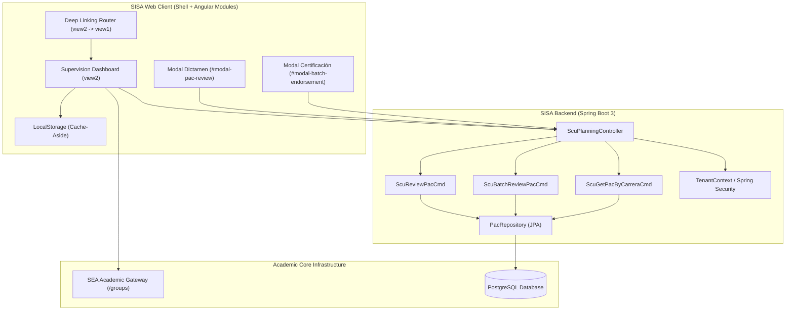
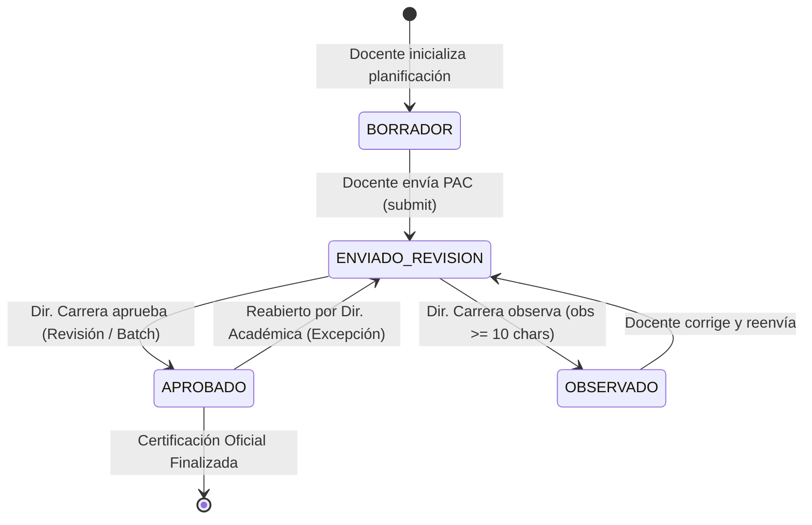
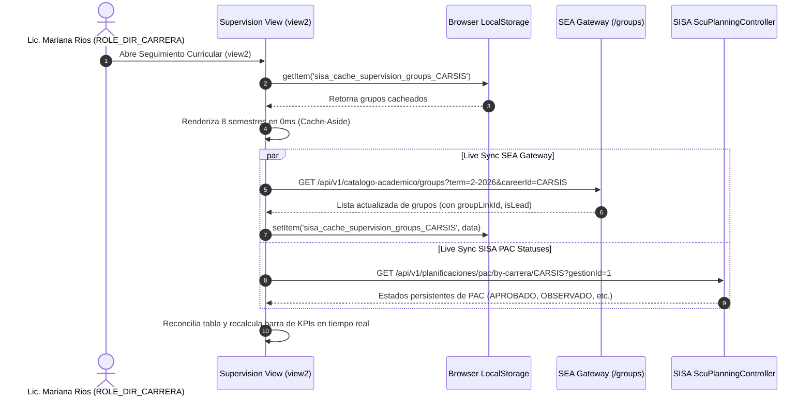
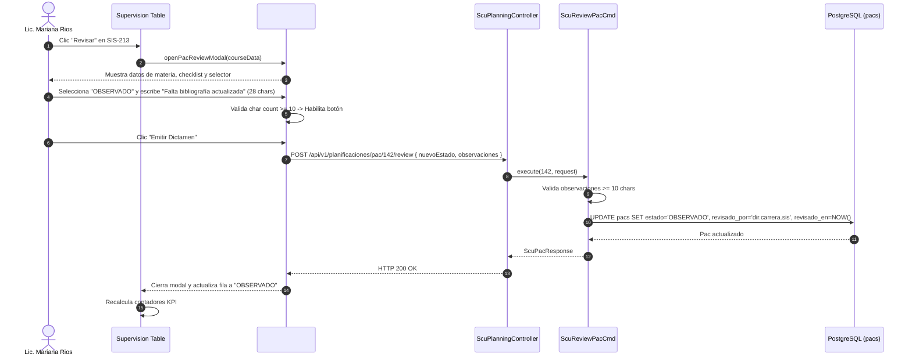
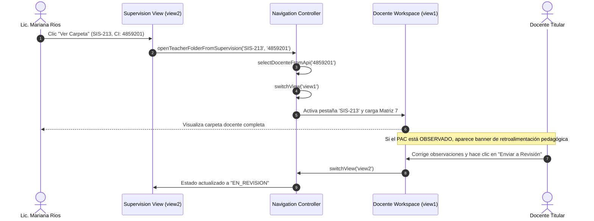

# Technical Design: 11-career-director-supervision-module

## 1. Overview & Architectural Decisions

This document details the technical design for the **Career Director Curricular Supervision, Ingestion, and Certification Module** (`ROLE_DIR_CARRERA`) for Universidad Privada Franz Tamayo / UNITEPC (SISA). The module delivers production-grade curricular governance for the pilot career **Ingeniería de Sistemas** (`CARSIS`) at **Sede Central Cochabamba**, persona **Lic. Mariana Rios Vargas** (`dir.carrera.sis`).

### 1.1 Architecture Decision Records (ADRs)

#### ADR-01: Hybrid Cohesive Pattern (Shell Optimization + Angular Module Parity)
- **Context**: The active portal application runs as an ultra-responsive single-page shell (`app.component.html` and `app-controller.js`), providing sub-millisecond tab switching across views (`view1` through `view7`). Concurrently, an Angular module (`career-oversight`) exists for modular enterprise composition.
- **Decision**: Adopt the **Hybrid Cohesive Pattern**:
  1. Implement the complete, polished review and certification workflow directly within `#view2` of the portal shell, using native Tailwind CSS and FontAwesome/Lucide icons.
  2. Wire client actions to official backend REST endpoints (`/api/v1/planificaciones/pac/...`).
  3. Synchronize Angular module contracts ([`scu-career-oversight.http.ts`](file:///c:/PROYECTOS/SISA/sisa-frontend/src/app/modules/secure/career-oversight/http/scu-career-oversight.http.ts), [`scu-pac-review.cmd.ts`](file:///c:/PROYECTOS/SISA/sisa-frontend/src/app/modules/secure/career-oversight/commands/scu-pac-review.cmd.ts), [`scu-pac-review-modal.component.ts`](file:///c:/PROYECTOS/SISA/sisa-frontend/src/app/modules/secure/career-oversight/components/scu-pac-review-modal/scu-pac-review-modal.component.ts)) with identical DTOs, endpoint signatures, and character validation rules to guarantee testability and enterprise parity.
- **Consequences**: Zero regressions on inter-view navigation (`view2` to `view1`), no PrimeNG style bleeding, and complete architectural consistency across layers.

#### ADR-02: Identity & Multi-Tenant Binding Model
- **Context**: `ROLE_DIR_CARRERA` must oversee only their appointed career and campus, while elevated authorities require cross-career oversight.
- **Decision**:
  - Persona `dir.carrera.sis` binds automatically to `CARSIS` (`648febfd-dc79-4dd8-a8aa-dc7549ef649b`) and Sede Cochabamba (`ea4fb26e-11a9-452f-9bae-4962de2dd931`).
  - Elevated roles (`ROLE_DIR_ACADEMICA`, `ROLE_VICERRECTOR_SEDE`, `ROLE_VICERRECTOR_NACIONAL`, `ROLE_ADMIN`) receive a dynamic career switcher dropdown in `#view2` header to inspect other academic departments (e.g. `CARELE`, `CARMED`).
  - All review operations pass JWT authentication; the backend resolves reviewer identity via `TenantContext.getTenantInfo().getUserId()`.

#### ADR-03: Resilient 0ms Cache-Aside Ingestion
- **Context**: Director dashboards must render instantaneously without waiting for network roundtrips to the SEA Gateway.
- **Decision**: Maintain a dual-tier Cache-Aside pattern:
  - Cache key `sisa_cache_supervision_groups_{cCode}` stores the latest SEA catalog in `localStorage`.
  - On page/tab activation: Render immediately from cache (0ms delay).
  - Background task: Invoke `/api/v1/catalogo-academico/groups` with active term (`2-2026`) and UUIDs. Upon arrival, update cache and execute smooth reconciliation.

#### ADR-04: Cross-Career Common Subjects Governance (`groupLinkId` and `isLead`)
- **Context**: Certain fundamental courses (e.g., *Cálculo I*, *Física I*, *Base de Datos*) are shared across departments. Allowing any director to approve shared courses causes conflicting visas.
- **Decision**:
  - Gateway payload exposes `groupLinkId` and `isLead`.
  - **Lead Career** (`isLead === true`): Director has full authority to `Aprobar`, `Observar`, and issue institutional visa. Badge: `⚡ COMÚN (LÍDER: ING. SISTEMAS)` (Amber).
  - **Non-Lead Career** (`isLead === false`): Director has read-only access (`Ver Carpeta`) and may submit collaborative feedback notes, but approval controls are disabled to protect the lead director's administrative authority. Badge: `⚡ COMÚN (LÍDER: [CARRERA EXTERNA])` (Slate/Gray).

#### ADR-05: Atomic Transactional Batch Certification
- **Context**: At term milestones, Directors validate entire semesters. Submitting N distinct HTTP requests is error-prone and volatile.
- **Decision**: Expose `POST /api/v1/planificaciones/pac/batch-review` accepting semester and career identifiers. The backend updates all eligible PACs (`ENVIADO_REVISION`, `PENDIENTE`) to `APROBADO` inside a single `@Transactional` boundary with audit metadata.

---

## 2. Component Architecture & System Context



---

## 3. Backend REST Endpoints & Data Contracts

### 3.1 Expose Career PACs Query
Provides persistent PAC states across all courses in a career for a given academic term.

- **HTTP Route**: `GET /api/v1/planificaciones/pac/by-carrera/{carreraId}?gestionId={gestionId}`
- **Security**: `@PreAuthorize("hasAnyRole('ROLE_DIR_CARRERA', 'ROLE_DIR_ACADEMICA', 'ROLE_VICERRECTOR_SEDE', 'ROLE_VICERRECTOR_NACIONAL', 'ROLE_ADMIN')")`
- **Query Parameters**:
  - `carreraId` (Long or String UUID): Identifier of the career.
  - `gestionId` (Long, optional, defaults to active term `1` for `2-2026`).
- **Response Format**: `Map<String, Object>` wrapped with `ResourceBuilder`:
  ```json
  {
    "status": 200,
    "message": "Planificaciones de la carrera obtenidas exitosamente",
    "data": [
      {
        "id": 142,
        "asignacionId": 105,
        "codigoAsignatura": "SIS-213",
        "nombreAsignatura": "Programación III",
        "docenteId": 12,
        "docenteNombre": "Lic. Carlos Mendoza",
        "docenteCi": "4859201",
        "semestre": 3,
        "estado": "EN_REVISION",
        "observacionesRevision": null,
        "revisadoPorId": null,
        "revisadoPorNombre": null,
        "revisadoEn": null,
        "matriz7Count": 20,
        "actualizadoEn": "2026-10-14T09:15:00Z"
      }
    ]
  }
  ```

### 3.2 Single PAC Review & Pedagogical Endorsement
Enforces state transitions and validates that observations have at least 10 characters when status is `OBSERVADO`.

- **HTTP Route**: `POST /api/v1/planificaciones/pac/{id}/review`
- **Security**: `@PreAuthorize("hasAnyRole('ROLE_DIR_CARRERA', 'ROLE_DIR_ACADEMICA', 'ROLE_VICERRECTOR_SEDE', 'ROLE_VICERRECTOR_NACIONAL', 'ROLE_ADMIN')")`
- **Request Body (`ScuPacReviewRequest`)**:
  ```json
  {
    "nuevoEstado": "APROBADO",
    "observaciones": "Planificación cumple con los saberes conceptuales, procedimentales y calendario de 20 semanas."
  }
  ```
- **Validation Rules**:
  - `nuevoEstado` MUST be either `APROBADO` or `OBSERVADO`.
  - If `nuevoEstado == OBSERVADO`, `observaciones` MUST NOT be null and `observaciones.trim().length() >= 10`. If violated, throw HTTP 400 with code `OBSERVATIONS_REQUIRED`.
- **Response Format**: Updated `ScuPacResponse` entity with `revisadoPor` CI/name and `revisadoEn` timestamp.

### 3.3 Semester-Level Batch Certification
Executes atomic approval of all qualifying PACs in a semester.

- **HTTP Route**: `POST /api/v1/planificaciones/pac/batch-review`
- **Security**: `@PreAuthorize("hasAnyRole('ROLE_DIR_CARRERA', 'ROLE_DIR_ACADEMICA', 'ROLE_VICERRECTOR_SEDE', 'ROLE_ADMIN')")`
- **Request Body (`ScuPacBatchReviewRequest`)**:
  ```json
  {
    "carreraId": 1,
    "gestionId": 1,
    "semestre": 3,
    "pacIds": [142, 143, 145],
    "observaciones": "Certificación curricular en bloque - 3º Semestre Gestión II-2026"
  }
  ```
- **Response Format (`ScuPacBatchReviewResponse`)**:
  ```json
  {
    "status": 200,
    "message": "Certificación en bloque ejecutada exitosamente",
    "data": {
      "totalReviewed": 3,
      "approvedIds": [142, 143, 145],
      "carreraId": 1,
      "semestre": 3,
      "revisadoPor": "Lic. Mariana Rios Vargas",
      "revisadoEn": "2026-10-14T10:30:00Z"
    }
  }
  ```

### 3.4 Resilient Auto-Provisioning Strategy
If a course returned by the SEA Gateway does not exist in `pacs` table:
1. Locate or create the corresponding `AsignacionDocente` using `carrera_id`, `asignatura_id`, `docente_id`, and `gestion_id`.
2. Automatically initialize a provisional `Pac` entity in status `ENVIADO_REVISION` with default 20-week sessions.
3. Return the provisional PAC ID to the frontend so the Director can approve or observe without interruption.

---

## 4. Modal UI Specifications & Design Tokens

### 4.1 Institutional Review Modal (`#modal-pac-review`)

The modal is constructed directly in `app.component.html` using Tailwind CSS with dark-mode support:

```html
<div id="modal-pac-review" class="fixed inset-0 z-50 bg-slate-950/70 backdrop-blur-sm flex items-center justify-center p-4 hidden">
  <div class="bg-white dark:bg-slate-900 rounded-2xl shadow-2xl border border-slate-200 dark:border-slate-800 max-w-2xl w-full p-6 space-y-5 animate-in fade-in zoom-in-95 duration-200 max-h-[90vh] overflow-y-auto custom-scrollbar">
    
    <!-- Modal Header -->
    <div class="flex items-start justify-between border-b border-slate-100 dark:border-slate-800 pb-3">
      <div>
        <div class="text-[10px] font-extrabold uppercase tracking-widest text-purple-600 dark:text-purple-400">
          DIRECCIÓN DE CARRERA • DICTAMEN PEDAGÓGICO
        </div>
        <h3 id="modal-pac-review-title" class="text-base font-bold text-slate-900 dark:text-white font-display mt-0.5">
          Revisión Curricular de Asignatura
        </h3>
        <p id="modal-pac-review-subtitle" class="text-xs text-slate-500 dark:text-slate-400 mt-0.5">
          Auditoría de Planificación de Asignatura (PAC) y Plan de Clases
        </p>
      </div>
      <button onclick="window.closePacReviewModal()" class="text-slate-400 hover:text-slate-600 dark:hover:text-slate-200 p-1.5 rounded-lg hover:bg-slate-100 dark:hover:bg-slate-800 transition-colors cursor-pointer">
        <i data-lucide="x" class="w-5 h-5"></i>
      </button>
    </div>

    <!-- Course Metadata Card -->
    <div class="p-3.5 rounded-xl bg-purple-50/70 dark:bg-slate-800/60 border border-purple-100 dark:border-slate-700/80 space-y-2">
      <div class="flex items-center justify-between">
        <div class="flex items-center gap-2">
          <span id="modal-pac-review-code" class="px-2 py-0.5 rounded-md bg-purple-200 dark:bg-purple-900/60 text-purple-900 dark:text-purple-200 font-mono font-bold text-xs">SIS-213</span>
          <span id="modal-pac-review-name" class="font-bold text-xs text-slate-900 dark:text-white">Programación III</span>
        </div>
        <span id="modal-pac-review-semester" class="text-[11px] font-semibold text-purple-700 dark:text-purple-300">3º Semestre</span>
      </div>
      <div class="flex items-center justify-between text-xs text-slate-600 dark:text-slate-300">
        <div>Docente: <strong id="modal-pac-review-teacher" class="text-slate-900 dark:text-white">Lic. Carlos Mendoza</strong> <span id="modal-pac-review-ci" class="text-[10px] text-slate-400 font-mono">(CI: 4859201)</span></div>
        <div id="modal-pac-review-schedule" class="text-[11px] text-slate-500 dark:text-slate-400">Mañana • Aula 302</div>
      </div>
    </div>

    <!-- Pedagogical Evaluation Checklist -->
    <div class="space-y-2">
      <div class="text-[11px] font-bold uppercase tracking-wider text-slate-700 dark:text-slate-300">Dimensiones Pedagógicas Evaluadas</div>
      <div class="grid grid-cols-1 sm:grid-cols-2 gap-2 text-xs">
        <label class="flex items-center gap-2 p-2 rounded-lg bg-slate-50 dark:bg-slate-800/40 border border-slate-200 dark:border-slate-700/60 cursor-pointer">
          <input type="checkbox" checked class="w-4 h-4 rounded text-purple-600 focus:ring-purple-500">
          <span class="text-slate-700 dark:text-slate-300 text-[11px]">Competencias y Saberes</span>
        </label>
        <label class="flex items-center gap-2 p-2 rounded-lg bg-slate-50 dark:bg-slate-800/40 border border-slate-200 dark:border-slate-700/60 cursor-pointer">
          <input type="checkbox" checked class="w-4 h-4 rounded text-purple-600 focus:ring-purple-500">
          <span class="text-slate-700 dark:text-slate-300 text-[11px]">Evidencias y Criterios</span>
        </label>
        <label class="flex items-center gap-2 p-2 rounded-lg bg-slate-50 dark:bg-slate-800/40 border border-slate-200 dark:border-slate-700/60 cursor-pointer">
          <input type="checkbox" checked class="w-4 h-4 rounded text-purple-600 focus:ring-purple-500">
          <span class="text-slate-700 dark:text-slate-300 text-[11px]">Calendario (20 Semanas)</span>
        </label>
        <label class="flex items-center gap-2 p-2 rounded-lg bg-slate-50 dark:bg-slate-800/40 border border-slate-200 dark:border-slate-700/60 cursor-pointer">
          <input type="checkbox" checked class="w-4 h-4 rounded text-purple-600 focus:ring-purple-500">
          <span class="text-slate-700 dark:text-slate-300 text-[11px]">Estrategias y Bibliografía</span>
        </label>
      </div>
    </div>

    <!-- Dictamen Selection -->
    <div class="space-y-2">
      <div class="text-[11px] font-bold uppercase tracking-wider text-slate-700 dark:text-slate-300">Dictamen de Dirección</div>
      <div class="grid grid-cols-2 gap-3">
        <button id="btn-decision-approve" type="button" onclick="window.setPacReviewDecision('APROBADO')" class="p-3 rounded-xl border-2 border-emerald-500 bg-emerald-50/70 dark:bg-emerald-950/40 text-emerald-800 dark:text-emerald-200 font-bold text-xs flex items-center justify-center gap-2 transition-all cursor-pointer">
          <i data-lucide="check-circle" class="w-4 h-4"></i> APROBADO (Visa Institucional)
        </button>
        <button id="btn-decision-observe" type="button" onclick="window.setPacReviewDecision('OBSERVADO')" class="p-3 rounded-xl border border-slate-200 dark:border-slate-700 text-slate-600 dark:text-slate-400 font-bold text-xs flex items-center justify-center gap-2 hover:bg-slate-50 dark:hover:bg-slate-800 transition-all cursor-pointer">
          <i data-lucide="alert-triangle" class="w-4 h-4"></i> OBSERVADO (Solicitar Corrección)
        </button>
      </div>
    </div>

    <!-- Feedback Textarea with Character Counter -->
    <div class="space-y-1.5">
      <div class="flex items-center justify-between">
        <label for="modal-pac-obs-input" class="text-[11px] font-bold text-slate-700 dark:text-slate-300 uppercase tracking-wider">
          Observaciones y Retroalimentación Pedagógica <span id="modal-pac-obs-required" class="text-rose-500 hidden">*</span>
        </label>
        <span id="modal-pac-char-counter" class="text-[11px] font-mono text-slate-400">0 / 10 mín.</span>
      </div>
      <textarea id="modal-pac-obs-input" rows="3" oninput="window.handlePacReviewCharCount(this.value)" placeholder="Ingrese los fundamentos pedagógicos del dictamen..." class="w-full bg-slate-50 dark:bg-slate-800/80 border border-slate-300 dark:border-slate-700 rounded-xl p-3 text-xs text-slate-900 dark:text-white placeholder-slate-400 focus:outline-none focus:ring-2 focus:ring-purple-500"></textarea>
      <p id="modal-pac-validation-hint" class="text-[11px] text-slate-500 dark:text-slate-400">
        Opcional para dictamen favorable. Obligatorio (mínimo 10 caracteres) para observaciones.
      </p>
    </div>

    <!-- Digital Signature Footer -->
    <div class="pt-3 border-t border-slate-100 dark:border-slate-800 flex items-center justify-between">
      <div class="flex items-center gap-2 text-[11px] text-slate-500 dark:text-slate-400">
        <i data-lucide="shield-check" class="w-4 h-4 text-emerald-600 dark:text-emerald-400"></i>
        <span>Firmado por: <strong class="text-slate-700 dark:text-slate-300">Lic. Mariana Rios Vargas</strong> (Dir. de Carrera)</span>
      </div>
      <div class="flex items-center gap-2">
        <button onclick="window.closePacReviewModal()" type="button" class="px-4 py-2 rounded-xl border border-slate-300 dark:border-slate-700 text-xs font-semibold text-slate-700 dark:text-slate-300 hover:bg-slate-100 dark:hover:bg-slate-800 transition-colors cursor-pointer">
          Cancelar
        </button>
        <button id="modal-pac-submit-btn" onclick="window.submitPacReviewModal()" type="button" class="px-5 py-2 rounded-xl bg-purple-600 hover:bg-purple-700 text-white font-bold text-xs shadow-md shadow-purple-500/20 transition-all flex items-center gap-2 cursor-pointer">
          <i data-lucide="award" class="w-4 h-4"></i> Emitir Dictamen
        </button>
      </div>
    </div>

  </div>
</div>
```

### 4.2 Semester Batch Endorsement Modal (`#modal-batch-endorsement`)

Confirmation dialog preventing accidental bulk updates:
- Displays target semester (e.g. `3º Semestre`).
- Shows total subjects and list of pending subjects that will transition to `APROBADO`.
- Requires checking a confirmation box before enabling the submission button.

### 4.3 Visual Tokens & Design Badges

| Badge Type | Light Theme Classes | Dark Theme Classes | Semantics |
|:---|:---|:---|:---|
| **Común Líder** | `bg-amber-100 text-amber-900 border-amber-300` | `dark:bg-amber-950/80 dark:text-amber-300 dark:border-amber-700` | Current career is primary owner. Director can approve. |
| **Común No Líder** | `bg-slate-100 text-slate-700 border-slate-300` | `dark:bg-slate-800 dark:text-slate-300 dark:border-slate-700` | External career is lead. Read-only folder inspection. |
| **Estado Aprobado** | `bg-emerald-100 text-emerald-800 border-emerald-200` | `dark:bg-emerald-950/70 dark:text-emerald-300 dark:border-emerald-800/60` | PAC certified with digital signature. |
| **Estado Observado** | `bg-rose-100 text-rose-800 border-rose-200` | `dark:bg-rose-950/70 dark:text-rose-300 dark:border-rose-800/60` | Returned to teacher with feedback. |
| **Estado En Revisión** | `bg-amber-100 text-amber-800 border-amber-200` | `dark:bg-amber-950/70 dark:text-amber-300 dark:border-amber-800/60` | Submitted by teacher, awaiting review. |
| **Estado Pendiente** | `bg-slate-100 text-slate-700 border-slate-200` | `dark:bg-slate-800 dark:text-slate-300 dark:border-slate-700` | Planning not yet submitted. |

---

## 5. State Machine & Lifecycle Transitions



### State Transition Validation Table

| Source State | Target State | Trigger Actor | Preconditions / Validations | Side Effects |
|:---|:---|:---|:---|:---|
| `BORRADOR` | `ENVIADO_REVISION` | Docente | All 20 weekly sessions generated. | Enters Director's pending queue. |
| `ENVIADO_REVISION` | `APROBADO` | Director Carrera | Lead career director (`isLead === true`). | Generates visa stamp, updates KPI compliance. |
| `ENVIADO_REVISION` | `OBSERVADO` | Director Carrera | Lead career director, `observaciones.length >= 10`. | Triggers feedback alert on teacher view. |
| `OBSERVADO` | `ENVIADO_REVISION` | Docente | Teacher modifies rubrics/sessions and re-submits. | Clears previous observation alert, queues for review. |
| Any | `APROBADO` (Batch) | Director Carrera | Selected semester, confirmation checkbox checked. | Batch commits all pending PACs atomically. |

---

## 6. Sequence Diagrams

### 6.1 Ingestion & 0ms Cache-Aside Sync



### 6.2 Institutional Pedagogical Review & Endorsement



### 6.3 Inter-View Deep Linking Feedback Loop (`view2` -> `view1`)



---

## 7. Angular Module Contract Parity

To maintain architectural parity between the portal shell and the enterprise Angular modules, the following files in `sisa-frontend/src/app/modules/secure/career-oversight/` are synchronized:

### 7.1 [`scu-career-oversight.http.ts`](file:///c:/PROYECTOS/SISA/sisa-frontend/src/app/modules/secure/career-oversight/http/scu-career-oversight.http.ts)
Adds methods:
- `getPacsByCareer(careerId: number | string, gestionId: number | string): Observable<{ data: ScuPacModel[] }>` invoking `GET /api/v1/planificaciones/pac/by-carrera/{careerId}?gestionId={gestionId}`.
- `batchReviewPacs(batchCmd: ScuPacBatchReviewRequest): Observable<{ data: ScuPacBatchReviewResponse }>` invoking `POST /api/v1/planificaciones/pac/batch-review`.

### 7.2 [`scu-pac-review.cmd.ts`](file:///c:/PROYECTOS/SISA/sisa-frontend/src/app/modules/secure/career-oversight/commands/scu-pac-review.cmd.ts)
Enhances client-side assertion:
```typescript
if (decision.nuevoEstado === 'OBSERVADO' && (!decision.observaciones || decision.observaciones.trim().length < 10)) {
  throw new Error('Las observaciones pedagógicas deben contener al menos 10 caracteres.');
}
```

### 7.3 [`scu-pac-review-modal.component.ts`](file:///c:/PROYECTOS/SISA/sisa-frontend/src/app/modules/secure/career-oversight/components/scu-pac-review-modal/scu-pac-review-modal.component.ts)
Updates validation bindings to enforce the live character counter and disabled state when `observaciones.trim().length < 10`.

---

## 8. Security, Auditing & Multi-Tenancy

1. **Authorization**: All review endpoints are secured using Spring Security `@PreAuthorize`:
   - `ROLE_DIR_CARRERA`: Scoped to the career bound to their user assignment.
   - `ROLE_DIR_ACADEMICA`, `ROLE_VICERRECTOR_SEDE`, `ROLE_VICERRECTOR_NACIONAL`, `ROLE_ADMIN`: Scoped globally or to their campus.
2. **Audit Trail**: Every PAC transition stamps:
   - `revisadoPor`: Foreign key to `usuarios` resolving the authenticated user.
   - `revisadoEn`: UTC `OffsetDateTime` of the endorsement.
   - `observacionesRevision`: Full verbatim text of pedagogical directives.
3. **Common Subject Protection**: When `isLead === false`, non-lead users are prevented from issuing approvals, ensuring that only the career owning the subject's curriculum can finalize the institutional visa.
