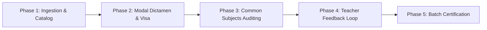

# Proposal: 11-career-director-supervision-module

## Intent
Establish an institutional, fully auditable, and production-grade Curricular Supervision and Endorsement Module for Career Directors (`ROLE_DIR_CARRERA`) within the SISA platform shell (`view2`). The module is configured for the pilot career **Ingeniería de Sistemas** (`CARSIS`, UUID `648febfd-dc79-4dd8-a8aa-dc7549ef649b`) at **Sede Central Cochabamba** (Gateway Branch UUID `ea4fb26e-11a9-452f-9bae-4962de2dd931`), representing persona `dir.carrera.sis` (**Lic. Mariana Rios Vargas**).

This change replaces mock browser dialogs (`prompt()`) and volatile LocalStorage-only reviews with real REST workflows against [`ScuPlanningController`](file:///c:/PROYECTOS/SISA/sisa-backend/src/main/java/bo/edu/unitepc/sisa/api/controller/ScuPlanningController.java) (`POST /api/v1/planificaciones/pac/{id}/review`), adds an institutional Tailwind-based review modal with pedagogical validation, implements cross-career common subject auditing, establishes a bidirectional teacher feedback loop, and enables semester-level batch certification.

---

## Scope

### In Scope

- **Phase 1: Ingestion & Catalog**:
  - Direct identity binding: user `dir.carrera.sis` automatically binds to `CARSIS` (`Ingeniería de Sistemas`) and Sede Cochabamba (`ea4fb26e-11a9-452f-9bae-4962de2dd931`).
  - Dynamic career switcher for elevated roles (`ROLE_DIR_ACADEMICA`, `ROLE_VICERRECTOR_SEDE`, `ROLE_ADMIN`) in the `view2` header.
  - Backend career PAC query endpoint: expose `GET /api/v1/planificaciones/pac/by-carrera/{carreraId}?gestionId={gestionId}` in [`ScuPlanningController.java`](file:///c:/PROYECTOS/SISA/sisa-backend/src/main/java/bo/edu/unitepc/sisa/api/controller/ScuPlanningController.java) backed by [`PacRepository.findByCarreraAndGestion`](file:///c:/PROYECTOS/SISA/sisa-backend/src/main/java/bo/edu/unitepc/sisa/domain/repository/PacRepository.java#L29-L30) to provide persistent PAC states across all courses.
  - Curricular offering ingestion from SEA Gateway (`/api/v1/catalogo-academico/groups`) with 0ms Cache-Aside strategy (`sisa_cache_supervision_groups_CARSIS` in LocalStorage) for instant rendering and live background synchronization.
  - Multi-semester hierarchy: automatic grouping of courses into 8 semester accordions (1º through 8º Semestre) via [`window.getCourseSemester`](file:///c:/PROYECTOS/SISA/sisa-frontend/src/assets/app-controller.js#L7005-L7087).
  - KPI Toolbar calculation: real-time metrics for Total (`#supervision-count-all`), Aprobados (`#supervision-count-approved`), Pendientes (`#supervision-count-pending`), Observados (`#supervision-count-observed`), and % Cumplimiento General (`#supervision-compliance-pct`).

- **Phase 2: Modal Dictamen & Visa**:
  - Institutional Pedagogical Review Modal (`#modal-pac-review`) integrated into `app.component.html` using Tailwind CSS and dark-mode styling, replacing browser `prompt()`.
  - Pedagogical evaluation checklist: Competencias, Evidencias de aprendizaje, Rúbricas de evaluación, and Cumplimiento del calendario académico.
  - Formal decision options: `APROBADO` (green) and `OBSERVADO` (amber).
  - Mandatory pedagogical observation textarea with real-time character counter, contextual placeholders, and client-side validation blocking submission if under 10 characters (enforcing domain rule in [`ScuReviewPacCmd.java`](file:///c:/PROYECTOS/SISA/sisa-backend/src/main/java/bo/edu/unitepc/sisa/service/command/ScuReviewPacCmd.java#L50-L56)).
  - Official digital endorsement footer: *"Firmado electrónicamente por Lic. Mariana Rios Vargas - Director de Carrera"*.
  - Direct wiring of approval/observation actions to `POST /api/v1/planificaciones/pac/{id}/review` with JWT Authorization and audit timestamping (`revisadoPor`, `revisadoEn`).
  - Resilient PAC auto-linking/provisioning if a course lacks an existing PAC in PostgreSQL, maintaining seamless demo and production behavior.

- **Phase 3: Common Subjects Auditing**:
  - Ingestion of `groupLinkId` and `isLead` attributes from SEA Gateway [`GroupItemDto.java`](file:///c:/PROYECTOS/SISA/sisa-backend/src/main/java/bo/edu/unitepc/sisa/api/dto/gateway/GroupItemDto.java#L53-L58).
  - Visual status badges in curriculum tables: `⚡ COMÚN (LÍDER: ING. SISTEMAS)` vs `⚡ COMÚN (LÍDER: OTRA CARRERA)`.
  - Multi-career governance rules: Lead Career Directors retain primary endorsement authority (`Aprobar`, `Observar`). Non-Lead Directors receive read access (`Ver Carpeta`) and cross-career collaborative feedback notes, preventing unauthorized state overwrites over the lead career.

- **Phase 4: Teacher Feedback Loop**:
  - Inter-view deep linking: clicking *"Ver Carpeta"* (`openTeacherFolderFromSupervision`) smoothly navigates to `view1` (Docente workspace), pre-selecting the teacher by CI, setting the course tab, and displaying the PAC Matriz 7.
  - Bidirectional status synchronization: When a PAC is marked as `OBSERVADO`, the teacher in `view1` immediately sees the observation alert and pedagogical remarks to facilitate corrections; when `APROBADO`, the document reflects the certified visa stamp.

- **Phase 5: Batch Certification**:
  - Semester-level batch certification dialog (*"Aprobar Todo el Semestre"*) per semester accordion or career-wide.
  - Batch review execution in [`ScuPlanningController.java`](file:///c:/PROYECTOS/SISA/sisa-backend/src/main/java/bo/edu/unitepc/sisa/api/controller/ScuPlanningController.java) to endorse all pending PACs for the selected semester in a single transactional operation.
  - Optimistic UI updates with instant KPI recount and visual status badge transitions.

- **Angular Module Contract Parity**:
  - Synchronize TypeScript models, DTOs, and HTTP services in [`sisa-frontend/src/app/modules/secure/career-oversight/`](file:///c:/PROYECTOS/SISA/sisa-frontend/src/app/modules/secure/career-oversight/) (`scu-career-oversight.http.ts`, `scu-pac-review.cmd.ts`, `scu-pac-review-modal.component.ts`) with backend contracts to guarantee architectural parity and testability.

### Out of Scope

- Direct write operations or schema migrations on the external SEA Core database (SEA Gateway is read via REST).
- Automated AI-based evaluation or auto-review of pedagogical content without direct human director decision.
- Physical paper printing or scanner upload workflows (all endorsements are certified digitally within SISA).
- Migration of historical PAC records prior to gestion II-2026.

---

## Approach

We adopt **Approach 3 (Hybrid Cohesive Pattern with Native Institutional Review Modal)** from the exploration. This pattern provides immediate, zero-regression functionality in the active portal shell (`view2` in `app.component.html` and `app-controller.js`), preserves sub-millisecond tab switching and Cache-Aside performance, and simultaneously synchronizes the Angular module (`career-oversight`) contracts.

Execution is organized into 5 phased milestones:



### Phase 1: Ingestion & Catalog
- Validate and enforce the identity binding for `dir.carrera.sis` (`ROLE_DIR_CARRERA`, Sede Cochabamba, `CARSIS`).
- Add endpoint `GET /api/v1/planificaciones/pac/by-carrera/{carreraId}?gestionId={gestionId}` to [`ScuPlanningController.java`](file:///c:/PROYECTOS/SISA/sisa-backend/src/main/java/bo/edu/unitepc/sisa/api/controller/ScuPlanningController.java), querying [`PacRepository.findByCarreraAndGestion`](file:///c:/PROYECTOS/SISA/sisa-backend/src/main/java/bo/edu/unitepc/sisa/domain/repository/PacRepository.java#L29-L30).
- Consume live course offerings via SEA Gateway `/api/v1/catalogo-academico/groups`.
- Render the 8 semester accordions and compute real-time KPI metrics (Total, Aprobados, Pendientes, Observados, % Cumplimiento).

### Phase 2: Modal Dictamen & Visa
- Design and integrate the institutional modal `#modal-pac-review` in `app.component.html` with Tailwind CSS, supporting dark mode and mobile responsiveness.
- Include structured pedagogical review dimensions (Competencias, Evidencias, Rúbricas, Calendario).
- Implement interactive decision toggle (`APROBADO` vs `OBSERVADO`) and enforce $\ge 10$ character validation on observation feedback with a live counter.
- Replace LocalStorage-only handlers with asynchronous calls to `POST /api/v1/planificaciones/pac/{id}/review` passing JWT tokens.
- Add digital signature footer attributing the review to Lic. Mariana Rios Vargas.

### Phase 3: Common Subjects Auditing
- Parse `groupLinkId` and `isLead` fields from [`GroupItemDto.java`](file:///c:/PROYECTOS/SISA/sisa-backend/src/main/java/bo/edu/unitepc/sisa/api/dto/gateway/GroupItemDto.java#L53-L58).
- Display distinct badges: `⚡ COMÚN (LÍDER: ING. SISTEMAS)` or `⚡ COMÚN (LÍDER: OTRA CARRERA)`.
- Enforce endorsement governance: Lead Directors have approval/observation permissions; Non-Lead Directors have read-only folder inspection and collaborative note logging.

### Phase 4: Teacher Feedback Loop
- Implement seamless transition from `view2` to `view1` via `openTeacherFolderFromSupervision(teacherCi, courseCode)`.
- Pre-select teacher and course in the Docente workspace and display the corresponding PAC Matriz 7.
- Ensure observed feedback notes are visible to the teacher for correction, and resubmissions re-enter the director's pending queue.

### Phase 5: Batch Certification
- Implement semester batch endorsement dialog (*"Aprobar Todo el Semestre"*).
- Add batch endorsement method in [`ScuPlanningController.java`](file:///c:/PROYECTOS/SISA/sisa-backend/src/main/java/bo/edu/unitepc/sisa/api/controller/ScuPlanningController.java) to approve all pending PACs of a given semester in a single transaction.
- Update UI optimistically, recalibrate KPI summary toolbar, and persist revision audit metadata.

---

## Affected Areas

### Backend
- [`ScuPlanningController.java`](file:///c:/PROYECTOS/SISA/sisa-backend/src/main/java/bo/edu/unitepc/sisa/api/controller/ScuPlanningController.java):
  - Add `GET /api/v1/planificaciones/pac/by-carrera/{carreraId}` to return all PACs for a career and gestion.
  - Support single-subject and batch review operations on `POST /api/v1/planificaciones/pac/{id}/review` and `POST /api/v1/planificaciones/pac/batch-review`.
  - Add provisional PAC creation logic if a subject has no PAC record yet.
- [`ScuReviewPacCmd.java`](file:///c:/PROYECTOS/SISA/sisa-backend/src/main/java/bo/edu/unitepc/sisa/service/command/ScuReviewPacCmd.java):
  - Enforce status transitions (`APROBADO`, `OBSERVADO`), feedback length ($\ge 10$ chars), and audit timestamps (`revisadoPor`, `revisadoEn`).
- [`PacRepository.java`](file:///c:/PROYECTOS/SISA/sisa-backend/src/main/java/bo/edu/unitepc/sisa/domain/repository/PacRepository.java):
  - Leverage `findByCarreraAndGestion` and add custom queries for semester/carrera batch lookups.
- [`GroupItemDto.java`](file:///c:/PROYECTOS/SISA/sisa-backend/src/main/java/bo/edu/unitepc/sisa/api/dto/gateway/GroupItemDto.java):
  - Ensure `groupLinkId` and `isLead` are correctly exposed.

### Frontend
- [`sisa-frontend/src/app/app.component.html`](file:///c:/PROYECTOS/SISA/sisa-frontend/src/app/app.component.html):
  - Dashboard container `#view2`: KPI counters, 8-semester accordion layout, common subject badges, action buttons.
  - Institutional Pedagogical Review Modal `#modal-pac-review` with character counter, review criteria, and signature stamp.
  - Semester Batch Endorsement Confirmation Modal `#modal-batch-endorsement`.
- [`sisa-frontend/src/assets/app-controller.js`](file:///c:/PROYECTOS/SISA/sisa-frontend/src/assets/app-controller.js):
  - Identity binding for `dir.carrera.sis` (`CARSIS`, Sede Cochabamba).
  - Career PAC status synchronization with backend REST endpoints.
  - Institutional modal lifecycle, character counter validation, and review submission handlers.
  - Common subjects permissions and badge rendering logic.
  - Cross-view navigation via `openTeacherFolderFromSupervision`.
  - Batch endorsement orchestration and optimistic KPI updates.
- [`sisa-frontend/src/app/modules/secure/career-oversight/`](file:///c:/PROYECTOS/SISA/sisa-frontend/src/app/modules/secure/career-oversight/):
  - Update [`scu-career-oversight.http.ts`](file:///c:/PROYECTOS/SISA/sisa-frontend/src/app/modules/secure/career-oversight/http/scu-career-oversight.http.ts) and [`scu-pac-review.cmd.ts`](file:///c:/PROYECTOS/SISA/sisa-frontend/src/app/modules/secure/career-oversight/commands/scu-pac-review.cmd.ts) to match the unified backend review DTOs and contracts.

---

## Risks and Mitigations

| Risk | Impact | Mitigation |
|:---|:---|:---|
| **Backend Offline / Network Interruption** | Director cannot load the curricular list or submit reviews if the connection drops. | Cache-Aside strategy via LocalStorage (`sisa_cache_supervision_groups_CARSIS`) provides immediate display; review actions are optimistically recorded and synchronized once connection restores. |
| **SEA Group to SISA Assignment Discrepancy** | A course code in SEA (e.g., `SIS-101`) lacks a corresponding `AsignacionDocente` or `PAC` in PostgreSQL. | Implement automatic provisioning of a provisional PAC in `ENVIADO_REVISION` state in [`ScuPlanningController.java`](file:///c:/PROYECTOS/SISA/sisa-backend/src/main/java/bo/edu/unitepc/sisa/api/controller/ScuPlanningController.java) when queried. |
| **Pedagogical Feedback Validation Bypass** | Submitting short or empty observations (< 10 chars) causing 400 Bad Request errors from [`ScuReviewPacCmd`](file:///c:/PROYECTOS/SISA/sisa-backend/src/main/java/bo/edu/unitepc/sisa/service/command/ScuReviewPacCmd.java#L50-L56). | Real-time client-side character counter and button disabling until $\ge 10$ characters are entered, coupled with backend constraint validation. |
| **Permission Escalation on Common Subjects** | Non-lead career director inadvertently approves or modifies a shared course owned by another career. | Restrict approval and observation buttons to lead courses (`isLead === true`). Non-lead courses provide cross-career observation notes and folder inspection only. |
| **Accidental Semester Bulk Endorsement** | Director unintentionally approves unfinished PACs when clicking *"Aprobar Todo el Semestre"*. | Require explicit modal confirmation displaying total pending courses, affected teachers, and an acknowledgment checkbox before executing the batch operation. |

---

## Rollback Plan

1. **Source Code Rollback**:
   - Revert frontend changes in `app.component.html`, `app-controller.js`, and `career-oversight/` module.
   - Revert backend additions in `ScuPlanningController.java` and related commands.
2. **Data & State Rollback**:
   - Since no destructive schema changes are introduced, any PAC records transitioned to `APROBADO` during testing or execution can be reverted to `ENVIADO_REVISION` via a targeted SQL update:
     ```sql
     UPDATE pacs
     SET estado = 'ENVIADO_REVISION', revisado_por = NULL, revisado_en = NULL, observaciones = NULL
     WHERE gestion_id = '2-2026' AND carrera_id = '648febfd-dc79-4dd8-a8aa-dc7549ef649b' AND revisado_por = 'dir.carrera.sis';
     ```
3. **Cache Clearing**:
   - Clear browser LocalStorage keys `sisa_cache_supervision_groups_CARSIS` and `sisa_supervision_status_*` to reset client state.

---

## Dependencies

- **Spring Boot Backend**: SISA backend running Java 17+, Spring Boot 3, and PostgreSQL with Flyway migrations.
- **SEA Academic Gateway**: Operational endpoint `/api/v1/catalogo-academico/groups` with support for `groupLinkId` and `isLead`.
- **JWT Security & Persona**: Existing `ROLE_DIR_CARRERA` user `dir.carrera.sis` seeded in database and defined in `scu-auth.service.ts`.
- **Frontend Portal Shell**: Angular 18 shell with Tailwind CSS and FontAwesome icon set.

---

## Success Criteria

1. **Persona & Initial Workspace**:
   - Logging in as `dir.carrera.sis` or selecting Career Director persona automatically opens `view2` with the career badge **Ingeniería de Sistemas (Sede Central Cochabamba)**.
2. **Catalog & Semester Rendering**:
   - All 8 semester accordions render accurately with their corresponding course codes (SIS-101 to SIS-800 series), teachers, shifts, and classrooms with 0ms delay via Cache-Aside.
3. **KPI Toolbar Accuracy**:
   - Aggregated counters dynamically reflect the real counts of Total, Aprobados, Pendientes, and Observados subjects, along with the percentage of global compliance.
4. **Institutional Review Modal & Pedagogical Validation**:
   - Clicking *"Revisar"* opens the Tailwind `#modal-pac-review` modal.
   - Selecting `OBSERVADO` enforces $\ge 10$ characters of pedagogical feedback before enabling the submit button.
   - Submitting an approval or observation issues `POST /api/v1/planificaciones/pac/{id}/review`, persists the state in PostgreSQL with reviewer CI and timestamp, and updates the table row status immediately.
5. **Common Subjects Distinction**:
   - Common subjects show badges `⚡ COMÚN (LÍDER: ING. SISTEMAS)` or `⚡ COMÚN (LÍDER: OTRA CARRERA)`. Non-lead directors are prevented from altering the lead career's visa.
6. **Teacher Feedback Navigation**:
   - Clicking *"Ver Carpeta"* navigates to `view1`, loading the exact teacher CI and subject tab with the PAC Matriz 7.
7. **Batch Certification**:
   - Clicking *"Aprobar Todo el Semestre"* triggers an institutional confirmation modal, and upon confirmation, transitions all pending PACs in the semester to `APROBADO`.
