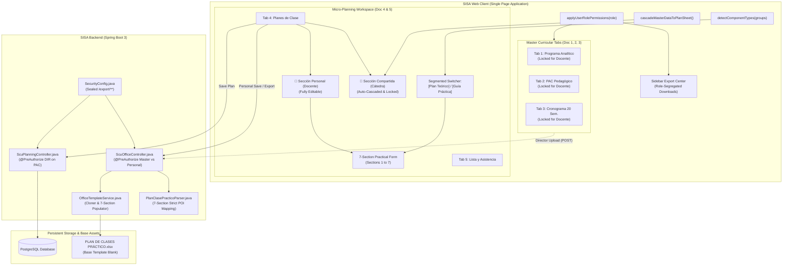
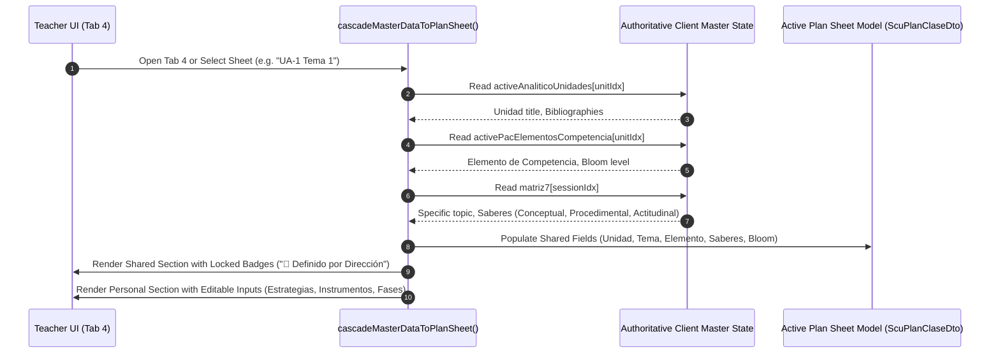

# Technical Design: 13-curriculum-governance-and-practical-plan-alignment

## 1. Overview & Architectural Decisions

This document details the technical architecture and engineering specifications for **Curriculum Governance, Cascading Data Inheritance, and Practical Lesson Plan Alignment** within the SISA platform for Universidad Técnica Privada Cosmos (UNITEPC).

The primary goal is to resolve institutional governance vulnerabilities, eliminate redundant manual data entry through automated master-to-micro cascading, achieve 100% cell-level parity with the official [`PLAN DE CLASES PRÁCTICO.xlsx`](file:///c:/PROYECTOS/SISA/DOCUMENTOS%20BASE/DOCUMENTOS%20PARA%20CARPETA%20DOCENTE%20BASE/BLANCOS/PLAN%20DE%20CLASES%20PRÁCTICO.xlsx) institutional template across all 7 sections, and dynamically adapt the workspace according to teaching modality (Theory vs Practice).

---

### 1.1 Architecture Decision Records (ADRs)

#### ADR-01: Shared vs Personal Document Governance Boundary
- **Context**: In UNITEPC university governance, syllabus design documents—**Documento 1: Programa Analítico**, **Documento 2: PAC Pedagógico**, and **Documento 3: Cronograma de 20 Semanas**—constitute cátedra-wide institutional policy. Prior to this change, endpoints like `/import/pac` allowed individual teachers (`ROLE_DOCENTE`) to upload spreadsheets that overwrote cátedra definitions, while omitting `ROLE_DIR_CARRERA` and `ROLE_DIR_ACADEMICA`.
- **Decision**: Establish an immutable governance boundary separating **Master Cátedra Consensus Documents** from **Personal Classroom Execution Documents**:
  1. Master documents (Documentos 1, 2, 3) are owned exclusively by Career Direction (`ROLE_DIR_CARRERA`, `ROLE_DIR_ACADEMICA`, `ROLE_ADMIN`). Individual teachers possess read-only viewing rights.
  2. Personal execution documents (**Documento 4: Planes de Clase** and **Documento 5: Lista y Asistencia**) are owned and authored by individual teachers (`ROLE_DOCENTE`, `ROLE_DIR_CARRERA`, `ROLE_ADMIN`).
- **Consequences**:
  - *Pros*: Prevents accidental corruption of cátedra curriculum, ensures audit compliance with Vicerrectorado regulations, and guarantees consistent syllabus across all course commissions.
  - *Cons*: Career Directors must perform initial master uploads for new subjects; teachers cannot unilaterally change unit titles or competence elements.

#### ADR-02: Zero-Duplication Cascading Inheritance Strategy
- **Context**: In traditional workflows, teachers re-typed unit titles, competence elements, Bloom outcomes, and saberes into every class plan sheet, leading to human error, typos, and desynchronization when the Director modified the master PAC or Cronograma.
- **Decision**: Implement a **Client-Side Reactive Cascading Inheritance Engine** (`window.cascadeMasterDataToPlanSheet(sheetIndex, sessionOrTopicIndex)`):
  1. The engine reads the authoritative master subject state (`activeAnaliticoUnidades`, `activePacElementosCompetencia`, `matriz7`, `bibliografias`).
  2. It automatically populates shared fields into the target plan sheet without persisting redundant copies in the database.
  3. Shared fields are rendered inside the `"🤝 Sección Compartida (Cátedra)"` container as locked cards with an institutional badge `"🤝 Definido por Dirección de Carrera"`.
  4. If the Director updates the master PAC or Cronograma, the changes propagate instantly to all plan sheets upon view.
- **Consequences**:
  - *Pros*: Zero manual duplication, guaranteed pedagogical coherence between macro-curriculum and micro-planning, instant reactivity.
  - *Cons*: Shared fields cannot be overridden per individual plan sheet by teachers without submitting a curricular change request to the Career Director.

#### ADR-03: Multi-Modality Component Segmentation (TA vs PL)
- **Context**: A course offering may consist of theoretical lectures (`TA`), laboratory sessions (`PL`), clinical practice (`PA`), or seminar workshops (`PS`). Forcing theoretical teachers to view practical equipment fields or forcing laboratory teachers to navigate theoretical 5-moment sequences creates cognitive overload and form errors.
- **Decision**: Integrate `detectComponentTypes(groups)` into Tab 4 rendering:
  1. **Pure Theoretical (`TA`)**: Render only theoretical 5-moment sequence (`#plan-secuencia-standard`); hide practical fields and switcher.
  2. **Pure Practical (`PL`, `PA`, `PS`)**: Render only 7-section practical lesson plan (`#plan-practico-fields`, 4-phase table, Section 6 Desarrollo, Section 7 Notas); hide theoretical sequence and switcher.
  3. **Dual Modality (`TA` + `PL`)**: Render an explicit segmented toggle (`[ 📘 Plan Teórico (TA) ]` / `[ 🔬 Guía Práctica (PL/PA) ]`) that switches between views while preserving unsaved form states in memory.
- **Consequences**:
  - *Pros*: Teachers only interact with fields relevant to their assigned class type; simplifies navigation for clinical and laboratory faculty.
  - *Cons*: Mixed-modality courses maintain two parallel plan states (theoretical and practical) in browser memory.

#### ADR-04: Apache POI 7-Section Practical Template Cell-Mapping Architecture
- **Context**: UNITEPC accreditation requires submitted practical guides to conform identically to [`PLAN DE CLASES PRÁCTICO.xlsx`](file:///c:/PROYECTOS/SISA/DOCUMENTOS%20BASE/DOCUMENTOS%20PARA%20CARPETA%20DOCENTE%20BASE/BLANCOS/PLAN%20DE%20CLASES%20PRÁCTICO.xlsx). The previous backend parser (`PlanClasePracticoParser.java`) omitted Section 4 (Modelo Metodológico 3-column table), Section 6 (Desarrollo dynamic step rows), and Section 7 (Notas del Docente reflection log), producing incomplete workbooks.
- **Decision**: Implement strict anchor-cell mapping targeting the top-left coordinate of every merged range in the official template:
  1. Use Apache POI `XSSFWorkbook` and `XlsxTemplateCloner` to clone the authentic template preserving all cell styles, borders, fonts, and merged regions.
  2. Map Section 4 to rows 34-37 across cols C (Finalidad), F (Actividad Docente), and H (Actividad Estudiante).
  3. Map Section 5 to rows 42-43 across cols C (Actividades), F (Instrumentos), and H (Evidencias).
  4. Map Section 6 to rows 48-54 across cols B (Fase), C (Tiempo), D (Actividad), F (Recursos), and H (Otra información).
  5. Map Section 7 to rows 59-77 across col B (Sesión) and col C (anchor for C:I Notas).
- **Consequences**:
  - *Pros*: 100% roundtrip export/import fidelity; generated spreadsheets pass institutional audit without manual formatting adjustments.
  - *Cons*: Cell coordinates are strictly bound to the institutional layout; changes to template geometry require updating coordinate constants.

#### ADR-05: Dual-Surface RBAC Enforcement (Backend HTTP 403 + Frontend DOM State)
- **Context**: Relying exclusively on frontend DOM hiding is vulnerable to direct API manipulation via cURL/Postman. Conversely, relying exclusively on backend 403 errors produces a frustrating user experience if disabled actions appear clickable in the browser.
- **Decision**: Implement a **Dual-Surface Security Architecture**:
  1. **Surface 1 (Backend API Sealing)**:
     - Remove `/api/v1/office/export/**` from `permitAll()` in `SecurityConfig.java`.
     - Secure master import/export routes in `ScuOfficeController` with `@PreAuthorize("hasAnyRole('ROLE_DIR_CARRERA', 'ROLE_DIR_ACADEMICA', 'ROLE_ADMIN')")`.
     - Secure master planning routes in `ScuPlanningController` (`POST /pac`, `POST /submit`, `POST /programa-analitico`) for Director roles.
     - Return HTTP `403 Forbidden` for unauthorized roles.
  2. **Surface 2 (Frontend DOM State)**:
     - Implement `window.applyUserRolePermissions(role)` in `app-controller.js`.
     - Hide or disable top banner `"Subir Documentación"` for `ROLE_DOCENTE`.
     - In Tabs 1, 2, 3, lock all form controls (`readonly`/`disabled`, muted background `bg-slate-100 dark:bg-slate-800`), hide file upload buttons, and render the institutional badge `"🤝 Definido por Dirección de Carrera"`.
     - In sidebar export center, lock master document downloads for teachers while preserving personal exports.
- **Consequences**:
  - *Pros*: Maximum defense-in-depth security combined with clean, intuitive visual feedback.
  - *Cons*: Role transitions in the portal shell must execute DOM state updates immediately.

---

## 2. Component Architecture & System Context

### 2.1 System Context Diagram



### 2.2 Cascading Data Inheritance Sequence



### 2.3 Modality Detection and View Transition Flow

```mermaid
stateDiagram-v2
    [*] --> DetectComponents: Teacher selects course card
    
    DetectComponents --> PureTheory: Commission types == ['TA']
    DetectComponents --> PurePractice: Commission types == ['PL'] or ['PA'] or ['PS']
    DetectComponents --> DualModality: Commission types contain 'TA' AND ('PL' or 'PA' or 'PS')

    state PureTheory {
        [*] --> RenderTeorico
        RenderTeorico: Show 5-Moment Pedagogical Sequence
        RenderTeorico: Hide Practical Parameters & 4 Fases
        RenderTeorico: Hide Switcher
    }

    state PurePractice {
        [*] --> RenderPractico
        RenderPractico: Show 7-Section Practical Plan
        RenderPractico: Show 4 Fases (3-Col Table)
        RenderPractico: Show Section 6 Desarrollo & Section 7 Notas
        RenderPractico: Hide 5-Moment Sequence
        RenderPractico: Hide Switcher
    }

    state DualModality {
        [*] --> DefaultTeorico
        DefaultTeorico: Render [Plan Teórico (TA)] / [Guía Práctica (PL/PA)] Switcher
        DefaultTeorico: Active view = Teórico (5 Momentos)
        
        DefaultTeorico --> SwitchToPractico: Click [Guía Práctica]
        SwitchToPractico --> SwitchToTeorico: Click [Plan Teórico]
        
        state SwitchToPractico {
            Display 7-Section Practical Plan Form
            Synchronize shared cátedra fields
        }
        state SwitchToTeorico {
            Display 5-Moment Theoretical Sequence
            Synchronize shared cátedra fields
        }
    }
```

---

## 3. Data Structures & DTO Specifications

### 3.1 DTO Model Expansion ([`ScuPlanClaseDto.java`](file:///c:/PROYECTOS/SISA/sisa-backend/src/main/java/bo/edu/unitepc/sisa/api/request/ScuPlanClaseDto.java))

To accommodate all 7 sections of [`PLAN DE CLASES PRÁCTICO.xlsx`](file:///c:/PROYECTOS/SISA/DOCUMENTOS%20BASE/DOCUMENTOS%20PARA%20CARPETA%20DOCENTE%20BASE/BLANCOS/PLAN%20DE%20CLASES%20PRÁCTICO.xlsx) with full typing while maintaining backward compatibility with existing string fields, the following nested structures are defined:

#### 3.1.1 `FaseMetodologicaDto` (Section 4: Modelo Metodológico)
```java
package bo.edu.unitepc.sisa.api.request;

import lombok.AllArgsConstructor;
import lombok.Builder;
import lombok.Getter;
import lombok.NoArgsConstructor;
import lombok.Setter;

/**
 * Represents one of the 4 institutional phases of the practical pedagogical model.
 * Institutional Phases: Preparación, Ejecución guiada, Ejecución autónoma, Cierre.
 */
@Getter
@Setter
@NoArgsConstructor
@AllArgsConstructor
@Builder
public class FaseMetodologicaDto {
    /** Phase identifier or name: PREPARACION, EJECUCION_GUIADA, EJECUCION_AUTONOMA, CIERRE */
    private String fase;
    
    /** Column C:E in template - Finalidad pedagógica de la fase */
    private String finalidad;
    
    /** Column F:G in template - Actividad detallada a cargo del Docente */
    private String actividadDocente;
    
    /** Column H:I in template - Actividad detallada a cargo del Estudiante */
    private String actividadEstudiante;
    
    /** Optional duration in minutes */
    private Integer duracionMin;
}
```

#### 3.1.2 `DesarrolloPasoDto` (Section 6: Desarrollo)
```java
package bo.edu.unitepc.sisa.api.request;

import lombok.AllArgsConstructor;
import lombok.Builder;
import lombok.Getter;
import lombok.NoArgsConstructor;
import lombok.Setter;

/**
 * Represents a dynamic execution step in Section 6 (Desarrollo) of the practical plan.
 * Pre-allocated rows 48 to 54 in PLAN DE CLASES PRÁCTICO.xlsx.
 */
@Getter
@Setter
@NoArgsConstructor
@AllArgsConstructor
@Builder
public class DesarrolloPasoDto {
    /** Step sequence number (1 to 7) */
    private Integer pasoNro;
    
    /** Column B - Fase común: Preparación, Ejecución guiada, Ejecución autónoma, Cierre */
    private String faseComun;
    
    /** Column C - Tiempo estimado en minutos */
    private Integer tiempoMin;
    
    /** Column D:E - Descripción de la actividad práctica */
    private String actividad;
    
    /** Column F:G - Recursos, insumos, instrumentos, reactivos o software */
    private String recursos;
    
    /** Column H:I - Otra información, advertencias de seguridad o criterios clave */
    private String otraInformacion;
}
```

#### 3.1.3 `NotaDocenteSesionDto` (Section 7: Notas del Docente)
```java
package bo.edu.unitepc.sisa.api.request;

import lombok.AllArgsConstructor;
import lombok.Builder;
import lombok.Getter;
import lombok.NoArgsConstructor;
import lombok.Setter;

/**
 * Represents a longitudinal reflection note in Section 7 (Notas del Docente).
 * Pre-allocated rows 59 to 77 for Sessions 1.0 through 19.0.
 */
@Getter
@Setter
@NoArgsConstructor
@AllArgsConstructor
@Builder
public class NotaDocenteSesionDto {
    /** Session number: 1.0, 2.0, ..., 19.0 */
    private Double sesionNro;
    
    /** Column C:I - Teacher reflective notes, pedagogical observations, and improvement proposals */
    private String nota;
}
```

#### 3.1.4 Updates to `PersonalPlanData` & `ScuPlanClaseDto`
Inside `PersonalPlanData`:
```java
@Getter
@Setter
@NoArgsConstructor
@AllArgsConstructor
public static class PersonalPlanData {
    private String nombreDocente;
    private String fecha;
    private String ambiente;
    private String nroEstudiantes;
    private String duracionPractica;
    private String estrategiaEnsenanza;
    private String estrategiaAprendizaje;
    private String evaluacionFormativaActividad;
    private String evaluacionFormativaInstrumento;
    private String evaluacionFormativaEvidencia;
    private String evaluacionSumativaActividad;
    private String evaluacionSumativaInstrumento;
    private String evaluacionSumativaEvidencia;
    
    // Legacy string fields preserved for backward compatibility
    private String modeloMetodologico;
    private String desarrollo;
    private String observaciones;
    
    // Structured 7-Section Practical Models
    private List<FaseMetodologicaDto> fasesMetodologicas = new ArrayList<>();
    private List<DesarrolloPasoDto> pasosDesarrollo = new ArrayList<>();
    private List<NotaDocenteSesionDto> notasDocente = new ArrayList<>();
    
    private List<ScuMomentoPedagogicoDto> momentos = new ArrayList<>();
}
```

---

## 4. Exact POI Cell Coordinate Table for `PLAN DE CLASES PRÁCTICO.xlsx`

The table below defines the exact cell coordinates, merged ranges, 1-indexed Excel coordinates, 0-indexed Apache POI row/column indices, target write anchor cells, and DTO field bindings for [`PLAN DE CLASES PRÁCTICO.xlsx`](file:///c:/PROYECTOS/SISA/DOCUMENTOS%20BASE/DOCUMENTOS%20PARA%20CARPETA%20DOCENTE%20BASE/BLANCOS/PLAN%20DE%20CLASES%20PRÁCTICO.xlsx):

| Section | Label / Item | Excel Row (1-idx) | POI Row (0-idx) | Merged Cell Range | Anchor Write Cell | POI Write Col (0-idx) | Target DTO Field | Read / Write Rule |
| :--- | :--- | :---: | :---: | :---: | :---: | :---: | :--- | :--- |
| **Header** | Institución | 3 | 2 | `B3:I3` | `B3` | 1 | Institutional Static | Read-only |
| **Header** | Vicerrectorado | 4 | 3 | `B4:I4` | `B4` | 1 | Institutional Static | Read-only |
| **Header** | Tipo Documento | 7 | 6 | `B7:I7` | `B7` | 1 | Institutional Static | "PLAN DE CLASE PRÁCTICO" |
| **1. DATOS GENERALES** | Section Banner | 10 | 9 | `B10:I10` | `B10` | 1 | Section Title | Read-only header |
| 1. DATOS GENERALES | Nombre del docente | 12 | 11 | `C12:E12` | `C12` | 2 | `dto.nombreDocente` | String / Top-left merged |
| 1. DATOS GENERALES | Asignatura | 12 | 11 | `G12:I12` | `G12` | 6 | `dto.nombreAsignatura` | String / Top-left merged |
| 1. DATOS GENERALES | Fecha | 13 | 12 | `C13:E13` | `C13` | 2 | `dto.fecha` | String / Top-left merged |
| 1. DATOS GENERALES | Carrera | 13 | 12 | `G13:I13` | `G13` | 6 | `dto.carrera` | String / Top-left merged |
| 1. DATOS GENERALES | Unidad de aprendizaje 1 | 15 | 14 | `C15:I15` | `C15` | 2 | `dto.unidadTitulo` | Cascaded from Analítico |
| 1. DATOS GENERALES | Elemento de Competencia 1 | 16 | 15 | `C16:I16` | `C16` | 2 | `dto.elementoCompetencia` | Cascaded from PAC |
| **2. DATOS DE LA PRÁCTICA** | Section Banner | 18 | 17 | `B18:I18` | `B18` | 1 | Section Title | Read-only header |
| 2. DATOS DE LA PRÁCTICA | Título de la práctica | 20 | 19 | None | `C20` | 2 | `dto.tituloPractica` | Single cell |
| 2. DATOS DE LA PRÁCTICA | Fecha de la práctica | 20 | 19 | None | `E20` | 4 | `dto.fecha` | Single cell |
| 2. DATOS DE LA PRÁCTICA | Duración | 20 | 19 | None | `G20` | 6 | `dto.duracionPractica` | Single cell (e.g. "180 min") |
| 2. DATOS DE LA PRÁCTICA | Semestre | 20 | 19 | None | `I20` | 8 | `dto.semestre` | Single cell (e.g. "5° Semestre") |
| 2. DATOS DE LA PRÁCTICA | Ambiente | 21 | 20 | None | `C21` | 2 | `dto.ambiente` | Single cell (e.g. "Lab 3") |
| 2. DATOS DE LA PRÁCTICA | N° de estudiantes | 21 | 20 | None | `E21` | 4 | `dto.nroEstudiantes` | Single cell (e.g. "25") |
| 2. DATOS DE LA PRÁCTICA | Docente | 21 | 20 | `G21:I21` | `G21` | 6 | `dto.nombreDocente` | String / Top-left merged |
| **3. ALINEACIÓN Y RECURSOS** | Section Banner | 23 | 22 | `B23:I23` | `B23` | 1 | Section Title | Read-only header |
| 3. ALINEACIÓN Y RECURSOS | Objetivo de aprendizaje | 25 | 24 | `D25:I25` | `D25` | 3 | `dto.objetivoAprendizaje` | Label in B25:C25, val in D25 |
| 3. ALINEACIÓN Y RECURSOS | Resultados de aprendizaje (Bloom) | 26 | 25 | `D26:I26` | `D26` | 3 | `dto.resultadosBloom` | Label in B26:C26, val in D26 |
| 3. ALINEACIÓN Y RECURSOS | Preparación materiales previos | 27 | 26 | `D27:I27` | `D27` | 3 | `dto.preparacionMateriales` | Label in B27:C27, val in D27 |
| 3. ALINEACIÓN Y RECURSOS | Equipamiento (entorno) | 28 | 27 | `D28:I28` | `D28` | 3 | `dto.equipamiento` | Label in B28:C28, val in D28 |
| 3. ALINEACIÓN Y RECURSOS | Equipo (para la práctica) | 29 | 28 | `D29:I29` | `D29` | 3 | `dto.equipo` | Label in B29:C29, val in D29 |
| **4. MODELO METODOLÓGICO** | Section Banner | 31 | 30 | `B31:I31` | `B31` | 1 | Section Title | Read-only header |
| 4. MODELO METODOLÓGICO | Column Headers | 33 | 32 | C33:E33, F33:G33, H33:I33 | - | - | Table Header | Finalidad / Docente / Estudiante |
| 4. MODELO METODOLÓGICO | 1. Preparación: Finalidad | 34 | 33 | `C34:E34` | `C34` | 2 | `fases[0].finalidad` | Top-left anchor |
| 4. MODELO METODOLÓGICO | 1. Preparación: Act. Docente | 34 | 33 | `F34:G34` | `F34` | 5 | `fases[0].actividadDocente` | Top-left anchor |
| 4. MODELO METODOLÓGICO | 1. Preparación: Act. Estudiante | 34 | 33 | `H34:I34` | `H34` | 7 | `fases[0].actividadEstudiante`| Top-left anchor |
| 4. MODELO METODOLÓGICO | 2. Ejecución guiada: Finalidad | 35 | 34 | `C35:E35` | `C35` | 2 | `fases[1].finalidad` | Top-left anchor |
| 4. MODELO METODOLÓGICO | 2. Ejecución guiada: Act. Docente | 35 | 34 | `F35:G35` | `F35` | 5 | `fases[1].actividadDocente` | Top-left anchor |
| 4. MODELO METODOLÓGICO | 2. Ejecución guiada: Act. Estudiante | 35 | 34 | `H35:I35` | `H35` | 7 | `fases[1].actividadEstudiante`| Top-left anchor |
| 4. MODELO METODOLÓGICO | 3. Ejecución autónoma: Finalidad | 36 | 35 | `C36:E36` | `C36` | 2 | `fases[2].finalidad` | Top-left anchor |
| 4. MODELO METODOLÓGICO | 3. Ejecución autónoma: Act. Docente | 36 | 35 | `F36:G36` | `F36` | 5 | `fases[2].actividadDocente` | Top-left anchor |
| 4. MODELO METODOLÓGICO | 3. Ejecución autónoma: Act. Estudiante | 36 | 35 | `H36:I36` | `H36` | 7 | `fases[2].actividadEstudiante`| Top-left anchor |
| 4. MODELO METODOLÓGICO | 4. Cierre: Finalidad | 37 | 36 | `C37:E37` | `C37` | 2 | `fases[3].finalidad` | Top-left anchor |
| 4. MODELO METODOLÓGICO | 4. Cierre: Act. Docente | 37 | 36 | `F37:G37` | `F37` | 5 | `fases[3].actividadDocente` | Top-left anchor |
| 4. MODELO METODOLÓGICO | 4. Cierre: Act. Estudiante | 37 | 36 | `H37:I37` | `H37` | 7 | `fases[3].actividadEstudiante`| Top-left anchor |
| **5. EVALUACIÓN** | Section Banner | 39 | 38 | `B39:I39` | `B39` | 1 | Section Title | Read-only header |
| 5. EVALUACIÓN | Column Headers | 41 | 40 | C41:E41, F41:G41, H41:I41 | - | - | Table Header | Técnicas / Instrumentos / Evidencias |
| 5. EVALUACIÓN | Formativa: Actividades y Técnicas | 42 | 41 | `C42:E42` | `C42` | 2 | `dto.evaluacionFormativaActividad` | Top-left anchor |
| 5. EVALUACIÓN | Formativa: Instrumentos | 42 | 41 | `F42:G42` | `F42` | 5 | `dto.evaluacionFormativaInstrumento` | Top-left anchor |
| 5. EVALUACIÓN | Formativa: Evidencias | 42 | 41 | `H42:I42` | `H42` | 7 | `dto.evaluacionFormativaEvidencia` | Top-left anchor |
| 5. EVALUACIÓN | Sumativa: Actividades y Técnicas | 43 | 42 | `C43:E43` | `C43` | 2 | `dto.evaluacionSumativaActividad` | Top-left anchor |
| 5. EVALUACIÓN | Sumativa: Instrumentos | 43 | 42 | `F43:G43` | `F43` | 5 | `dto.evaluacionSumativaInstrumento` | Top-left anchor |
| 5. EVALUACIÓN | Sumativa: Evidencias | 43 | 42 | `H43:I43` | `H43` | 7 | `dto.evaluacionSumativaEvidencia` | Top-left anchor |
| **6. DESARROLLO** | Section Banner | 45 | 44 | `B45:I45` | `B45` | 1 | Section Title | Read-only header |
| 6. DESARROLLO | Column Headers | 47 | 46 | D47:E47, F47:G47, H47:I47 | - | - | Table Header | Fase, Tiempo, Actividad, Recursos, Otra |
| 6. DESARROLLO | Paso 1 (Fase común) | 48 | 47 | None | `B48` | 1 | `pasos[0].faseComun` | Single cell |
| 6. DESARROLLO | Paso 1 (Tiempo) | 48 | 47 | None | `C48` | 2 | `pasos[0].tiempoMin` | Single cell numeric/string |
| 6. DESARROLLO | Paso 1 (Actividad) | 48 | 47 | `D48:E48` | `D48` | 3 | `pasos[0].actividad` | Top-left anchor |
| 6. DESARROLLO | Paso 1 (Recursos) | 48 | 47 | `F48:G48` | `F48` | 5 | `pasos[0].recursos` | Top-left anchor |
| 6. DESARROLLO | Paso 1 (Otra información) | 48 | 47 | `H48:I48` | `H48` | 7 | `pasos[0].otraInformacion` | Top-left anchor |
| 6. DESARROLLO | Pasos 2 a 7 (Iteración) | 49-54 | 48-53 | Same pattern as row 48 | `B[r], C[r], D[r], F[r], H[r]` | 1, 2, 3, 5, 7 | `pasos[r-48].*` | Up to 7 pre-allocated step rows |
| **7. NOTAS DEL DOCENTE** | Section Banner | 56 | 55 | `B56:I56` | `B56` | 1 | Section Title | Read-only header |
| 7. NOTAS DEL DOCENTE | Table Headers | 58 | 57 | `C58:I58` | - | - | Table Header | "Sesión" (B58), "Notas del docente" (C58) |
| 7. NOTAS DEL DOCENTE | Sesión 1.0 | 59 | 58 | `C59:I59` | `C59` | 2 | `notas[1.0]` | Col B=1.0, Note in C59 |
| 7. NOTAS DEL DOCENTE | Sesión 2.0 | 60 | 59 | `C60:I60` | `C60` | 2 | `notas[2.0]` | Col B=2.0, Note in C60 |
| 7. NOTAS DEL DOCENTE | Sesiones 3.0 a 19.0 | 61-77 | 60-76 | `C[r]:I[r]` | `C[r]` | 2 | `notas[r-58]` | Col B=(r-58).0, Note in C[r] |

---

## 5. Frontend DOM Elements & State Transition Flow

### 5.1 New & Updated DOM Elements in [`app.component.html`](file:///c:/PROYECTOS/SISA/sisa-frontend/src/app/app.component.html)

#### 5.1.1 Top Banner & Master Tabs Role Badges
- **Banner Documentation Upload Button** (`#btn-top-upload-doc`):
  - Added attribute `data-roles="ROLE_DIR_CARRERA,ROLE_DIR_ACADEMICA,ROLE_ADMIN"`.
  - For `ROLE_DOCENTE`, replaced with informational badge or disabled state with tooltip.
- **Tabs 1, 2, 3 Header Badges**:
  - Inserted institutional read-only indicator `#tab-governance-badge-[1|2|3]`:
    ```html
    <div class="institutional-governance-badge p-3 rounded-xl bg-blue-50/80 dark:bg-blue-950/40 border border-blue-200 dark:border-blue-800 flex items-center justify-between text-xs mb-4">
      <div class="flex items-center gap-2 text-blue-900 dark:text-blue-200">
        <i data-lucide="shield-check" class="w-4 h-4 text-blue-600 dark:text-blue-400"></i>
        <span><strong>🤝 Definido por Dirección de Carrera:</strong> Contenido curricular oficial aprobado por cátedra. Modo de solo lectura para el cuerpo docente.</span>
      </div>
      <span class="px-2 py-0.5 rounded-full text-[10px] font-bold bg-blue-100 dark:bg-blue-900 text-blue-800 dark:text-blue-300">Oficial Cátedra</span>
    </div>
    ```

#### 5.1.2 Tab 4 Practical Plan Form Expansion (`#tab-cronograma-planes`)
- **Modality Switcher Container** (`#plan-type-switcher-container`):
  ```html
  <div id="plan-type-switcher-container" class="mb-4 hidden">
    <div class="inline-flex p-1 rounded-xl bg-slate-100 dark:bg-slate-800 border border-slate-200 dark:border-slate-700 shadow-inner">
      <button type="button" id="btn-toggle-modality-teorico" onclick="window.switchPlanModalityView('TEORICO')" class="px-3.5 py-1.5 rounded-lg text-xs font-bold transition-all flex items-center gap-1.5 cursor-pointer">
        <i data-lucide="book-open" class="w-3.5 h-3.5"></i> <span>📘 Plan Teórico (TA)</span>
      </button>
      <button type="button" id="btn-toggle-modality-practico" onclick="window.switchPlanModalityView('PRACTICO')" class="px-3.5 py-1.5 rounded-lg text-xs font-bold transition-all flex items-center gap-1.5 cursor-pointer">
        <i data-lucide="flask-conical" class="w-3.5 h-3.5"></i> <span>🔬 Guía Práctica (PL/PA)</span>
      </button>
    </div>
  </div>
  ```
- **Section 4: Modelo Metodológico (4 Fases x 3 Columns)** (`#plan-sec-4-metodologia`):
  - Renders a clean 3-column table for:
    - Fase 1: Preparación
    - Fase 2: Ejecución guiada
    - Fase 3: Ejecución autónoma
    - Fase 4: Cierre
  - Each phase row has inputs:
    - `#plan-prac-fase[1-4]-finalidad` (cols C:E)
    - `#plan-prac-fase[1-4]-act-docente` (cols F:G)
    - `#plan-prac-fase[1-4]-act-estudiante` (cols H:I)
- **Section 6: Desarrollo (Dynamic Step Matrix)** (`#plan-sec-6-desarrollo`):
  - Renders dynamic rows for up to 7 steps.
  - Columns:
    - *Fase común*: Select dropdown (`Preparación`, `Ejecución guiada`, `Ejecución autónoma`, `Cierre`)
    - *Tiempo (min)*: Number input with `oninput="window.updateDesarrolloTimeSum()"`
    - *Actividad*: Textarea
    - *Recursos*: Textarea
    - *Otra información*: Textarea
    - *Acciones*: Remove button
  - Footer with `"[+] Agregar Paso"` button and `#plan-desarrollo-total-min` sum badge.
- **Section 7: Notas del Docente (Longitudinal Reflection Log)** (`#plan-sec-7-notas`):
  - Collapsible drawer or grid showing Sessions 1.0 through 19.0.
  - Textarea `#plan-prac-nota-sesion-[1-19]` mapped to each session index.

---

### 5.2 Frontend State Controller Functions in [`app-controller.js`](file:///c:/PROYECTOS/SISA/sisa-frontend/src/assets/app-controller.js)

#### 5.2.1 `window.applyUserRolePermissions(role)`
Centralized permission applicator that executes across the DOM:
1. Queries `const isDocente = (role === 'ROLE_DOCENTE')`.
2. Hides/disables `#btn-top-upload-doc` and file input elements in Tabs 1, 2, 3 if `isDocente`.
3. Sets `readonly` and `disabled` attributes on all form inputs and manipulation buttons within `#tab-analitico`, `#tab-pac-matrix`, and `#tab-cronograma-semanas`.
4. Adds CSS classes `bg-slate-100 dark:bg-slate-800/60 cursor-not-allowed text-slate-600 dark:text-slate-300` to locked fields.
5. In the sidebar download center, disables buttons for `programa_docx`, `pac_gral_xlsx`, and `pac_prac_xlsx` when `isDocente`, adding a visual badge `"Exclusivo Dirección"`.
6. Leaves personal micro-planning (Tab 4) and attendance (Tab 5) fully interactive for `ROLE_DOCENTE`.

#### 5.2.2 `window.cascadeMasterDataToPlanSheet(sheetIndex, sessionOrTopicIndex)`
Pulls data from authoritative cátedra objects:
```javascript
window.cascadeMasterDataToPlanSheet = function(sheetIndex, sessionOrTopicIndex) {
  if (!activePlanesList || !activePlanesList[sheetIndex]) return;
  const p = activePlanesList[sheetIndex];

  // 1. Resolve active learning unit
  let unitTitle = '';
  let elemComp = '';
  if (activeAnaliticoUnidades && activeAnaliticoUnidades.length > 0) {
    const u = activeAnaliticoUnidades[sheetIndex % activeAnaliticoUnidades.length];
    if (u) unitTitle = u.titulo || ('Unidad ' + (u.numeroUnidad || (sheetIndex + 1)));
  }
  if (activePacElementosCompetencia && activePacElementosCompetencia.length > 0) {
    elemComp = activePacElementosCompetencia[sheetIndex % activePacElementosCompetencia.length] || '';
  }

  // 2. Resolve topic & saberes from Matriz 7 (Cronograma)
  let topicName = p.contenidoTema || '';
  let saberC = p.saberConceptual || '';
  let saberP = p.saberProcedimental || '';
  let saberA = p.saberActitudinal || '';
  let objSesion = p.objetivoSesion || '';

  if (typeof matriz7 !== 'undefined' && matriz7 && matriz7.length > 0) {
    const s = matriz7[sessionOrTopicIndex || sheetIndex] || matriz7[0];
    if (s) {
      if (!topicName || topicName === 'Práctica de formación profesional') topicName = s.contenidoEspecifico || s.tema || topicName;
      if (!saberC) saberC = s.saberConceptual || '';
      if (!saberP) saberP = s.saberProcedimental || '';
      if (!saberA) saberA = s.saberActitudinal || '';
      if (!objSesion) objSesion = s.criterioDesempeno || s.objetivo || '';
    }
  }

  // 3. Assign cascaded values to active plan object
  p.unidadTitulo = unitTitle || p.unidadTitulo;
  p.elementoCompetencia = elemComp || p.elementoCompetencia;
  p.contenidoTema = topicName || p.contenidoTema;
  p.saberConceptual = saberC || p.saberConceptual;
  p.saberProcedimental = saberP || p.saberProcedimental;
  p.saberActitudinal = saberA || p.saberActitudinal;
  p.objetivoSesion = objSesion || p.objetivoSesion;
};
```

#### 5.2.3 `window.switchPlanModalityView(modality)`
Toggles the active plan display between `'TEORICO'` and `'PRACTICO'`:
1. Sets `window.activePlanModality = modality`.
2. If `'TEORICO'`:
   - Highlights `#btn-toggle-modality-teorico`, un-highlights `#btn-toggle-modality-practico`.
   - Displays `#plan-secuencia-standard` (5 pedagogical moments).
   - Hides `#plan-practico-fields`, `#plan-secuencia-practica`, Section 6 Desarrollo, and Section 7 Notas.
3. If `'PRACTICO'`:
   - Highlights `#btn-toggle-modality-practico`, un-highlights `#btn-toggle-modality-teorico`.
   - Displays `#plan-practico-fields`, 4-phase methodology table, Section 6 Desarrollo, and Section 7 Notas.
   - Hides `#plan-secuencia-standard`.
4. Preserves all teacher inputs in memory and synchronizes the active plan sheet DTO.

#### 5.2.4 Dynamic Step Engine for Section 6 (Desarrollo)
- `window.addDesarrolloPaso()`: Appends a new step object to `p.pasosDesarrollo` and inserts a dynamic DOM row.
- `window.removeDesarrolloPaso(idx)`: Removes the step at `idx`, updates row numbering, and recalculates total time.
- `window.updateDesarrolloTimeSum()`: Sums the values of all step duration inputs and updates `#plan-desarrollo-total-min`.

---

## 6. Implementation Security & Verification Gates

### 6.1 Backend Security Matrix

| Endpoint | Method | Previous Authorization | New Hardened Authorization | Failure Status |
| :--- | :---: | :--- | :--- | :---: |
| `/api/v1/office/export/**` | ALL | `permitAll()` | Removed from permitAll; authenticated filter | HTTP 401 |
| `/api/v1/office/import/programa-analitico` | POST | `ROLE_DOCENTE, ROLE_ADMIN` | `ROLE_DIR_CARRERA, ROLE_DIR_ACADEMICA, ROLE_ADMIN` | HTTP 403 |
| `/api/v1/office/import/pac` | POST | `ROLE_DOCENTE, ROLE_ADMIN` | `ROLE_DIR_CARRERA, ROLE_DIR_ACADEMICA, ROLE_ADMIN` | HTTP 403 |
| `/api/v1/office/import/cronograma` | POST | `ROLE_DOCENTE, ROLE_ADMIN` | `ROLE_DIR_CARRERA, ROLE_DIR_ACADEMICA, ROLE_ADMIN` | HTTP 403 |
| `/api/v1/office/export/programa-analitico` | GET/POST | None (`permitAll`) | `ROLE_DIR_CARRERA, ROLE_DIR_ACADEMICA, ROLE_VICERRECTOR_SEDE, ROLE_VICERRECTOR_NACIONAL, ROLE_ADMIN` | HTTP 403 |
| `/api/v1/office/export/pac` | GET/POST | None (`permitAll`) | `ROLE_DIR_CARRERA, ROLE_DIR_ACADEMICA, ROLE_VICERRECTOR_SEDE, ROLE_VICERRECTOR_NACIONAL, ROLE_ADMIN` | HTTP 403 |
| `/api/v1/office/export/cronograma` | GET/POST | None (`permitAll`) | `ROLE_DIR_CARRERA, ROLE_DIR_ACADEMICA, ROLE_VICERRECTOR_SEDE, ROLE_VICERRECTOR_NACIONAL, ROLE_ADMIN` | HTTP 403 |
| `/api/v1/office/import/plan-clase` | POST | `ROLE_DOCENTE, ROLE_ADMIN` | `ROLE_DOCENTE, ROLE_DIR_CARRERA, ROLE_ADMIN` | HTTP 403 |
| `/api/v1/office/export/plan-clase` | GET/POST | None (`permitAll`) | `ROLE_DOCENTE, ROLE_DIR_CARRERA, ROLE_ADMIN` | HTTP 403 |
| `/api/v1/planificaciones/pac` | POST | `ROLE_DOCENTE, ROLE_ADMIN` | `ROLE_DIR_CARRERA, ROLE_DIR_ACADEMICA, ROLE_ADMIN` | HTTP 403 |
| `/api/v1/planificaciones/submit` | POST | `ROLE_DOCENTE, ROLE_ADMIN` | `ROLE_DIR_CARRERA, ROLE_DIR_ACADEMICA, ROLE_ADMIN` | HTTP 403 |
| `/api/v1/planificaciones/programa-analitico` | POST | `ROLE_DOCENTE, ROLE_ADMIN` | `ROLE_DIR_CARRERA, ROLE_DIR_ACADEMICA, ROLE_ADMIN` | HTTP 403 |
| `/api/v1/planificaciones/plan-clase` | POST | `ROLE_DOCENTE, ROLE_ADMIN` | `ROLE_DOCENTE, ROLE_DIR_CARRERA, ROLE_ADMIN` | HTTP 403 |

### 6.2 Testing Verification Gates

1. **Gate 1: RBAC Integration Tests**:
   - Send requests as `ROLE_DOCENTE` to master import/export endpoints; verify HTTP 403.
   - Send requests as `ROLE_DIR_CARRERA` and `ROLE_ADMIN`; verify HTTP 200 / 201.
   - Send unauthenticated request to `/api/v1/office/export/pac`; verify HTTP 401.
2. **Gate 2: Cascading Data Engine Tests**:
   - Verify that initializing a plan sheet without manual input pulls unit title, theme, and 3 saberes from master state.
   - Verify that cascaded fields in DOM are marked `readonly` with badge `"🤝 Definido por Dirección de Carrera"`.
3. **Gate 3: POI Cell Coordinate Parity Roundtrip**:
   - Create a practical plan with all 7 sections populated.
   - Export to Excel via `ScuExportPlanClasesXlsxCmd` / `OfficeTemplateService`.
   - Verify with Apache POI reader that rows 34-37, 42-43, 48-54, and 59-77 contain expected data at exact anchor coordinates.
   - Re-import the generated file via `PlanClasePracticoParser`; verify all 7 sections restore into `ScuPlanClaseDto`.
4. **Gate 4: Modality UI Segmentation**:
   - Test with pure `TA` commission: verify 5-moment sequence shown, practical hidden, switcher hidden.
   - Test with pure `PL` commission: verify 7-section practical plan shown, theoretical hidden, switcher hidden.
   - Test with dual `TA` + `PL` commission: verify switcher displayed, toggling renders corresponding view without loss of form data.
