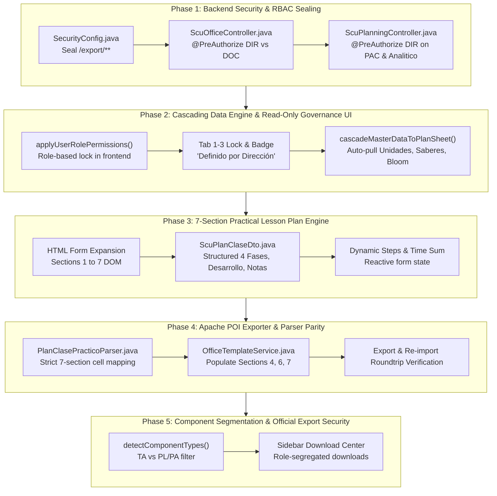

# Proposal: Curriculum Governance, Shared vs Personal Documentation, Cascading Inheritance, and Practical Plan Alignment

## Intent

Establish an institutional, role-governed curricular architecture and high-fidelity pedagogical planning engine in SISA. This proposal addresses four foundational operational requirements:

1. **Curriculum Governance & Authority Centralization**: In university governance under UNITEPC regulations, syllabus design—comprising **Documento 1: Programa Analítico**, **Documento 2: PAC Pedagógico**, and **Documento 3: Cronograma de 20 Semanas**—constitutes cátedra-wide institutional policy established by Career Direction (`ROLE_DIR_CARRERA`, `ROLE_DIR_ACADEMICA`, `ROLE_ADMIN`) and academic consensus. Individual teachers (`ROLE_DOCENTE`) must not have authority to upload or overwrite these master curricular definitions. Teachers must be restricted to personal micro-planning (**Documento 4: Planes de Clase** and **Documento 5: Lista y Asistencia**).
2. **Automated Cascading Inheritance Engine**: Eliminate manual, redundant data entry by implementing an automatic data pipeline that propagates master subject definitions (Unidades de Aprendizaje, specific topic names, competence elements, expected learning outcomes with Bloom taxonomy levels, conceptual/procedural/attitudinal saberes, and APA bibliographies) directly into lesson plan sheets upon creation and view. Master fields are rendered as read-only cards marked with an institutional governance badge, clearly distinguishing cátedra consensus from personal execution fields.
3. **Institutional Practical Lesson Plan Alignment (7 Official Sections)**: Align the web interface and Apache POI Excel export/import engine with the official UNITEPC template [`PLAN DE CLASES PRÁCTICO.xlsx`](file:///c:/PROYECTOS/SISA/DOCUMENTOS%20BASE/DOCUMENTOS%20PARA%20CARPETA%20DOCENTE%20BASE/BLANCOS/PLAN%20DE%20CLASES%20PRÁCTICO.xlsx), resolving current omissions in Section 4 (*Modelo Metodológico* with 3-column phase activities), Section 6 (*Desarrollo* step matrix), and Section 7 (*Notas del Docente* longitudinal reflection log).
4. **Component-Driven Class Modality Segmentation**: Dynamically adapt the teacher workspace based on assigned commission types: pure theoretical teachers (`TA`) see only theoretical 5-moment planning; pure practical teachers (`PL`, `PA`, `PS`) see only 7-section practical guides; dual-modality teachers receive an explicit, frictionless switcher.

---

## Scope

### In Scope

- **Full-Stack Role-Based Access Control (RBAC)**:
  - Backend API sealing in [`SecurityConfig.java`](file:///c:/PROYECTOS/SISA/sisa-backend/src/main/java/bo/edu/unitepc/sisa/infrastructure/security/SecurityConfig.java): Remove `/api/v1/office/export/**` from `permitAll()` and enforce authenticated role checks.
  - Controller authorization in [`ScuOfficeController.java`](file:///c:/PROYECTOS/SISA/sisa-backend/src/main/java/bo/edu/unitepc/sisa/api/controller/ScuOfficeController.java): Restrict `/import/programa-analitico`, `/import/pac`, `/import/cronograma`, `/export/programa-analitico`, `/export/pac`, and `/export/cronograma` to `@PreAuthorize("hasAnyRole('ROLE_DIR_CARRERA', 'ROLE_DIR_ACADEMICA', 'ROLE_ADMIN')")`. Keep personal document routes (`/import/plan-clase`, `/export/plan-clases`, `/export/asistencia`) accessible to `ROLE_DOCENTE`.
  - Planning lifecycle sealing in [`ScuPlanningController.java`](file:///c:/PROYECTOS/SISA/sisa-backend/src/main/java/bo/edu/unitepc/sisa/api/controller/ScuPlanningController.java): Restrict `POST /pac`, `POST /submit`, and `POST /programa-analitico` to Career Direction and Academic Administration roles.
- **Frontend Governance & Read-Only Locking for Documentos 1, 2, 3**:
  - Centralized role application via `window.applyUserRolePermissions(role)` in [`app-controller.js`](file:///c:/PROYECTOS/SISA/sisa-frontend/src/assets/app-controller.js).
  - In [`app.component.html`](file:///c:/PROYECTOS/SISA/sisa-frontend/src/app/app.component.html): Conditionally hide or disable top banner `"Subir Documentación"` (`window.triggerAutoCapture`) for `ROLE_DOCENTE`.
  - In Tabs 1, 2, and 3: Replace upload/import buttons with a prominent institutional badge: `"🤝 Definido por Dirección de Carrera"`. Set form inputs, textareas, selects, and row-manipulation buttons to `readonly`/`disabled` with muted visual styling for teachers.
  - Sidebar Download Center (`Centro de Descargas y Exportación Oficial`): Hide cátedra-wide compiled official exports (PAC, Cronograma, Programa Analítico) from `ROLE_DOCENTE`, rendering an informative notice; preserve personal exports (Planes de Clase, Asistencia). Full download capabilities remain unlocked for `ROLE_DIR_CARRERA` and `ROLE_ADMIN`.
- **Automated Cascading Inheritance Engine**:
  - Implement `window.cascadeMasterDataToPlanSheet(sheetIndex, sessionOrTopicIndex)` in [`app-controller.js`](file:///c:/PROYECTOS/SISA/sisa-frontend/src/assets/app-controller.js) to automatically pull master data from `activeAnaliticoUnidades`, `activePacElementosCompetencia`, `matriz7`, and `bibliografias`.
  - Synchronize learning unit title, specific topic, competence element, Bloom learning outcome, the three saberes (conceptual, procedimental, actitudinal), and institutional bibliographies into the lesson plan.
  - Render inherited master fields inside Plan de Clase as read-only cards with institutional badges, guaranteeing teachers cannot tamper with official cátedra definitions while retaining complete ownership over pedagogical execution fields (didactic strategies, assessment instruments, step durations, classroom activities).
- **Practical Lesson Plan UI & POI Parser Alignment (7 Official Sections)**:
  - Exact DOM and form state structure matching [`PLAN DE CLASES PRÁCTICO.xlsx`](file:///c:/PROYECTOS/SISA/DOCUMENTOS%20BASE/DOCUMENTOS%20PARA%20CARPETA%20DOCENTE%20BASE/BLANCOS/PLAN%20DE%20CLASES%20PRÁCTICO.xlsx):
    - **1. DATOS GENERALES** (Rows 10-16): Docente, Asignatura, Fecha, Carrera, Unidad de Aprendizaje 1, Elemento de Competencia 1 (cascaded and locked).
    - **2. DATOS DE LA PRÁCTICA** (Rows 18-21): Título de la práctica, Fecha, Duración, Semestre, Ambiente/Laboratorio, N° de estudiantes, Docente.
    - **3. ALINEACIÓN Y RECURSOS** (Rows 23-29): Objetivo de aprendizaje, Resultados de aprendizaje (Bloom), Preparación de materiales previos, Equipamiento entorno, Equipos para la práctica.
    - **4. MODELO METODOLÓGICO** (Rows 31-37): 4 institutional phases (*1. Preparación*, *2. Ejecución guiada*, *3. Ejecución autónoma*, *4. Cierre*), each requiring 3 dedicated columns: *Finalidad* (cols C:E), *Actividad del Docente* (cols F:G), and *Actividad del Estudiante* (cols H:I).
    - **5. EVALUACIÓN DE LOS APRENDIZAJES** (Rows 39-43): 2 rows (*Formativa*, *Sumativa*) with 3 columns: *Actividades y Técnicas* (cols C:E), *Instrumentos* (cols F:G), and *Evidencias* (cols H:I).
    - **6. DESARROLLO** (Rows 45-55): Dynamic 5-column step matrix: *Fase común*, *Tiempo (min)*, *Actividad*, *Recursos*, and *Otra información*, with dynamic row adding/removing and total time auto-sum.
    - **7. NOTAS DEL DOCENTE** (Rows 56-77): Longitudinal log for sessions 1.0 through 19.0 with teacher reflective observations.
  - Data transfer object update in [`ScuPlanClaseDto.java`](file:///c:/PROYECTOS/SISA/sisa-backend/src/main/java/bo/edu/unitepc/sisa/api/request/ScuPlanClaseDto.java): Support nested models for Section 4 phases, Section 6 steps, and Section 7 notes.
  - Apache POI parser & exporter alignment: Update [`PlanClasePracticoParser.java`](file:///c:/PROYECTOS/SISA/sisa-backend/src/main/java/bo/edu/unitepc/sisa/infrastructure/office/strategy/impl/PlanClasePracticoParser.java), [`OfficeTemplateService.java`](file:///c:/PROYECTOS/SISA/sisa-backend/src/main/java/bo/edu/unitepc/sisa/infrastructure/office/OfficeTemplateService.java), and [`ScuExportPlanClasesXlsxCmd.java`](file:///c:/PROYECTOS/SISA/sisa-backend/src/main/java/bo/edu/unitepc/sisa/service/command/ScuExportPlanClasesXlsxCmd.java) to read and populate all 7 sections with zero cell coordinate drift and complete fidelity.
- **Component Type Segmentation (Theory vs Practice)**:
  - Inspect commission component types (`TA`, `PA`, `PL`, `PS`) via [`detectComponentTypes`](file:///c:/PROYECTOS/SISA/sisa-frontend/src/assets/app-controller.js#L577-L682).
  - Single-modality theoretical teachers (`TA`) see only theoretical 5-moment planning; practical teachers (`PL`/`PA`/`PS`) see only 7-section practical guides.
  - Dual-modality teachers are provided an intuitive segmented switcher (*"Plan Teórico"* / *"Guía Práctica"*) to toggle smoothly between modalities.

### Out of Scope

- Changes to student attendance tracking or SEA Gateway student roster endpoints (already implemented, verified, and certified in Change 12).
- Relational database schema migrations (not needed; existing JSONB storage in `recursos_didacticos` and JPA entity structures accommodate expanded practical structures without table alterations).
- Direct schema modifications to external SEA Core database systems.
- Historical data backfilling for semesters prior to gestion II-2026.

---

## Approach

We implement **Approach 2: Full-Stack Governance & Strict Template Alignment** from the exploration analysis. The implementation is divided into five cohesive, verifiable phases:



### Phase 1: Backend Security & RBAC Sealing
- In [`SecurityConfig.java`](file:///c:/PROYECTOS/SISA/sisa-backend/src/main/java/bo/edu/unitepc/sisa/infrastructure/security/SecurityConfig.java#L53-L73): Remove `/api/v1/office/export/**` from `permitAll()` and route it through authenticated security filter chain.
- In [`ScuOfficeController.java`](file:///c:/PROYECTOS/SISA/sisa-backend/src/main/java/bo/edu/unitepc/sisa/api/controller/ScuOfficeController.java):
  - Tighten document import endpoints (`/import/programa-analitico`, `/import/pac`, `/import/cronograma`) to `@PreAuthorize("hasAnyRole('ROLE_DIR_CARRERA', 'ROLE_DIR_ACADEMICA', 'ROLE_ADMIN')")`.
  - Secure compiled cátedra export endpoints (`/export/programa-analitico`, `/export/pac`, `/export/cronograma`) with `@PreAuthorize("hasAnyRole('ROLE_DIR_CARRERA', 'ROLE_DIR_ACADEMICA', 'ROLE_VICERRECTOR_SEDE', 'ROLE_VICERRECTOR_NACIONAL', 'ROLE_ADMIN')")`.
  - Preserve teacher micro-planning access for personal endpoints (`/import/plan-clase`, `/export/plan-clase`, `/export/asistencia`) under `@PreAuthorize("hasAnyRole('ROLE_DOCENTE', 'ROLE_DIR_CARRERA', 'ROLE_ADMIN')")`.
- In [`ScuPlanningController.java`](file:///c:/PROYECTOS/SISA/sisa-backend/src/main/java/bo/edu/unitepc/sisa/api/controller/ScuPlanningController.java):
  - Update `POST /pac`, `POST /submit`, `POST /pac/{id}/submit`, and `POST /programa-analitico` to require `ROLE_DIR_CARRERA`, `ROLE_DIR_ACADEMICA`, or `ROLE_ADMIN`.

### Phase 2: Cascading Data Engine & Read-Only Governance UI
- In [`app-controller.js`](file:///c:/PROYECTOS/SISA/sisa-frontend/src/assets/app-controller.js):
  - Create `window.applyUserRolePermissions(role)` to programmatically disable/enable UI elements based on authentication context.
  - When the active user has `ROLE_DOCENTE`:
    - Top banner `"Subir Documentación"` button is hidden or marked as disabled with tooltip `"Acción reservada para Dirección de Carrera"`.
    - Document Tabs 1 (Programa Analítico), 2 (PAC), and 3 (Cronograma) display a header badge: `"🤝 Definido por Dirección de Carrera"` and disable file inputs (`#analitico-file-input`, `#pac-file-input`, `#cronograma-file-input`).
    - Inputs, textareas, and interactive modification buttons in Tabs 1, 2, and 3 are set to `readonly`/`disabled` with background styling `bg-slate-100 dark:bg-slate-800 cursor-not-allowed`.
  - Implement `window.cascadeMasterDataToPlanSheet(sheetIndex, sessionOrTopicIndex)`:
    - Extracts the corresponding Unidad de Aprendizaje from `activeAnaliticoUnidades` (or PAC).
    - Extracts the specific topic title and session details from `matriz7`.
    - Extracts the Elemento de Competencia, Bloom learning outcome, and the 3 Saberes from `activePacElementosCompetencia`.
    - Auto-populates these values into the Plan de Clase sheet state.
    - Displays them in Plan de Clase inside a locked card with the institutional badge `"🤝 Definido por Dirección de Carrera"`, while personal classroom execution fields remain fully editable.

### Phase 3: 7-Section Practical Lesson Plan Engine
- Expand [`app.component.html`](file:///c:/PROYECTOS/SISA/sisa-frontend/src/app/app.component.html#L2123-L2380) to render the full institutional practical structure matching [`PLAN DE CLASES PRÁCTICO.xlsx`](file:///c:/PROYECTOS/SISA/DOCUMENTOS%20BASE/DOCUMENTOS%20PARA%20CARPETA%20DOCENTE%20BASE/BLANCOS/PLAN%20DE%20CLASES%20PRÁCTICO.xlsx):
  - **Section 1**: Datos Generales (Docente, Asignatura, Fecha, Carrera, Unidad de Aprendizaje 1, Elemento de Competencia 1).
  - **Section 2**: Datos de la Práctica (Título de la práctica, Fecha, Duración, Semestre, Ambiente/Laboratorio, N° estudiantes, Docente).
  - **Section 3**: Alineación y Recursos (Objetivo de aprendizaje, Resultados Bloom, Preparación de materiales previos, Equipamiento entorno, Equipos).
  - **Section 4**: Modelo Metodológico (4 Fases: *Preparación*, *Ejecución guiada*, *Ejecución autónoma*, *Cierre*), with three interactive sub-columns for each phase: *Finalidad*, *Actividad del Docente*, and *Actividad del Estudiante*.
  - **Section 5**: Evaluación de los Aprendizajes (*Formativa* and *Sumativa* rows with *Actividades y Técnicas*, *Instrumentos*, and *Evidencias*).
  - **Section 6**: Desarrollo (Dynamic matrix with *Fase común*, *Tiempo*, *Actividad*, *Recursos*, and *Otra información*), allowing teachers to add/remove steps with live time recalculation.
  - **Section 7**: Notas del Docente (Longitudinal session reflection table for sessions 1.0 to 19.0).
- Expand [`ScuPlanClaseDto.java`](file:///c:/PROYECTOS/SISA/sisa-backend/src/main/java/bo/edu/unitepc/sisa/api/request/ScuPlanClaseDto.java):
  - Add typed nested DTO classes: `FaseMetodologicaDto`, `DesarrolloPasoDto`, and `NotaDocenteSesionDto` inside `PersonalPlanData` and root DTO, maintaining backward compatibility with existing string fields.

### Phase 4: Apache POI Practical Plan Exporter & Parser Parity
- In [`PlanClasePracticoParser.java`](file:///c:/PROYECTOS/SISA/sisa-backend/src/main/java/bo/edu/unitepc/sisa/infrastructure/office/strategy/impl/PlanClasePracticoParser.java):
  - Align cell reading and writing with the exact merged coordinates of [`PLAN DE CLASES PRÁCTICO.xlsx`](file:///c:/PROYECTOS/SISA/DOCUMENTOS%20BASE/DOCUMENTOS%20PARA%20CARPETA%20DOCENTE%20BASE/BLANCOS/PLAN%20DE%20CLASES%20PRÁCTICO.xlsx):
    - Section 1: Rows 11-15 (0-indexed: 10-14).
    - Section 2: Rows 19-20 (0-indexed: 18-19).
    - Section 3: Rows 24-28 (0-indexed: 23-27).
    - Section 4: Rows 33-36 (0-indexed: 32-35; cols C:E Finalidad, cols F:G Actividad Docente, cols H:I Actividad Estudiante).
    - Section 5: Rows 41-42 (0-indexed: 40-41; cols C:E Actividades, cols F:G Instrumentos, cols H:I Evidencias).
    - Section 6: Rows 47-54 (0-indexed: 46-53; col B Fase común, col C Tiempo, cols D:E Actividad, cols F:G Recursos, cols H:I Otra información).
    - Section 7: Rows 58-76 (0-indexed: 57-75; col B Sesión, cols C:I Notas del Docente).
- In [`OfficeTemplateService.java`](file:///c:/PROYECTOS/SISA/sisa-backend/src/main/java/bo/edu/unitepc/sisa/infrastructure/office/OfficeTemplateService.java) and [`ScuExportPlanClasesXlsxCmd.java`](file:///c:/PROYECTOS/SISA/sisa-backend/src/main/java/bo/edu/unitepc/sisa/service/command/ScuExportPlanClasesXlsxCmd.java):
  - Populate Sections 4, 6, and 7 into generated practical workbooks without leaving empty or unmapped sections.
  - Verify template file lookup path and fallbacks.

### Phase 5: Component Type Segmentation & Official Export Security
- In [`app-controller.js`](file:///c:/PROYECTOS/SISA/sisa-frontend/src/assets/app-controller.js):
  - Connect [`detectComponentTypes`](file:///c:/PROYECTOS/SISA/sisa-frontend/src/assets/app-controller.js#L577-L682) to the Plan de Clase view mode:
    - Pure `TA`: Show theoretical planning tab only; hide practical controls.
    - Pure `PL`/`PA`/`PS`: Show practical planning tab only; hide theoretical 5-moment sequence.
    - Mixed (`TA` + `PL`): Display modality switcher button group (`[ Plan Teórico ]` / `[ Guía de Práctica ]`) allowing seamless toggling.
- In [`app.component.html`](file:///c:/PROYECTOS/SISA/sisa-frontend/src/app/app.component.html):
  - In sidebar `"Centro de Descargas y Exportación Oficial"`, segregate document downloads:
    - `ROLE_DOCENTE`: Master compiled downloads (PAC, Cronograma, Programa Analítico) are disabled or replaced with an institutional guidance note; personal exports (Planes de Clase, Asistencia) remain active.
    - `ROLE_DIR_CARRERA` / `ROLE_ADMIN`: All official and personal exports are enabled.

---

## Affected Areas

```
+----------------------------------------------------------------------------------------------------------+
| AFFECTED CODEBASE ARTIFACTS                                                                              |
+--------------------------+--------------------------------------------------------+----------------------+
| Layer                    | File Path                                              | Primary Changes      |
+--------------------------+--------------------------------------------------------+----------------------+
| Backend Security         | SecurityConfig.java                                    | Seal /export/**      |
| Backend API Controllers  | ScuOfficeController.java                               | RBAC on import/export|
| Backend API Controllers  | ScuPlanningController.java                             | RBAC on PAC/Analitico|
| Backend DTO Models       | ScuPlanClaseDto.java                                   | 7-section practical  |
| Backend Office Strategy  | PlanClasePracticoParser.java                           | POI parse/populate   |
| Backend Office Services  | OfficeTemplateService.java                             | POI export alignment |
| Backend Commands         | ScuExportPlanClasesXlsxCmd.java                        | Practical workbook   |
| Frontend UI Views        | sisa-frontend/.../app.component.html                   | RBAC locks & 7 sects |
| Frontend State Logic     | sisa-frontend/.../assets/app-controller.js             | Cascading & RBAC UX  |
| Frontend Constants       | sisa-frontend/.../constants/scu-api.constant.ts        | Endpoint references  |
+--------------------------+--------------------------------------------------------+----------------------+
```

### Detailed File References

#### Backend
- [`SecurityConfig.java`](file:///c:/PROYECTOS/SISA/sisa-backend/src/main/java/bo/edu/unitepc/sisa/infrastructure/security/SecurityConfig.java#L53-L73): Seal `/api/v1/office/export/**` to authenticated requests.
- [`ScuOfficeController.java`](file:///c:/PROYECTOS/SISA/sisa-backend/src/main/java/bo/edu/unitepc/sisa/api/controller/ScuOfficeController.java#L72-L418): Add `@PreAuthorize` role restrictions distinguishing Director master documents from Teacher personal documents.
- [`ScuPlanningController.java`](file:///c:/PROYECTOS/SISA/sisa-backend/src/main/java/bo/edu/unitepc/sisa/api/controller/ScuPlanningController.java#L81-L190): Restrict master planning creation and submissions to Career Direction and Academic roles.
- [`ScuPlanClaseDto.java`](file:///c:/PROYECTOS/SISA/sisa-backend/src/main/java/bo/edu/unitepc/sisa/api/request/ScuPlanClaseDto.java#L740-L808): Expand `PersonalPlanData` and create nested DTOs for 4-phase methodology, Section 6 desarrollo steps, and Section 7 teacher reflection notes.
- [`PlanClasePracticoParser.java`](file:///c:/PROYECTOS/SISA/sisa-backend/src/main/java/bo/edu/unitepc/sisa/infrastructure/office/strategy/impl/PlanClasePracticoParser.java#L305-L345): Update parsing and cell population to cover Sections 1 through 7 matching exact coordinates of [`PLAN DE CLASES PRÁCTICO.xlsx`](file:///c:/PROYECTOS/SISA/DOCUMENTOS%20BASE/DOCUMENTOS%20PARA%20CARPETA%20DOCENTE%20BASE/BLANCOS/PLAN%20DE%20CLASES%20PRÁCTICO.xlsx).
- [`OfficeTemplateService.java`](file:///c:/PROYECTOS/SISA/sisa-backend/src/main/java/bo/edu/unitepc/sisa/infrastructure/office/OfficeTemplateService.java#L242-L272): Populate practical methodology, step-by-step desarrollo, and notes into generated workbooks.
- [`ScuExportPlanClasesXlsxCmd.java`](file:///c:/PROYECTOS/SISA/sisa-backend/src/main/java/bo/edu/unitepc/sisa/service/command/ScuExportPlanClasesXlsxCmd.java#L1-L120): Ensure practical plan export routes use the complete 7-section strategy.

#### Frontend
- [`app.component.html`](file:///c:/PROYECTOS/SISA/sisa-frontend/src/app/app.component.html):
  - Top banner upload button role-gating ([#L1040-L1080](file:///c:/PROYECTOS/SISA/sisa-frontend/src/app/app.component.html#L1040-L1080)).
  - Documentos 1, 2, 3 read-only indicators and input locking ([#L1250-L1950](file:///c:/PROYECTOS/SISA/sisa-frontend/src/app/app.component.html#L1250-L1950)).
  - Plan de Clase 7-section practical form structure ([#L2123-L2380](file:///c:/PROYECTOS/SISA/sisa-frontend/src/app/app.component.html#L2123-L2380)).
  - Sidebar Download Center role segregation ([#L3100-L3250](file:///c:/PROYECTOS/SISA/sisa-frontend/src/app/app.component.html#L3100-L3250)).
- [`app-controller.js`](file:///c:/PROYECTOS/SISA/sisa-frontend/src/assets/app-controller.js):
  - `window.applyUserRolePermissions(role)` implementation and role-switch event listener.
  - `window.cascadeMasterDataToPlanSheet(sheetIndex, sessionOrTopicIndex)` auto-fill engine.
  - Dynamic step management for Section 6 (Desarrollo) and Section 7 (Notas).
  - Modality switcher logic based on `detectComponentTypes`.
- [`scu-api.constant.ts`](file:///c:/PROYECTOS/SISA/sisa-frontend/src/app/shared/constants/scu-api.constant.ts): Alignment of endpoint URLs and authorization headers.

---

## Risks

| Risk | Likelihood | Impact | Mitigation Strategy |
| :--- | :---: | :---: | :--- |
| **Teacher attempts to modify Master Subject definitions** | High | Medium | Enforce dual barrier: client-side UI fields rendered as locked cards with `"🤝 Definido por Dirección de Carrera"` badge; backend endpoints reject `ROLE_DOCENTE` with HTTP 403 Forbidden. |
| **Desynchronization after Director updates Master PAC/Cronograma** | Medium | Medium | The cascading inheritance engine (`cascadeMasterDataToPlanSheet`) dynamically queries the latest active subject master state whenever a plan sheet is opened, refreshing shared fields without overwriting teacher personal annotations. |
| **POI Merged Cells Misalignment in Practical Plan Template** | Medium | High | Coordinates verified directly from [`PLAN DE CLASES PRÁCTICO.xlsx`](file:///c:/PROYECTOS/SISA/DOCUMENTOS%20BASE/DOCUMENTOS%20PARA%20CARPETA%20DOCENTE%20BASE/BLANCOS/PLAN%20DE%20CLASES%20PRÁCTICO.xlsx). Write operations strictly target the top-left anchor of each merged range (e.g., C34 for Finalidad, F34 for Actividad Docente, H34 for Actividad Estudiante). |
| **Role Switching Inconsistency in Demo / Multi-Role Shell** | Low | Low | Wire `applyUserRolePermissions(role)` directly into `window.setAuthSession` and the shell role toggle, ensuring instantaneous DOM re-evaluation upon role transition without requiring page reload. |
| **Component Type Ambiguity for Complex Combined Commissions** | Low | Medium | Utilize the proven `detectComponentTypes` algorithm from Change 12. If commission contains both theory and laboratory codes, provide an explicit modality segmented pill with default selection set to `TEORICO`. |

---

## Rollback Plan

If unexpected regressions occur during execution:

1. **Backend Rollback**:
   - Revert controller changes in [`ScuOfficeController.java`](file:///c:/PROYECTOS/SISA/sisa-backend/src/main/java/bo/edu/unitepc/sisa/api/controller/ScuOfficeController.java), [`ScuPlanningController.java`](file:///c:/PROYECTOS/SISA/sisa-backend/src/main/java/bo/edu/unitepc/sisa/api/controller/ScuPlanningController.java), and [`SecurityConfig.java`](file:///c:/PROYECTOS/SISA/sisa-backend/src/main/java/bo/edu/unitepc/sisa/infrastructure/security/SecurityConfig.java) using `git checkout`.
   - Because no database schema migrations are executed, rollback requires zero database rollback scripts or data restructuring.
2. **Frontend Rollback**:
   - Revert [`app.component.html`](file:///c:/PROYECTOS/SISA/sisa-frontend/src/app/app.component.html) and [`app-controller.js`](file:///c:/PROYECTOS/SISA/sisa-frontend/src/assets/app-controller.js) to their previous state via git.
3. **Data Compatibility**:
   - All newly added fields in `PersonalPlanData` and JSON structures are nullable and backward-compatible. Existing plans created under previous versions will continue to render without corruption.

---

## Dependencies

- **Spring Security 6.x & JWT**: Underlying authorization filter infrastructure and `@EnableMethodSecurity`.
- **Apache POI 5.2.x**: Workbook generation and cell manipulation libraries already integrated in `sisa-backend/pom.xml`.
- **Official Institutional Template**: [`PLAN DE CLASES PRÁCTICO.xlsx`](file:///c:/PROYECTOS/SISA/DOCUMENTOS%20BASE/DOCUMENTOS%20PARA%20CARPETA%20DOCENTE%20BASE/BLANCOS/PLAN%20DE%20CLASES%20PRÁCTICO.xlsx) located in the project's base document repository.
- **Change 12 Artifacts**: Component detection logic (`detectComponentTypes`) and group link handling established during attendance system implementation.

---

## Success Criteria

- [ ] **RBAC Security Enforcement**:
  - `ROLE_DOCENTE` attempting `POST /api/v1/office/import/programa-analitico`, `/import/pac`, or `/import/cronograma` receives HTTP 403 Forbidden.
  - `ROLE_DIR_CARRERA` and `ROLE_ADMIN` successfully import and manage all three master documents.
  - `/api/v1/office/export/**` rejects unauthenticated access.
- [ ] **Frontend Master Document Governance**:
  - When logged in as `ROLE_DOCENTE`, Tabs 1, 2, and 3 display the institutional read-only indicator badge (`"🤝 Definido por Dirección de Carrera"`), and all form fields are locked (`readonly`/`disabled`).
  - Top banner `"Subir Documentación"` is hidden or disabled for teachers.
  - Sidebar Download Center displays official compiled downloads only for Directors; teachers see an informative advisory badge while retaining access to personal downloads (Planes de Clase, Asistencia).
- [ ] **Cascading Inheritance Verification**:
  - Creating or opening a Plan de Clase sheet automatically populates the learning unit title, specific topic, competence element, Bloom learning outcome, the three saberes, and bibliographies from master subject state.
  - Cascaded fields are visibly locked with the institutional governance badge, while personal planning fields (didactic strategies, assessment instruments, step durations) remain fully editable.
- [ ] **7-Section Practical Plan Alignment**:
  - The practical plan interface renders all 7 official sections: Datos Generales, Datos de la Práctica, Alineación y Recursos, Modelo Metodológico (4 Fases x 3 Columns), Evaluación de los Aprendizajes, Desarrollo (dynamic step matrix), and Notas del Docente (longitudinal log).
  - Adding and removing Desarrollo steps updates row ordering and recalculates total duration dynamically.
- [ ] **POI Excel Roundtrip Fidelity**:
  - Exporting a practical class plan produces an `.xlsx` file faithful to [`PLAN DE CLASES PRÁCTICO.xlsx`](file:///c:/PROYECTOS/SISA/DOCUMENTOS%20BASE/DOCUMENTOS%20PARA%20CARPETA%20DOCENTE%20BASE/BLANCOS/PLAN%20DE%20CLASES%20PRÁCTICO.xlsx), populating all 7 sections with zero cell overlaps or blank sections.
  - Re-importing the exported file correctly restores all 7 sections into SISA form state.
- [ ] **Component Type Segmentation**:
  - Teacher assigned only to theoretical commission (`TA`) sees only theoretical 5-moment planning.
  - Teacher assigned only to practical commission (`PL`, `PA`, `PS`) sees only 7-section practical guide.
  - Teacher assigned to dual commission (`TA` + `PL`) sees a segmented toggle button allowing seamless switching between theoretical and practical plans.
