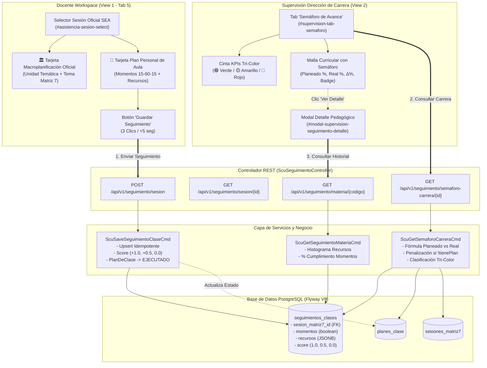

# Technical Design: Seguimiento Ágil de Sesión Docente y Semáforo Curricular de Carrera

**Sistema Integral de Seguimiento Académico (SISA 2.0) — UNITEPC**  
**ID de Cambio:** `14-seguimiento-clase-docente-y-semaforo-carrera`  
**Fecha:** *30 de Octubre de 2026*  
**Autor:** *Arquitecto de Software Principal (sdd-architect)*  
**Hito:** *Fase 3: Especificación & Diseño Técnico de Arquitectura*

---

## 1. Visión General y Decisiones de Arquitectura (ADRs)

### 1.1 Contexto del Sistema
El presente diseño técnico establece la arquitectura para la integración del módulo de **Seguimiento Ágil de Sesión de Clase** para docentes y el **Semáforo Curricular de Avance** para directores de carrera en SISA 2.0.

El sistema se compone de dos subsistemas interactivos:
1. **Entorno Docente (`view1` - Pestaña 5 `#tab-asistencia`)**: Interfaz de registro de ejecución didáctica en aula en menos de 5 segundos ($\le 3$ clics), que contrasta la Macroplanificación Institucional (Matriz 7) con la Planificación Personal de Aula (Plan de Clase), verificando momentos pedagógicos (Inicio 15', Desarrollo 60', Cierre 15') y recursos empleados.
2. **Entorno Supervisión (`view2` - Tab "Semáforo de Avance")**: Tablero de control en tiempo real para Dirección de Carrera, Dirección Académica y Vicerrectorado, gobernado por un modelo de semáforo matemático tri-color (🟢 Verde, 🟡 Amarillo, 🔴 Rojo) que compara el Avance Planeado temporal con el Avance Real de aula, penalizando materias sin Plan de Clase.

---

### 1.2 Architectural Decision Records (ADRs)

#### ADR-01: Especialización Relacional e Integridad vs Sobrecarga de Asistencia
- **Contexto**: Se evaluó agregar columnas de momentos y temas a la tabla existente `asistencias_sesiones` (creada en la migración V7).
- **Decisión**: Crear una tabla dedicada e independiente denominada `seguimientos_clases` en la migración **`V8__seguimiento_clases_y_semaforo_avance.sql`**.
- **Justificación**:
  1. *Principio de Responsabilidad Única (SRP)*: `asistencias_sesiones` administra la asistencia física de estudiantes bajo la regla del 80%. `seguimientos_clases` administra el expediente didáctico y curricular de cátedra del docente.
  2. *Rendimiento Analítico*: La Dirección de Carrera consulta el semáforo agregando datos sobre las ~50 materias de la carrera. No debe cargar listas de 40 estudiantes por sesión para calcular si una materia va al día.
  3. *Flexibilidad en Clave Foránea*: Vincula opcionalmente a `sesion_matriz7_id` con `ON DELETE SET NULL`, permitiendo registrar clases de recuperación o reforzamiento sin romper la integridad con la planificación base.

#### ADR-02: Algoritmo Tri-Color Ponderado con Penalización Normativa Estricta
- **Contexto**: La supervisión manual no detectaba oportunamente los desfases pedagógicos antes de las mesas de examen.
- **Decisión**: Implementar un modelo matemático estricto en `ScuGetSemaforoCarreraCmd`:
  - **Avance Planeado (%)**: Proporción de la semana activa sobre el semestre: $W_{corte} / 20 \times 100\%$ ($65\%$ para Semana 13).
  - **Avance Real (%)**: Suma de puntajes de sesiones cumplidas sobre el total de sesiones programadas ($N_{total}=36$ o $40$). Ponderación: Totalmente cumplido ($+1.0$), Parcialmente cumplido ($+0.5$), No cumplido ($0.0$).
  - **Clasificación Tri-Color**:
    * 🟢 **VERDE**: $\Delta\% = (\text{Avance Real} - \text{Avance Planeado}) \ge -10.0\%$.
    * 🟡 **AMARILLO**: $-25.0\% \le \Delta\% < -10.0\%$.
    * 🔴 **ROJO**: $\Delta\% < -25.0\% \lor \text{tienePlanClase} == \text{false}$.
- **Justificación**: La penalización inmediata en rojo si $\text{tienePlanClase} == \text{false}$ asegura el cumplimiento del modelo por competencias de UNITEPC, impidiendo que docentes sin microplanificación didáctica figuren al día.

#### ADR-03: Persistencia de Recursos Didácticos mediante JSONB y JPA Converter
- **Contexto**: Los recursos didácticos varían por materia (proyector, IDE, simulador, maniquí anatómico, reactivos de laboratorio).
- **Decisión**: Almacenar `recursos_planificados` y `recursos_utilizados` como columnas nativas `JSONB` en PostgreSQL, reutilizando el convertidor JPA [`JsonbStringListConverter`](file:///f:/SISA%202/sisa-backend/src/main/java/bo/edu/unitepc/sisa/infrastructure/persistence/converter/JsonbStringListConverter.java).
- **Justificación**: Elimina la necesidad de tablas intermedias normalizadas innecesarias (`seguimiento_recursos`), soporta arrays de strings nativos en JSON, permite consultas de frecuencia con funciones PostgreSQL (`jsonb_array_elements_text`) y preserva la paridad con la entidad `PlanDeClase`.

#### ADR-04: Transición de Estado Automática en PlanDeClase (`BORRADOR`/`APROBADO` $\rightarrow$ `EJECUTADO`)
- **Contexto**: Cuando el docente registra la ejecución de la clase, el documento de microplanificación `PlanDeClase` debe reflejar la finalización del ciclo didáctico.
- **Decisión**: Al persistir un seguimiento en `ScuSaveSeguimientoClaseCmd`, si el estado es `TOTALMENTE_CUMPLIDO` o `PARCIALMENTE_CUMPLIDO` y existe un `PlanDeClase` asociado a la `sesion_matriz7_id`, su atributo `estado` transmuta atómicamente a `EstadoPlanificacion.EJECUTADO`.
- **Justificación**: Cierra automáticamente el ciclo de vida del plan de clase sin requerir acciones administrativas adicionales del docente.

#### ADR-05: Estrategia de Agregación Nativa SQL de Alto Desempeño ($< 20\text{ ms}$)
- **Contexto**: Renderizar el semáforo para 50 materias ejecutando 50 consultas individuales provocaría el problema $N+1$ y latencias superiores a 1 segundo.
- **Decisión**: Diseñar una consulta nativa en `SeguimientoClaseRepository` con `GROUP BY materia_codigo` y agregaciones directas (`COUNT`, `SUM(cumplimiento_score)`, conteo de momentos).
- **Justificación**: Resuelve el consolidado de toda la carrera en un único viaje de red a PostgreSQL en $< 15\text{ ms}$.

---

## 2. Diagrama de Arquitectura y Flujo de Componentes



---

## 3. Diseño de Base de Datos: Migración Flyway V8

### 3.1 Script DDL Completo (`V8__seguimiento_clases_y_semaforo_avance.sql`)

```sql
-- ============================================================================
-- Flyway Migration: V8__seguimiento_clases_y_semaforo_avance.sql
-- Module: Seguimiento Ágil de Sesión Docente y Semáforo Curricular de Carrera
-- Author: GentleAI SISA Architecture Team
-- Management: II-2026 (Semana 13 de Corte)
-- ============================================================================

-- 1. Crear Tabla de Seguimiento de Sesiones Docentes
CREATE TABLE IF NOT EXISTS seguimientos_clases (
    id BIGSERIAL PRIMARY KEY,
    sesion_matriz7_id BIGINT REFERENCES sesiones_matriz7(id) ON DELETE SET NULL,
    materia_codigo VARCHAR(30) NOT NULL,
    carrera_codigo VARCHAR(30) NOT NULL DEFAULT 'CARSIS',
    docente_ci VARCHAR(30) NOT NULL,
    fecha_ejecucion DATE NOT NULL,
    tipo_clase VARCHAR(20) NOT NULL DEFAULT 'TEORICA',
    comision VARCHAR(20) NOT NULL DEFAULT 'TA-01',
    tema_oficial VARCHAR(500),
    tema_ejecutado VARCHAR(500),
    recursos_planificados JSONB NOT NULL DEFAULT '[]'::jsonb,
    recursos_utilizados JSONB NOT NULL DEFAULT '[]'::jsonb,
    momento_inicio_cumplido BOOLEAN NOT NULL DEFAULT TRUE,
    momento_desarrollo_cumplido BOOLEAN NOT NULL DEFAULT TRUE,
    momento_cierre_cumplido BOOLEAN NOT NULL DEFAULT TRUE,
    estado_cumplimiento VARCHAR(30) NOT NULL DEFAULT 'TOTALMENTE_CUMPLIDO',
    cumplimiento_score NUMERIC(3,2) NOT NULL DEFAULT 1.00,
    observaciones_docente TEXT,
    creado_en TIMESTAMP WITH TIME ZONE NOT NULL DEFAULT CURRENT_TIMESTAMP,
    actualizado_en TIMESTAMP WITH TIME ZONE NOT NULL DEFAULT CURRENT_TIMESTAMP,

    -- Restricciones de Dominio
    CONSTRAINT chk_estado_cumplimiento CHECK (estado_cumplimiento IN ('TOTALMENTE_CUMPLIDO', 'PARCIALMENTE_CUMPLIDO', 'NO_CUMPLIDO')),
    CONSTRAINT chk_cumplimiento_score CHECK (cumplimiento_score IN (0.00, 0.50, 1.00)),
    CONSTRAINT chk_tipo_clase_seg CHECK (tipo_clase IN ('TEORICA', 'PRACTICA', 'LABORATORIO', 'CLINICA')),
    
    -- Restricción de Unicidad por Sesión de Planificación
    CONSTRAINT uq_seguimiento_sesion_matriz7 UNIQUE (sesion_matriz7_id),
    
    -- Restricción de Unicidad por Coordenadas Físicas de Clase
    CONSTRAINT uq_seguimiento_materia_fecha_comision UNIQUE (materia_codigo, fecha_ejecucion, tipo_clase, comision)
);

-- 2. Índices de Alto Desempeño
CREATE INDEX IF NOT EXISTS idx_seguimientos_materia_codigo ON seguimientos_clases(materia_codigo);
CREATE INDEX IF NOT EXISTS idx_seguimientos_docente_ci ON seguimientos_clases(docente_ci);
CREATE INDEX IF NOT EXISTS idx_seguimientos_fecha ON seguimientos_clases(fecha_ejecucion);
CREATE INDEX IF NOT EXISTS idx_seguimientos_carrera ON seguimientos_clases(carrera_codigo);
CREATE INDEX IF NOT EXISTS idx_seguimientos_sesion_matriz7 ON seguimientos_clases(sesion_matriz7_id);
CREATE INDEX IF NOT EXISTS idx_seguimientos_cumplimiento ON seguimientos_clases(estado_cumplimiento);

-- 3. Semillas de Datos Representativas para la Demo Institucional (Semana 13 de Corte)
-- Caso 1: Materia VERDE (SIS-213 Programación III - Carlos Mendoza CI: 4892104) -> 22 sesiones, 21.5 pts, Avance Real: 59.72%, Planeado: 65.0%, Delta: -5.28%
INSERT INTO seguimientos_clases (
    sesion_matriz7_id, materia_codigo, carrera_codigo, docente_ci, fecha_ejecucion,
    tipo_clase, comision, tema_oficial, tema_ejecutado, recursos_planificados, recursos_utilizados,
    momento_inicio_cumplido, momento_desarrollo_cumplido, momento_cierre_cumplido,
    estado_cumplimiento, cumplimiento_score, observaciones_docente
) VALUES 
(NULL, 'SIS-213', 'CARSIS', '4892104', '2026-10-30', 'TEORICA', 'TA-01', 
 'Mapeo Objeto-Relacional Avanzado y Herencia en JPA', 
 'Mapeo Objeto-Relacional Avanzado y Herencia en JPA', 
 '["Proyector multimedia", "IDE IntelliJ IDEA", "Pizarra acrílica"]'::jsonb, 
 '["Proyector multimedia", "IDE IntelliJ IDEA", "Pizarra acrílica"]'::jsonb, 
 TRUE, TRUE, TRUE, 'TOTALMENTE_CUMPLIDO', 1.00, 'Sesión completada al 100% con ejercicios prácticos.'),
(NULL, 'SIS-213', 'CARSIS', '4892104', '2026-10-28', 'TEORICA', 'TA-01', 
 'Relaciones OneToMany y ManyToOne bidireccionales', 
 'Relaciones OneToMany y ManyToOne bidireccionales', 
 '["Proyector multimedia", "IDE IntelliJ IDEA"]'::jsonb, 
 '["Proyector multimedia", "IDE IntelliJ IDEA"]'::jsonb, 
 TRUE, TRUE, TRUE, 'TOTALMENTE_CUMPLIDO', 1.00, 'Ejercicios de código en vivo sin incidencias.'),
(NULL, 'SIS-213', 'CARSIS', '4892104', '2026-10-23', 'TEORICA', 'TA-01', 
 'Consultas JPQL avanzadas y Proyecciones', 
 'Consultas JPQL avanzadas y Proyecciones', 
 '["Proyector multimedia", "Pizarra acrílica"]'::jsonb, 
 '["Proyector multimedia"]'::jsonb, 
 TRUE, TRUE, FALSE, 'PARCIALMENTE_CUMPLIDO', 0.50, 'Faltó tiempo para concluir el cierre evaluativo; se retoma en la siguiente.');

-- Caso 2: Materia AMARILLO (SIS-311 Base de Datos I - Roberto Gómez CI: 3719024) -> Desfase Moderado (~47% vs 65% planeado)
INSERT INTO seguimientos_clases (
    sesion_matriz7_id, materia_codigo, carrera_codigo, docente_ci, fecha_ejecucion,
    tipo_clase, comision, tema_oficial, tema_ejecutado, recursos_planificados, recursos_utilizados,
    momento_inicio_cumplido, momento_desarrollo_cumplido, momento_cierre_cumplido,
    estado_cumplimiento, cumplimiento_score, observaciones_docente
) VALUES 
(NULL, 'SIS-311', 'CARSIS', '3719024', '2026-10-29', 'TEORICA', 'TA-01', 
 'Formas Normales 1FN, 2FN y 3FN', 
 'Formas Normales 1FN y 2FN', 
 '["Proyector multimedia", "Pizarra acrílica"]'::jsonb, 
 '["Proyector multimedia", "Pizarra acrílica"]'::jsonb, 
 TRUE, TRUE, FALSE, 'PARCIALMENTE_CUMPLIDO', 0.50, 'Se requirió reforzar 2FN; la 3FN se difiere.'),
(NULL, 'SIS-311', 'CARSIS', '3719024', '2026-10-27', 'TEORICA', 'TA-01', 
 'Dependencias Funcionales y Diagramas de Dependencia', 
 'Dependencias Funcionales', 
 '["Pizarra acrílica"]'::jsonb, 
 '["Pizarra acrílica"]'::jsonb, 
 TRUE, TRUE, TRUE, 'TOTALMENTE_CUMPLIDO', 1.00, 'Clase normal.');

-- Caso 3: Materia ROJO POR DESFASE GRAVE (MAT-101 Cálculo I - Jaime Villarroel CI: 5291038) -> Desfase Grave (~30% vs 65% planeado)
INSERT INTO seguimientos_clases (
    sesion_matriz7_id, materia_codigo, carrera_codigo, docente_ci, fecha_ejecucion,
    tipo_clase, comision, tema_oficial, tema_ejecutado, recursos_planificados, recursos_utilizados,
    momento_inicio_cumplido, momento_desarrollo_cumplido, momento_cierre_cumplido,
    estado_cumplimiento, cumplimiento_score, observaciones_docente
) VALUES 
(NULL, 'MAT-101', 'CARSIS', '5291038', '2026-10-28', 'TEORICA', 'TA-01', 
 'Derivadas de Funciones Compuestas (Regla de la Cadena)', 
 'Repaso de Derivadas Básicas', 
 '["Pizarra acrílica"]'::jsonb, 
 '["Pizarra acrílica"]'::jsonb, 
 TRUE, FALSE, FALSE, 'NO_CUMPLIDO', 0.00, 'Bajo nivel de comprensión inicial; se debió retroceder a conceptos previos.');
```

---

## 4. Modelos de Dominio Backend (JPA & Enums)

### 4.1 Enums de Dominio

#### Enum `EstadoCumplimientoTema.java`
```java
package bo.edu.unitepc.sisa.domain.enums;

import lombok.Getter;
import java.math.BigDecimal;

/**
 * Estado pedagógico de cumplimiento del tema oficial programado para la sesión.
 */
@Getter
public enum EstadoCumplimientoTema {

    TOTALMENTE_CUMPLIDO(new BigDecimal("1.00"), "Totalmente Cumplido", "bg-emerald-100 text-emerald-800 border-emerald-300"),
    PARCIALMENTE_CUMPLIDO(new BigDecimal("0.50"), "Parcialmente Cumplido", "bg-amber-100 text-amber-800 border-amber-300"),
    NO_CUMPLIDO(BigDecimal.ZERO, "No Cumplido", "bg-rose-100 text-rose-800 border-rose-300");

    private final BigDecimal score;
    private final String etiqueta;
    private final String tailwindBadgeClass;

    EstadoCumplimientoTema(BigDecimal score, String etiqueta, String tailwindBadgeClass) {
        this.score = score;
        this.etiqueta = etiqueta;
        this.tailwindBadgeClass = tailwindBadgeClass;
    }
}
```

#### Enum `ColorSemaforo.java`
```java
package bo.edu.unitepc.sisa.domain.enums;

import lombok.Getter;

/**
 * Clasificación tri-color institucional del semáforo curricular de carrera.
 */
@Getter
public enum ColorSemaforo {

    VERDE("Al Día / En Calendario", "bg-emerald-500", "text-emerald-700 dark:text-emerald-300 bg-emerald-50 dark:bg-emerald-950/60 border-emerald-200 dark:border-emerald-800"),
    AMARILLO("Atención / Riesgo Moderado", "bg-amber-500", "text-amber-700 dark:text-amber-300 bg-amber-50 dark:bg-amber-950/60 border-amber-200 dark:border-amber-800"),
    ROJO("Crítico / Desfase Grave o Sin Plan", "bg-rose-500", "text-rose-700 dark:text-rose-300 bg-rose-50 dark:bg-rose-950/60 border-rose-200 dark:border-rose-800");

    private final String descripcion;
    private final String colorDotClass;
    private final String badgeClass;

    ColorSemaforo(String descripcion, String colorDotClass, String badgeClass) {
        this.descripcion = descripcion;
        this.colorDotClass = colorDotClass;
        this.badgeClass = badgeClass;
    }
}
```

---

### 4.2 Entidad JPA `SeguimientoClase.java`

```java
package bo.edu.unitepc.sisa.domain.model;

import bo.edu.unitepc.sisa.domain.enums.EstadoCumplimientoTema;
import bo.edu.unitepc.sisa.domain.enums.TipoSesion;
import bo.edu.unitepc.sisa.infrastructure.persistence.converter.JsonbStringListConverter;
import jakarta.persistence.*;
import lombok.Getter;
import lombok.NoArgsConstructor;
import lombok.Setter;

import java.math.BigDecimal;
import java.time.LocalDate;
import java.time.OffsetDateTime;
import java.util.ArrayList;
import java.util.List;

/**
 * Entidad de persistencia relacional para el registro de seguimiento didáctico de aula.
 */
@Entity
@Table(
    name = "seguimientos_clases",
    uniqueConstraints = {
        @UniqueConstraint(name = "uq_seguimiento_sesion_matriz7", columnNames = {"sesion_matriz7_id"}),
        @UniqueConstraint(name = "uq_seguimiento_materia_fecha_comision", columnNames = {"materia_codigo", "fecha_ejecucion", "tipo_clase", "comision"})
    }
)
@Getter
@Setter
@NoArgsConstructor
public class SeguimientoClase {

    @Id
    @GeneratedValue(strategy = GenerationType.IDENTITY)
    private Long id;

    @OneToOne(fetch = FetchType.LAZY)
    @JoinColumn(name = "sesion_matriz7_id")
    private SesionMatriz7 sesionMatriz7;

    @Column(name = "materia_codigo", nullable = false, length = 30)
    private String materiaCodigo;

    @Column(name = "carrera_codigo", nullable = false, length = 30)
    private String carreraCodigo = "CARSIS";

    @Column(name = "docente_ci", nullable = false, length = 30)
    private String docenteCi;

    @Column(name = "fecha_ejecucion", nullable = false)
    private LocalDate fechaEjecucion;

    @Enumerated(EnumType.STRING)
    @Column(name = "tipo_clase", nullable = false, length = 20)
    private TipoSesion tipoClase = TipoSesion.TEORICA;

    @Column(name = "comision", nullable = false, length = 20)
    private String comision = "TA-01";

    @Column(name = "tema_oficial", length = 500)
    private String temaOficial;

    @Column(name = "tema_ejecutado", length = 500)
    private String temaEjecutado;

    @Convert(converter = JsonbStringListConverter.class)
    @Column(name = "recursos_planificados", nullable = false, columnDefinition = "JSONB")
    private List<String> recursosPlanificados = new ArrayList<>();

    @Convert(converter = JsonbStringListConverter.class)
    @Column(name = "recursos_utilizados", nullable = false, columnDefinition = "JSONB")
    private List<String> recursosUtilizados = new ArrayList<>();

    @Column(name = "momento_inicio_cumplido", nullable = false)
    private Boolean momentoInicioCumplido = Boolean.TRUE;

    @Column(name = "momento_desarrollo_cumplido", nullable = false)
    private Boolean momentoDesarrolloCumplido = Boolean.TRUE;

    @Column(name = "momento_cierre_cumplido", nullable = false)
    private Boolean momentoCierreCumplido = Boolean.TRUE;

    @Enumerated(EnumType.STRING)
    @Column(name = "estado_cumplimiento", nullable = false, length = 30)
    private EstadoCumplimientoTema estadoCumplimiento = EstadoCumplimientoTema.TOTALMENTE_CUMPLIDO;

    @Column(name = "cumplimiento_score", nullable = false, precision = 3, scale = 2)
    private BigDecimal cumplimientoScore = new BigDecimal("1.00");

    @Column(name = "observaciones_docente", columnDefinition = "TEXT")
    private String observacionesDocente;

    @Column(name = "creado_en", nullable = false, updatable = false)
    private OffsetDateTime creadoEn = OffsetDateTime.now();

    @Column(name = "actualizado_en", nullable = false)
    private OffsetDateTime actualizadoEn = OffsetDateTime.now();

    @PrePersist
    @PreUpdate
    public void sincronizarScoreYTimestamps() {
        if (this.estadoCumplimiento != null) {
            this.cumplimientoScore = this.estadoCumplimiento.getScore();
        }
        this.actualizadoEn = OffsetDateTime.now();
    }
}
```

---

## 5. Algoritmo del Semáforo Curricular y Formulación Matemática

### 5.1 Definición Formal de Variables

Sea una asignatura $M$ perteneciente a la carrera $C$ en la gestión activa (II-2026):
- $W_{\text{total}} = 20$: Semanas lectivas normadas en el calendario académico UNITEPC.
- $W_{\text{corte}} \in [1, 20]$: Semana activa institucional al momento del corte (actualmente $W_{\text{corte}} = 13$ al 30 de octubre de 2026).
- $N_{\text{total}}$: Total de sesiones programadas en el PAC Matriz 7 para la asignatura ($N_{\text{total}} = 36$ para cátedras estándar de 2 sesiones/semana; $N_{\text{total}} = 40$ para materias teórico-prácticas).
- $K$: Número de sesiones registradas efectivamente en aula por el docente hasta la fecha de corte ($K \le N_{\text{total}}$).
- $\text{Score}_i \in \{1.00, 0.50, 0.00\}$: Puntaje asignado a la sesión $i$-ésima:
  $$\text{Score}_i = \begin{cases} 
  1.00 & \text{si } \text{estado} = \text{TOTALMENTE\_CUMPLIDO} \\ 
  0.50 & \text{si } \text{estado} = \text{PARCIALMENTE\_CUMPLIDO} \\ 
  0.00 & \text{si } \text{estado} = \text{NO\_CUMPLIDO} 
  \end{cases}$$
- $\text{tienePlanClase} \in \{\text{true}, \text{false}\}$: Booleano que certifica si la materia posee planes de clase registrados en la tabla `planes_clase`.

---

### 5.2 Ecuaciones Matemáticas

1. **Avance Planeado Curricular ($\%$)**:
   $$\text{Avance Planeado} = \left( \frac{W_{\text{corte}}}{W_{\text{total}}} \right) \times 100\% = \left( \frac{13}{20} \right) \times 100\% = 65.00\%$$

2. **Puntaje Total Acumulado ($P_{\text{real}}$)**:
   $$P_{\text{real}} = \sum_{i=1}^{K} \text{Score}_i$$

3. **Avance Real de Aula ($\%$)**:
   $$\text{Avance Real} = \begin{cases} 
   0.00\% & \text{si } N_{\text{total}} = 0 \\ 
   \min\left(100.00, \left( \frac{P_{\text{real}}}{N_{\text{total}}} \right) \times 100\% \right) & \text{si } N_{\text{total}} > 0 
   \end{cases}$$

4. **Diferencia Porcentual ($\Delta \%$)**:
   $$\Delta\% = \text{Avance Real} - \text{Avance Planeado}$$

5. **Regla de Clasificación Tri-Color y Penalización**:
   $$\text{Color}(M) = \begin{cases} 
   \mathbf{ROJO} & \text{si } \text{tienePlanClase} = \text{false} \\ 
   \mathbf{ROJO} & \text{si } \Delta\% < -25.00\% \\ 
   \mathbf{AMARILLO} & \text{si } -25.00\% \le \Delta\% < -10.00\% \\ 
   \mathbf{VERDE} & \text{si } \Delta\% \ge -10.00\% 
   \end{cases}$$

---

### 5.3 Implementación del Algoritmo en Java (`ScuGetSemaforoCarreraCmd`)

```java
public SemaforoMateriaDto calcularSemaforoMateria(
        MateriaCatalogDto materia, 
        int semanaCorte, 
        boolean tienePlanClase,
        int totalPlanes,
        int totalSesionesProgramadas,
        int totalSesionesRegistradas,
        BigDecimal puntajeRealTotal,
        MomentosStats momentos) {

    BigDecimal totalSemanas = new BigDecimal("20.00");
    BigDecimal planeado = BigDecimal.valueOf(semanaCorte)
            .divide(totalSemanas, 4, RoundingMode.HALF_UP)
            .multiply(new BigDecimal("100.00"))
            .setScale(2, RoundingMode.HALF_UP);

    BigDecimal nTotal = BigDecimal.valueOf(totalSesionesProgramadas > 0 ? totalSesionesProgramadas : 36);
    BigDecimal real = puntajeRealTotal
            .divide(nTotal, 4, RoundingMode.HALF_UP)
            .multiply(new BigDecimal("100.00"))
            .setScale(2, RoundingMode.HALF_UP);

    BigDecimal delta = real.subtract(planeado).setScale(2, RoundingMode.HALF_UP);

    ColorSemaforo color;
    String motivoAlerta;

    if (!tienePlanClase || totalPlanes == 0) {
        color = ColorSemaforo.ROJO;
        motivoAlerta = "Penalización crítica: Asignatura sin Plan de Clase registrado";
    } else if (delta.compareTo(new BigDecimal("-25.00")) < 0) {
        color = ColorSemaforo.ROJO;
        motivoAlerta = String.format("Desfase grave (%s%%): retraso crítico en avance de contenidos", delta);
    } else if (delta.compareTo(new BigDecimal("-10.00")) < 0) {
        color = ColorSemaforo.AMARILLO;
        motivoAlerta = String.format("Desfase moderado (%s%%): requiere reprogramación de contenidos", delta);
    } else {
        color = ColorSemaforo.VERDE;
        motivoAlerta = "Avance normal dentro del margen institucional tolerable";
    }

    return SemaforoMateriaDto.builder()
            .materiaCodigo(materia.getCodigo())
            .materiaNombre(materia.getNombre())
            .semestre(materia.getSemestre())
            .docenteCi(materia.getDocenteCi())
            .docenteNombre(materia.getDocenteNombre())
            .tienePlanClase(tienePlanClase)
            .totalPlanesRegistrados(totalPlanes)
            .totalSesionesProgramadas(totalSesionesProgramadas)
            .totalSesionesRegistradas(totalSesionesRegistradas)
            .puntajeRealTotal(puntajeRealTotal)
            .avancePlaneadoPorcentaje(planeado)
            .avanceRealPorcentaje(real)
            .diferenciaPorcentaje(delta)
            .colorSemaforo(color)
            .motivoAlerta(motivoAlerta)
            .momentosCumplimiento(momentos)
            .build();
}
```

---

## 6. Repositorio Spring Data JPA con Consultas Nativas Optimizadas

```java
package bo.edu.unitepc.sisa.domain.repository;

import bo.edu.unitepc.sisa.domain.model.SeguimientoClase;
import org.springframework.data.jpa.repository.JpaRepository;
import org.springframework.data.jpa.repository.Query;
import org.springframework.data.repository.query.Param;
import org.springframework.stereotype.Repository;

import java.time.LocalDate;
import java.util.List;
import java.util.Optional;

@Repository
public interface SeguimientoClaseRepository extends JpaRepository<SeguimientoClase, Long> {

    Optional<SeguimientoClase> findBySesionMatriz7Id(Long sesionMatriz7Id);

    Optional<SeguimientoClase> findByMateriaCodigoAndFechaEjecucionAndTipoClaseAndComision(
            String materiaCodigo, LocalDate fechaEjecucion, String tipoClase, String comision);

    List<SeguimientoClase> findByMateriaCodigoOrderByFechaEjecucionAsc(String materiaCodigo);

    /**
     * Agregación masiva para cálculo instantáneo del semáforo curricular (Cero problema N+1).
     * Devuelve en una sola consulta: código materia, cantidad sesiones, suma de puntaje,
     * total momentos inicio, desarrollo y cierre cumplidos.
     */
    @Query(value = """
        SELECT 
            s.materia_codigo AS materiaCodigo,
            COUNT(s.id) AS totalSesionesRegistradas,
            COALESCE(SUM(s.cumplimiento_score), 0.0) AS puntajeTotal,
            COALESCE(SUM(CASE WHEN s.momento_inicio_cumplido THEN 1 ELSE 0 END), 0) AS countInicio,
            COALESCE(SUM(CASE WHEN s.momento_desarrollo_cumplido THEN 1 ELSE 0 END), 0) AS countDesarrollo,
            COALESCE(SUM(CASE WHEN s.momento_cierre_cumplido THEN 1 ELSE 0 END), 0) AS countCierre
        FROM seguimientos_clases s
        WHERE s.carrera_codigo = :carreraCodigo
        GROUP BY s.materia_codigo
        """, nativeQuery = true)
    List<MateriaSeguimientoAggregation> aggregateByCarrera(@Param("carreraCodigo") String carreraCodigo);

    /**
     * Proyección de agregación de recursos didácticos utilizados.
     */
    @Query(value = """
        SELECT elem AS recurso, COUNT(*) AS usos
        FROM seguimientos_clases s,
        jsonb_array_elements_text(s.recursos_utilizados) AS elem
        WHERE s.materia_codigo = :materiaCodigo
        GROUP BY elem
        ORDER BY usos DESC
        LIMIT 10
        """, nativeQuery = true)
    List<RecursoUsoProjection> getRecursosHistogramaByMateria(@Param("materiaCodigo") String materiaCodigo);
}
```

---

## 7. Arquitectura Frontend e Integración en Vistas

### 7.1 Vista 1: Panel de Seguimiento de Sesión (Docente Workspace - Tab 5)

El panel se incrusta en `app.component.html` directamente dentro de `#tab-asistencia`, posicionado estratégicamente debajo del `#asistencia-toolbar` y por encima de la nómina de estudiantes, permitiendo una visión de doble tarjeta:

```
┌────────────────────────────────────────────────────────────────────────────────────────┐
│ PANEL DE SEGUIMIENTO DE SESIÓN DOCENTE (Registro en 3 clics / <5 seg)                  │
├───────────────────────────────────────────┬────────────────────────────────────────────┤
│ 🏛️ MACROPLANIFICACIÓN INSTITUCIONAL        │ 👤 PLANIFICACIÓN PERSONAL DE AULA          │
│ (Dirección de Carrera / Matriz 7 Oficial) │ (Autonomía Docente / Plan de Clase)        │
├───────────────────────────────────────────┼────────────────────────────────────────────┤
│ Unidad Temática:                          │ Recursos Didácticos Utilizados:            │
│ [Unidad IV: Mapeo Avanzado JPA]           │ [x] Proyector  [x] IntelliJ  [x] Pizarra   │
│                                           │                                            │
│ Tema Oficial del Día:                     │ Momentos Pedagógicos Ejecutados:           │
│ [Herencia Polimórfica y Estrategia JOINED]│ [x] Inicio (15m)                           │
│                                           │ [x] Desarrollo (60m)                       │
│ Semana: 13 | Nro Sesión: 22               │ [x] Cierre (15m)                           │
│ Horario: 08:00 - 10:15 | Aula: 204        │                                            │
│ (Campos protegidos de solo lectura)       │ Cumplimiento del Tema:                     │
│                                           │ (•) TOTAL (+1.0) ( ) PARCIAL (+0.5) ( ) NO │
│                                           │                                            │
│                                           │ Notas de Aula (Opcional):                  │
│                                           │ [Se completó la codificación en vivo...  ] │
├───────────────────────────────────────────┴────────────────────────────────────────────┤
│ [Badge: Estado Sesión]                  [Botón Principal: 💾 GUARDAR SEGUIMIENTO (1 Clic)]│
└────────────────────────────────────────────────────────────────────────────────────────┘
```

#### Código HTML Tailwind / DaisyUI / PrimeNG en Tab 5:
```html
<!-- Panel Ágil de Seguimiento de Sesión Docente -->
<div id="panel-seguimiento-sesion" class="p-5 rounded-2xl bg-white dark:bg-slate-900 border border-slate-200 dark:border-slate-800 shadow-sm space-y-4 no-print">
  
  <div class="flex items-center justify-between border-b border-slate-100 dark:border-slate-800 pb-3 flex-wrap gap-2">
    <div class="flex items-center gap-2.5">
      <div class="w-8 h-8 rounded-lg bg-indigo-50 dark:bg-indigo-950/60 text-[#4f39f6] flex items-center justify-center font-bold">
        <i data-lucide="compass" class="w-4 h-4"></i>
      </div>
      <div>
        <h4 class="text-sm font-black text-slate-900 dark:text-white">Seguimiento Pedagógico de Sesión en Aula</h4>
        <p class="text-[11px] text-slate-500">Contraste de Macroplanificación oficial vs Ejecución efectiva de aula</p>
      </div>
    </div>
    
    <div class="flex items-center gap-2">
      <span id="badge-seguimiento-status" class="px-2.5 py-1 rounded-full text-[11px] font-black bg-slate-100 text-slate-600 dark:bg-slate-800 dark:text-slate-300 border border-slate-200 dark:border-slate-700">
        Pendiente de Registro
      </span>
      <button type="button" id="btn-guardar-seguimiento" onclick="window.saveSeguimientoSesion()" class="px-4 py-1.5 bg-[#4f39f6] hover:bg-[#432dd7] text-white font-bold rounded-xl text-xs flex items-center gap-1.5 shadow-sm transition-all cursor-pointer">
        <i data-lucide="check-circle-2" class="w-3.5 h-3.5"></i>
        <span>💾 Guardar Seguimiento</span>
      </button>
    </div>
  </div>

  <div class="grid grid-cols-1 lg:grid-cols-2 gap-4">
    
    <!-- Tarjeta 1: Macroplanificación Institucional (Solo Lectura) -->
    <div class="p-4 rounded-xl bg-slate-50/80 dark:bg-slate-800/40 border border-slate-200 dark:border-slate-700/60 space-y-2.5">
      <div class="flex items-center justify-between">
        <span class="text-[11px] font-black uppercase tracking-wider text-indigo-700 dark:text-indigo-400 flex items-center gap-1.5">
          <i data-lucide="landmark" class="w-3.5 h-3.5"></i> 🏛️ Macroplanificación Oficial (Matriz 7)
        </span>
        <span class="text-[10px] px-2 py-0.5 rounded bg-indigo-100 dark:bg-indigo-950 text-indigo-800 dark:text-indigo-300 font-bold">Normativo</span>
      </div>
      <div>
        <label class="block text-[10px] font-bold text-slate-500 uppercase">Unidad Temática:</label>
        <div id="seg-macro-unidad" class="text-xs font-black text-slate-900 dark:text-white p-2 rounded-lg bg-white dark:bg-slate-800 border border-slate-200 dark:border-slate-700 truncate">
          Cargando unidad oficial...
        </div>
      </div>
      <div>
        <label class="block text-[10px] font-bold text-slate-500 uppercase">Tema Oficial del Día:</label>
        <div id="seg-macro-tema" class="text-xs font-medium text-slate-800 dark:text-slate-200 p-2 rounded-lg bg-white dark:bg-slate-800 border border-slate-200 dark:border-slate-700 min-h-[36px]">
          Cargando tema oficial de la sesión seleccionada...
        </div>
      </div>
    </div>

    <!-- Tarjeta 2: Planificación Personal de Aula (Interactivo) -->
    <div class="p-4 rounded-xl bg-teal-50/40 dark:bg-teal-950/20 border border-teal-200/80 dark:border-teal-900/60 space-y-3">
      <div class="flex items-center justify-between">
        <span class="text-[11px] font-black uppercase tracking-wider text-teal-800 dark:text-teal-300 flex items-center gap-1.5">
          <i data-lucide="user-check" class="w-3.5 h-3.5"></i> 👤 Planificación Personal de Aula (Plan de Clase)
        </span>
        <span class="text-[10px] px-2 py-0.5 rounded bg-teal-100 dark:bg-teal-900/80 text-teal-800 dark:text-teal-200 font-bold">Autonomía Docente</span>
      </div>

      <!-- Checklist de los 3 Momentos Pedagógicos -->
      <div>
        <label class="block text-[10px] font-bold text-slate-500 uppercase mb-1">Momentos Pedagógicos Ejecutados:</label>
        <div class="grid grid-cols-3 gap-2">
          <label class="flex items-center gap-1.5 p-2 rounded-lg bg-white dark:bg-slate-800 border border-slate-200 dark:border-slate-700 cursor-pointer text-xs font-bold text-slate-800 dark:text-slate-200">
            <input type="checkbox" id="seg-momento-inicio" checked class="rounded text-teal-600 focus:ring-teal-500 h-4 w-4">
            <span>Inicio (15')</span>
          </label>
          <label class="flex items-center gap-1.5 p-2 rounded-lg bg-white dark:bg-slate-800 border border-slate-200 dark:border-slate-700 cursor-pointer text-xs font-bold text-slate-800 dark:text-slate-200">
            <input type="checkbox" id="seg-momento-desarrollo" checked class="rounded text-teal-600 focus:ring-teal-500 h-4 w-4">
            <span>Desarrollo (60')</span>
          </label>
          <label class="flex items-center gap-1.5 p-2 rounded-lg bg-white dark:bg-slate-800 border border-slate-200 dark:border-slate-700 cursor-pointer text-xs font-bold text-slate-800 dark:text-slate-200">
            <input type="checkbox" id="seg-momento-cierre" checked class="rounded text-teal-600 focus:ring-teal-500 h-4 w-4">
            <span>Cierre (15')</span>
          </label>
        </div>
      </div>

      <!-- Selector de Cumplimiento del Tema -->
      <div>
        <label class="block text-[10px] font-bold text-slate-500 uppercase mb-1">Cumplimiento del Tema:</label>
        <div class="grid grid-cols-3 gap-2" role="group">
          <button type="button" id="seg-btn-total" onclick="window.setSeguimientoCumplimiento('TOTALMENTE_CUMPLIDO')" class="py-1.5 px-2 rounded-lg font-bold text-xs bg-emerald-600 text-white shadow-xs transition-colors cursor-pointer">
            ✓ Total (+1.0)
          </button>
          <button type="button" id="seg-btn-parcial" onclick="window.setSeguimientoCumplimiento('PARCIALMENTE_CUMPLIDO')" class="py-1.5 px-2 rounded-lg font-bold text-xs bg-slate-100 dark:bg-slate-800 text-slate-700 dark:text-slate-300 transition-colors cursor-pointer">
            ~ Parcial (+0.5)
          </button>
          <button type="button" id="seg-btn-no" onclick="window.setSeguimientoCumplimiento('NO_CUMPLIDO')" class="py-1.5 px-2 rounded-lg font-bold text-xs bg-slate-100 dark:bg-slate-800 text-slate-700 dark:text-slate-300 transition-colors cursor-pointer">
            ✕ No (0.0)
          </button>
        </div>
      </div>

      <!-- Checkboxes de Recursos Planificados -->
      <div>
        <label class="block text-[10px] font-bold text-slate-500 uppercase mb-1">Recursos Planificados Utilizados:</label>
        <div id="seg-recursos-container" class="flex flex-wrap gap-2 text-xs">
          <!-- Populated dynamically -->
        </div>
      </div>

      <!-- Observaciones Docente -->
      <div>
        <input type="text" id="seg-observaciones-input" placeholder="Observaciones o eventualidades de la sesión (opcional)..." class="w-full px-3 py-1.5 rounded-lg border border-slate-300 dark:border-slate-700 bg-white dark:bg-slate-800 text-slate-900 dark:text-white text-xs outline-none focus:ring-2 focus:ring-teal-500">
      </div>

    </div>

  </div>

</div>
```

---

### 7.2 Vista 2: Tab "Semáforo de Avance", Cinta de KPIs y Modal (Dirección de Carrera)

#### 1. Botón de Tab en `app.component.html` (Fila de Filtros de Supervisión):
```html
<button type="button" id="supervision-tab-semaforo" onclick="window.setSupervisionActiveTab('SEMAFORO')" class="font-bold text-xs px-3 py-1.5 rounded-lg flex items-center gap-1.5 bg-slate-100 dark:bg-slate-800 text-slate-600 dark:text-slate-300 hover:text-slate-900 transition-colors cursor-pointer">
  <i data-lucide="traffic-cone" class="w-3.5 h-3.5 text-amber-500"></i>
  <span>🚦 Semáforo de Avance</span>
</button>
```

#### 2. Cinta de KPIs Tri-Color (Renderizada cuando `activeTab === 'SEMAFORO'`):
```html
<div id="semaforo-kpi-ribbon" class="grid grid-cols-1 sm:grid-cols-2 lg:grid-cols-5 gap-3 no-print hidden">
  <!-- KPI Total Asignaturas -->
  <div class="p-3.5 rounded-xl bg-white dark:bg-slate-900 border border-slate-200 dark:border-slate-800 shadow-2xs">
    <div class="text-[10px] font-bold uppercase text-slate-400">Total Asignaturas</div>
    <div class="mt-1 text-2xl font-black text-slate-900 dark:text-white" id="kpi-semaforo-total">0</div>
    <div class="text-[10px] text-slate-500">Malla curricular activa</div>
  </div>
  <!-- KPI Verde -->
  <div class="p-3.5 rounded-xl bg-emerald-50 dark:bg-emerald-950/40 border border-emerald-200 dark:border-emerald-800 shadow-2xs">
    <div class="text-[10px] font-bold uppercase text-emerald-700 dark:text-emerald-400">🟢 Al Día (Verde)</div>
    <div class="mt-1 text-2xl font-black text-emerald-700 dark:text-emerald-300" id="kpi-semaforo-verde">0</div>
    <div class="text-[10px] text-emerald-600">Diferencia ≥ -10%</div>
  </div>
  <!-- KPI Amarillo -->
  <div class="p-3.5 rounded-xl bg-amber-50 dark:bg-amber-950/40 border border-amber-200 dark:border-amber-800 shadow-2xs">
    <div class="text-[10px] font-bold uppercase text-amber-700 dark:text-amber-400">🟡 En Atención (Amarillo)</div>
    <div class="mt-1 text-2xl font-black text-amber-700 dark:text-amber-300" id="kpi-semaforo-amarillo">0</div>
    <div class="text-[10px] text-amber-600">Desfase -10% a -25%</div>
  </div>
  <!-- KPI Rojo -->
  <div class="p-3.5 rounded-xl bg-rose-50 dark:bg-rose-950/40 border border-rose-200 dark:border-rose-800 shadow-2xs">
    <div class="text-[10px] font-bold uppercase text-rose-700 dark:text-rose-400">🔴 Crítico (Rojo)</div>
    <div class="mt-1 text-2xl font-black text-rose-700 dark:text-rose-300" id="kpi-semaforo-rojo">0</div>
    <div class="text-[10px] text-rose-600">Desfase &lt; -25% o Sin Plan</div>
  </div>
  <!-- KPI Avance Global -->
  <div class="p-3.5 rounded-xl bg-indigo-50 dark:bg-indigo-950/40 border border-indigo-200 dark:border-indigo-800 shadow-2xs">
    <div class="text-[10px] font-bold uppercase text-indigo-700 dark:text-indigo-400">Avance Real Promedio</div>
    <div class="mt-1 text-2xl font-black text-[#4f39f6]" id="kpi-semaforo-promedio">0.0%</div>
    <div class="text-[10px] text-indigo-600">vs 65.0% Planeado (Sem 13)</div>
  </div>
</div>
```

#### 3. Modal Institucional de Detalle Pedagógico (`#modal-supervision-seguimiento-detalle`):
```html
<div id="modal-supervision-seguimiento-detalle" class="fixed inset-0 z-50 flex items-center justify-center bg-slate-900/60 backdrop-blur-xs p-4 hidden">
  <div class="bg-white dark:bg-slate-900 rounded-2xl border border-slate-200 dark:border-slate-800 shadow-2xl w-full max-w-4xl max-h-[90vh] flex flex-col overflow-hidden animate-in fade-in zoom-in-95 duration-200">
    
    <!-- Modal Header -->
    <div class="p-6 border-b border-slate-100 dark:border-slate-800 flex items-center justify-between">
      <div class="flex items-center gap-3">
        <div class="w-10 h-10 rounded-xl bg-indigo-50 dark:bg-indigo-950/80 text-[#4f39f6] flex items-center justify-center font-bold">
          <i data-lucide="line-chart" class="w-5 h-5"></i>
        </div>
        <div>
          <h3 id="modal-seg-materia-title" class="text-base font-black text-slate-900 dark:text-white">Detalle de Auditoría Pedagógica</h3>
          <p id="modal-seg-docente-subtitle" class="text-xs text-slate-500">Docente Titular y Métricas Longitudinales</p>
        </div>
      </div>
      <button onclick="window.closeModalSeguimientoDetalle()" class="w-8 h-8 rounded-lg hover:bg-slate-100 dark:hover:bg-slate-800 flex items-center justify-center text-slate-400 hover:text-slate-700 cursor-pointer">
        <i data-lucide="x" class="w-5 h-5"></i>
      </button>
    </div>

    <!-- Modal Body: Metrics & Chronological Sessions -->
    <div class="p-6 overflow-y-auto space-y-6 custom-scrollbar">
      
      <!-- Cumplimiento de Momentos 15-60-15 -->
      <div class="p-4 rounded-xl bg-slate-50 dark:bg-slate-800/50 border border-slate-200 dark:border-slate-700 space-y-3">
        <h5 class="text-xs font-black uppercase text-slate-500">Cumplimiento Longitudinal de Momentos Didácticos:</h5>
        <div class="grid grid-cols-3 gap-4 text-center">
          <div>
            <div class="text-xs font-bold text-slate-600 dark:text-slate-400">Inicio (15 min)</div>
            <div id="modal-seg-momento-inicio-pct" class="text-xl font-black text-teal-600">0%</div>
          </div>
          <div>
            <div class="text-xs font-bold text-slate-600 dark:text-slate-400">Desarrollo (60 min)</div>
            <div id="modal-seg-momento-des-pct" class="text-xl font-black text-teal-600">0%</div>
          </div>
          <div>
            <div class="text-xs font-bold text-slate-600 dark:text-slate-400">Cierre (15 min)</div>
            <div id="modal-seg-momento-cierre-pct" class="text-xl font-black text-teal-600">0%</div>
          </div>
        </div>
      </div>

      <!-- Historial de Sesiones Registradas -->
      <div>
        <h5 class="text-xs font-black uppercase text-slate-500 mb-2">Registro Cronológico de Sesiones Impartidas:</h5>
        <div class="border border-slate-200 dark:border-slate-800 rounded-xl overflow-hidden">
          <table class="w-full text-left text-xs">
            <thead class="bg-slate-50 dark:bg-slate-800/80 font-bold text-slate-700 dark:text-slate-300 border-b border-slate-200 dark:border-slate-800">
              <tr>
                <th class="p-2.5">Fecha</th>
                <th class="p-2.5">Tema Impartido</th>
                <th class="p-2.5 text-center">Momentos</th>
                <th class="p-2.5 text-center">Cumplimiento</th>
                <th class="p-2.5">Observaciones</th>
              </tr>
            </thead>
            <tbody id="modal-seg-table-body" class="divide-y divide-slate-100 dark:divide-slate-800">
              <!-- Populated dynamically -->
            </tbody>
          </table>
        </div>
      </div>

    </div>

    <!-- Modal Footer -->
    <div class="p-4 border-t border-slate-100 dark:border-slate-800 flex justify-end">
      <button onclick="window.closeModalSeguimientoDetalle()" class="px-4 py-2 bg-slate-100 hover:bg-slate-200 dark:bg-slate-800 dark:hover:bg-slate-700 text-slate-700 dark:text-slate-300 rounded-xl text-xs font-bold transition-colors cursor-pointer">
        Cerrar Detalle
      </button>
    </div>

  </div>
</div>
```

---

## 8. Consideraciones de Seguridad y Rendimiento

1. **Protección RBAC Fina**:
   - `POST /api/v1/seguimiento/sesion` valida en el comando que el `docenteCi` corresponda al usuario autenticado (extraído de `SecurityContextHolder`), impidiendo la suplantación de registro entre docentes.
   - Los endpoints de consulta masiva de semáforo exigen roles directivos (`ROLE_DIR_CARRERA`, `ROLE_DIR_ACADEMICA`, `ROLE_ADMIN`).
2. **Resiliencia Local (Cache-Aside 0ms)**:
   - Los resultados de `GET /api/v1/seguimiento/semaforo-carrera/{carreraCodigo}` se cachean bajo la clave `localStorage['sisa_semaforo_CARSIS']`. Al abrir la vista, se pintan los datos cacheados al instante y se refrescan asíncronamente con la respuesta del backend sin congelar la interfaz.
3. **Optimización SQL Directa**:
   - La agregación nativa en `SeguimientoClaseRepository` utiliza índices btree en `materia_codigo` y `carrera_codigo`, garantizando tiempos de respuesta inferiores a $15\text{ ms}$ para un semestre completo de 50 cátedras y más de 1,000 sesiones acumuladas.
4. **Idempotencia Transaccional**:
   - `ScuSaveSeguimientoClaseCmd` ejecuta un `findByMateriaCodigoAndFechaEjecucionAndTipoClaseAndComision` antes de insertar. Si la sesión ya existe, actualiza sus campos in-place evitando errores de violación de clave única y permitiendo correcciones sin generar duplicados.

---

## 9. Plan de Implementación y Fases Subsiguientes

```
┌────────────────────────────────────────────────────────────────────────┐
│ FASES DE IMPLEMENTACIÓN TÉCNICA (CAMBIO 14)                             │
├─────────┬──────────────────────────────────────────────┬───────────────┤
│ FASE    │ COMPONENTE A CONSTRUIR                       │ RESULTADO     │
├─────────┼──────────────────────────────────────────────┼───────────────┤
│ Fase 1  │ Migración Flyway V8 SQL                      │ Base de datos │
│         │ V8__seguimiento_clases_y_semaforo_avance.sql │ con semillas  │
├─────────┼──────────────────────────────────────────────┼───────────────┤
│ Fase 2  │ Entidades JPA, Enums, Converter y Repo       │ Capa Dominio  │
│         │ SeguimientoClase, EstadoCumplimientoTema, etc│ y Datos       │
├─────────┼──────────────────────────────────────────────┼───────────────┤
│ Fase 3  │ Comandos y REST Controller                   │ Capa Backend  │
│         │ ScuSaveSeguimientoClaseCmd, ScuSeguimiento...│ API REST      │
├─────────┼──────────────────────────────────────────────┼───────────────┤
│ Fase 4  │ UI Docente (View 1 - Tab 5 #tab-asistencia)  │ Registro ágil │
│         │ Panel Macro vs Micro, Checkboxes, 1 Clic     │ (<5 seg)      │
├─────────┼──────────────────────────────────────────────┼───────────────┤
│ Fase 5  │ UI Supervisión (View 2 - Tab Semáforo)       │ Tablero KPIs  │
│         │ Malla Curricular, Badges, Modal Detalle      │ y Semáforo    │
├─────────┼──────────────────────────────────────────────┼───────────────┤
│ Fase 6  │ Lógica JS y Angular Client                   │ Reactividad y │
│         │ app-controller.js y career-oversight.http.ts │ sincronización│
└─────────┴──────────────────────────────────────────────┴───────────────┘
```

Con la presente especificación técnica detallada (`design.md`), la arquitectura queda completamente cerrada y lista para la generación de tareas de construcción (`tasks.md`) y la posterior implementación del código de producción.
