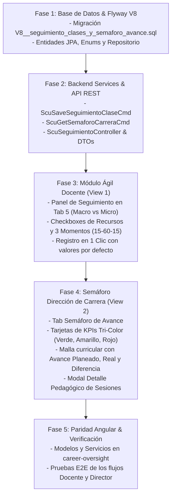

# Exploration: 14-seguimiento-clase-docente-y-semaforo-carrera
**Módulo Ágil de Seguimiento de Sesión de Clase Docente y Supervisión Curricular con Semáforo para Dirección de Carrera**  
**Sistema Integral de Seguimiento Académico (SISA 2.0) — UNITEPC**  
*Fecha: 30 de Octubre de 2026*

---

## 1. Resumen Ejecutivo

Este documento presenta la exploración técnica, arquitectónica y pedagógica para la implementación del cambio **14-seguimiento-clase-docente-y-semaforo-carrera**.

El objetivo es cerrar la brecha entre la planificación curricular y la ejecución efectiva en aula mediante dos subsistemas integrados:
1. **Seguimiento Ágil de Sesión para el Docente (`ROLE_DOCENTE`)**:
   - Permite al docente registrar la ejecución de su clase en aula en **pocos clics** (registro en menos de 5 segundos).
   - Diferencia con total claridad la **Macroplanificación Institucional** (Unidad Temática y Tema oficial del día definidos en la mesoplanificación Matriz 7 por la Dirección) de la **Planificación Personal de Aula** (los recursos didácticos planificados por el docente y los 3 momentos pedagógicos de la sesión: Inicio 15', Desarrollo 60', Cierre 15').
   - Permite marcar con checkboxes los recursos didácticos planificados que efectivamente se utilizaron, los momentos pedagógicos que se ejecutaron, registrar el estado general de cumplimiento del tema (`TOTALMENTE CUMPLIDO +1.0`, `PARCIALMENTE CUMPLIDO +0.5`, `NO CUMPLIDO 0.0`), e ingresar observaciones breves opcionales.
2. **Supervisión Curricular con Modelo de Semáforo para la Dirección de Carrera (`ROLE_DIR_CARRERA`, `ROLE_DIR_ACADEMICA`, `ROLE_ADMIN`)**:
   - Monitorea el avance de la cátedra a través de un modelo de semáforo matemático y pedagógico en tiempo real:
     * **Avance Planeado (%)**: Calculado en función de la semana actual del calendario institucional (sobre 20 semanas lectivas) o sesiones calendarizadas a la fecha de corte.
     * **Avance Real (%)**: Calculado sobre la sumatoria de puntajes de sesiones y momentos cumplidos respecto al total de sesiones programadas en la gestión.
     * **Diferencia (%)**: $\text{Avance Real} - \text{Avance Planeado}$.
     * **Semáforo Tri-Color Institucional**:
       - 🟢 **Verde (Al día)**: Diferencia $\ge -10\%$.
       - 🟡 **Amarillo (Atención / Riesgo Moderado)**: Diferencia entre $-10\%$ y $-25\%$.
       - 🔴 **Rojo (Crítico / Desfase Grave)**: Diferencia $< -25\%$ **o** falta de plan de clase (`PlanDeClase` ausente o sin microplanificación).
     * **Detalle Pedagógico por Docente y Materia**: Auditoría de cumplimiento porcentual por momento (Inicio, Desarrollo, Cierre), histograma de recursos didácticos más utilizados y notas de retroalimentación docente.

---

## 2. Estado Actual del Repositorio (Current State Analysis)

### 2.1 Backend (`sisa-backend`)

1. **Modelos de Planificación Existentes**:
   - [`SesionMatriz7.java`](file:///f:/SISA%202/sisa-backend/src/main/java/bo/edu/unitepc/sisa/domain/model/SesionMatriz7.java):
     Representa la sesión individual dentro del PAC Matriz 7 (20 semanas / 36+ sesiones). Almacena los datos de la macroplanificación institucional: `semana`, `nroSesion`, `fechaProgramada`, `tipoSesion`, `unidadTematica` (Unidad), `contenidoEspecifico` (Tema oficial del día), `saberConceptual`, `saberProcedimental`, `saberActitudinal`, `criterioDesempeno`, `evidenciaAprendizaje`, `instrumentoEvaluacion`, `hitoEvaluativo`.
   - [`PlanDeClase.java`](file:///f:/SISA%202/sisa-backend/src/main/java/bo/edu/unitepc/sisa/domain/model/PlanDeClase.java):
     Almacena la microplanificación de aula vinculada 1:1 con `SesionMatriz7`: `duracionTotalMin` (estándar 90 min), `objetivoSesion`, `planType`, `recursosDidacticos` (`List<String>` convertida a JSONB), `estado` (`BORRADOR`, `APROBADO`, `EJECUTADO`), y la colección de momentos pedagógicos.
   - [`MomentoPedagogico.java`](file:///f:/SISA%202/sisa-backend/src/main/java/bo/edu/unitepc/sisa/domain/model/MomentoPedagogico.java):
     Estructura los momentos pedagógicos por tipo ([`TipoMomentoPedagogico.java`](file:///f:/SISA%202/sisa-backend/src/main/java/bo/edu/unitepc/sisa/domain/enums/TipoMomentoPedagogico.java): `INICIO` 15 min, `DESARROLLO` 60 min, `CIERRE` 15 min), con `actividadesDocente`, `actividadesEstudiante` e `indicadorEvaluacion`.
   - [`ScuSavePlanClaseCmd.java`](file:///f:/SISA%202/sisa-backend/src/main/java/bo/edu/unitepc/sisa/service/command/ScuSavePlanClaseCmd.java):
     Aplica validación aritmética estricta exigiendo que la sumatoria de minutos de los 3 momentos sea idéntica a `duracionTotalMin` (90 min), actualizando los momentos in-place para preservar IDs y evitar colisiones con la restricción `uq_plan_momento`.

2. **Registro de Asistencia de Sesiones**:
   - [`AsistenciaSesion.java`](file:///f:/SISA%202/sisa-backend/src/main/java/bo/edu/unitepc/sisa/domain/model/AsistenciaSesion.java) y [`AsistenciaEstudiante.java`](file:///f:/SISA%202/sisa-backend/src/main/java/bo/edu/unitepc/sisa/domain/model/AsistenciaEstudiante.java):
     Creados en la migración `V7__student_attendance_tracking.sql`. Registra la asistencia física de estudiantes por fecha y comisión (`materia_codigo`, `fecha`, `tipo_clase`, `comision`, `tema`, `observaciones`).
   - Sin embargo, `AsistenciaSesion` está orientada primordialmente al control administrativo de estudiantes y al cálculo de la Regla del 80% (UNITEPC). **No almacena** la ejecución de los 3 momentos pedagógicos de la clase, no desglosa los recursos didácticos efectivamente empleados, ni calcula el puntaje de avance curricular del tema para la Dirección de Carrera.

3. **Historial de Migraciones Flyway**:
   - `V1__init_sisa_schema.sql` a `V7__student_attendance_tracking.sql`.
   - No existe una tabla para registrar el seguimiento didáctico longitudinal ni el semáforo institucional de avance por carrera. La siguiente migración disponible es **`V8__seguimiento_clases_y_semaforo_avance.sql`**.

4. **Supervisión de Carrera en Backend**:
   - [`ScuPlanningController.java`](file:///f:/SISA%202/sisa-backend/src/main/java/bo/edu/unitepc/sisa/api/controller/ScuPlanningController.java):
     Expone `GET /api/v1/planificaciones/pac/by-carrera/{carreraId}`, `POST /pac/{id}/review` y `POST /pac/batch-review`.
   - Actualmente **no existe un endpoint** que consolide la comparación entre el avance temporal del calendario institucional y el avance real de aula, requiriendo un endpoint REST dedicado para el reporte del semáforo curricular.

---

### 2.2 Frontend (`sisa-frontend`)

1. **Entorno del Docente (`view1` en [`app.component.html`](file:///f:/SISA%202/sisa-frontend/src/app/app.component.html))**:
   - Cuenta con 5 pestañas principales:
     * Pestaña 1: Programa Analítico (`#tab-analitico`)
     * Pestaña 2: PAC Pedagógico Matriz 7 (`#tab-pac-matrix`)
     * Pestaña 3: Cronograma de 20 Semanas (`#tab-cronograma-semanas`)
     * Pestaña 4: Planes de Clase (`#tab-cronograma-planes`)
     * Pestaña 5: Lista y Asistencia (`#tab-asistencia`)
   - En la Pestaña 5 (`#tab-asistencia`), el toolbar interactivo (`#asistencia-toolbar`) ya cuenta con el selector inteligente de sesiones oficiales del horario SEA (`#asistencia-sesion-select`), badges de horario/aula, e input de tema prellenado desde el cronograma.
   - **Carencia detectada**: No existe un panel de seguimiento ágil donde el docente, tras pasar la lista o al concluir su clase, pueda tildar con un par de clics: "¿Qué momentos ejecuté?", "¿Qué recursos usé?", y "¿Se cumplió el tema?" (+1.0 / +0.5 / 0).

2. **Entorno de Supervisión Curricular (`view2` en [`app.component.html`](file:///f:/SISA%202/sisa-frontend/src/app/app.component.html))**:
   - Diseñado para Directores de Carrera (`dir.carrera.sis`).
   - Posee un selector de filtros de seguimiento: `TODOS` (Dossier Completo), `ANALITICO`, `PAC`, `PRACTICO`, `CLASES`.
   - El contenedor `#supervision-semesters-container` renderiza la malla curricular agrupada en los 8 semestres de Ingeniería de Sistemas (o 10 para carreras de salud).
   - **Carencia detectada**: Los indicadores en la tabla muestran únicamente el estado de aprobación formal del documento (`APROBADO`, `EN_REVISION`, `OBSERVADO`), pero **no informan el avance real en aula**. El Director de Carrera no puede saber si el docente que tiene el PAC aprobado va al día con el calendario (Semana 13 de 20) o si se encuentra desfasado en temas críticos.
   - Falta el filtro y vista de **Semáforo de Avance**, las métricas de Avance Planeado vs Real, la diferencia porcentual, el badge del semáforo (Verde, Amarillo, Rojo), y el modal con el detalle pedagógico de sesiones por cátedra.

3. **Lógica de Controlador en [`app-controller.js`](file:///f:/SISA%202/sisa-frontend/src/assets/app-controller.js)**:
   - `buildCourseSessionsFromSea`: Genera la proyección de sesiones oficiales combinando los bloques de horario del Gateway SEA con la Matriz 7 (fecha base 3 de Agosto de 2026, 20 semanas).
   - `processAndRenderSupervisionData` y `renderSupervisionAccordions`: Procesan los grupos y asignaciones para renderizar las tablas de supervisión.
   - La arquitectura está lista para incorporar la pestaña interactiva del semáforo y la invocación de datos en tiempo de ejecución.

---

## 3. Especificación del Modelo Pedagógico y Semáforo

### 3.1 Separación de Responsabilidades: Macro vs Microplanificación

```
┌────────────────────────────────────────────────────────────────────────┐
│ MACROPLANIFICACIÓN INSTITUCIONAL (Dirección de Carrera / Cátedra)       │
│ - Definida en: Programa Analítico & PAC Matriz 7                       │
│ - Datos Oficiales: Unidad Temática, Tema oficial del día, Semana/Sesión │
│ - Naturaleza: Oficial, normativa, solo lectura para el docente         │
└───────────────────────────────────┬────────────────────────────────────┘
                                    │ Hereda y vincula
┌───────────────────────────────────▼────────────────────────────────────┐
│ PLANIFICACIÓN PERSONAL DE AULA (Docente Titular)                       │
│ - Definida en: Plan de Clase (.xlsx)                                   │
│ - Datos Personales: Recursos planificados, Momentos didácticos (90m)   │
│ - Naturaleza: Flexible, autonomía didáctica del docente                │
└───────────────────────────────────┬────────────────────────────────────┘
                                    │ Ejecución en clase (Pocos clics)
┌───────────────────────────────────▼────────────────────────────────────┐
│ SEGUIMIENTO DE SESIÓN (Registro en Aula)                               │
│ - Recursos didácticos realmente utilizados                             │
│ - Momentos pedagógicos ejecutados: Inicio (15'), Desarrollo (60'),     │
│   Cierre (15')                                                         │
│ - Cumplimiento del tema: TOTAL (+1.0), PARCIAL (+0.5), NO CUMPLIDO (0) │
│ - Observaciones breves de aula                                         │
└────────────────────────────────────────────────────────────────────────┘
```

### 3.2 Formulación Matemática del Semáforo de Avance

Para una cátedra con un total de $N_{total}$ sesiones planificadas en el semestre (típicamente 36 sesiones teóricas o 40 sesiones teórico-prácticas):

1. **Avance Planeado ($\%$)**:
   Determinado por la semana activa del calendario institucional $W_{actual} \in [1, 20]$:
   $$\text{Avance Planeado} = \left( \frac{W_{actual}}{20} \right) \times 100\%$$
   *(Alternativamente, basado en el número de sesiones programadas cronológicamente hasta la fecha actual $S_{plan}$ sobre $N_{total}$).*  
   *A la fecha de corte institucional (30 de Octubre de 2026, Semana 13):*
   $$\text{Avance Planeado}_{\text{Semana 13}} = \left( \frac{13}{20} \right) \times 100\% = 65.0\%$$

2. **Avance Real ($\%$)**:
   Calculado a partir de la suma de los puntajes de cumplimiento de cada sesión registrada en aula:
   $$\text{Puntaje Total Real} = \sum_{i=1}^{K} \text{Score}_i$$
   Donde cada sesión ejecutada aporta:
   - `TOTALMENTE_CUMPLIDO`: $+1.0$ punto.
   - `PARCIALMENTE_CUMPLIDO`: $+0.5$ puntos.
   - `NO_CUMPLIDO`: $0.0$ puntos.
   
   Por tanto:
   $$\text{Avance Real} = \left( \frac{\text{Puntaje Total Real}}{N_{total}} \right) \times 100\%$$

3. **Diferencia Porcentual ($\Delta$ %)**:
   $$\Delta\% = \text{Avance Real} - \text{Avance Planeado}$$

4. **Reglas de Clasificación del Semáforo**:
   - 🟢 **VERDE (Al Día / En Calendario)**:
     $$\Delta\% \ge -10\%$$
     *(Indica que la materia avanza al ritmo programado o con una holgura operativa aceptable de hasta 10% de desfase).*
   - 🟡 **AMARILLO (Atención / Riesgo Moderado)**:
     $$-25\% \le \Delta\% < -10\%$$
     *(Alerta académica: El docente tiene un atraso de entre 2 y 4 sesiones respecto al calendario; requiere monitoreo de la Dirección para reprogramar contenidos).*
   - 🔴 **ROJO (Crítico / Desfase Grave)**:
     $$\Delta\% < -25\% \quad \lor \quad \text{tienePlanClase} = \text{false}$$
     *(Alerta crítica: Retraso grave mayor al 25% o incumplimiento de la microplanificación didáctica por falta de Plan de Clase; requiere intervención inmediata de auditoría in situ o plan de acción).*

---

## 4. Áreas Afectadas del Sistema

### 4.1 Backend (`sisa-backend`)

| Componente | Tipo | Responsabilidad / Cambio |
|:---|:---|:---|
| `V8__seguimiento_clases_y_semaforo_avance.sql` | Flyway SQL | Creación de la tabla `seguimientos_clases`, índices optimizados, restricciones de integridad y semillas de datos representativas para prueba inmediata de los 3 estados del semáforo. |
| `SeguimientoClase.java` | Entidad JPA | Mapeo relacional de la sesión ejecutada con vínculos a `SesionMatriz7`, `recursos_planificados`, `recursos_utilizados` (JSONB), marcas booleanas de momentos (`inicio`, `desarrollo`, `cierre`), `estado_cumplimiento`, y `cumplimiento_score`. |
| `EstadoCumplimientoTema.java` | Enum | `TOTALMENTE_CUMPLIDO` (+1.0), `PARCIALMENTE_CUMPLIDO` (+0.5), `NO_CUMPLIDO` (0.0). |
| `ColorSemaforo.java` | Enum | `VERDE`, `AMARILLO`, `ROJO`. |
| `SeguimientoClaseRepository.java` | Repositorio Spring | Consultas optimizadas por materia, docente, fecha y agregaciones estadísticas para la Dirección de Carrera. |
| `GuardarSeguimientoClaseRequest.java` | DTO Request | Payload validado para registro ágil de sesión. |
| `SeguimientoClaseDto.java` | DTO Response | Representación completa de la sesión ejecutada. |
| `SemaforoMateriaDto.java` | DTO Response | Métricas por cátedra: Planeado %, Real %, Diferencia %, Color, Detalle de Momentos y Recursos. |
| `SemaforoCarreraReporteDto.java` | DTO Response | Consolidado a nivel de carrera: KPIs totales, distribución por color y lista de asignaturas. |
| `ScuSaveSeguimientoClaseCmd.java` | Servicio / Comando | Lógica transaccional de guardado/upsert de seguimiento y sincronización del estado de `PlanDeClase` a `EJECUTADO` cuando proceda. |
| `ScuGetSemaforoCarreraCmd.java` | Servicio / Comando | Motor de cálculo del semáforo con resolución de semanas lectivas, detección de materias sin plan de clase y agregación pedagógica. |
| `ScuSeguimientoController.java` | REST Controller | Endpoints `/api/v1/seguimiento/sesion`, `/api/v1/seguimiento/materia/{materiaCodigo}`, y `/api/v1/seguimiento/semaforo/carrera/{carreraCodigo}`. |

---

### 4.2 Frontend (`sisa-frontend`)

| Archivo / Componente | Ubicación | Responsabilidad / Cambio |
|:---|:---|:---|
| `app.component.html` (Vista 1) | Docente Workspace | Integración del panel ágil **"Seguimiento de Sesión"** en la Pestaña 5 (`#tab-asistencia`), con tarjetas contrastadas: 🏛️ Macroplanificación Institucional vs 👤 Planificación Personal (Checkboxes de recursos y momentos 15'-60'-15', selector visual de cumplimiento +1.0/+0.5/0 y botón de registro ágil). |
| `app.component.html` (Vista 2) | Dirección de Carrera | 1. Adición de la pestaña interactiva **"Semáforo de Avance"** en el selector de seguimiento.<br>2. Cinta de KPIs de Semáforo: Contadores de asignaturas en 🟢 Al Día, 🟡 Atención y 🔴 Crítico.<br>3. Columnas de Semáforo en la tabla curricular (Planeado %, Real %, Diferencia %, Badge Semáforo, Detalle de Momentos).<br>4. Modal institucional de **Detalle Pedagógico de Seguimiento** (`#modal-supervision-seguimiento-detalle`). |
| `app-controller.js` | Capa Lógica JS | 1. Funciones de auto-población del seguimiento según la sesión seleccionada en el horario.<br>2. Carga y persistencia ágil de sesiones contra la API REST con soporte de caché en `localStorage`.<br>3. Motor de renderizado del semáforo en la supervisión de carrera.<br>4. Handlers para apertura y visualización del desglose pedagógico en el modal de detalle. |
| `career-oversight.http.ts` | Angular Service | Métodos tipados para consumo de endpoints del semáforo. |
| `scu-seguimiento.model.ts` | Angular Model | Interfaces TypeScript para `SeguimientoClaseModel`, `SemaforoMateriaModel` y `SemaforoCarreraReportModel`. |

---

## 5. Análisis de Alternativas Arquitectónicas

```
+---------------------------------------------------------------------------------------------------+
| MATRIZ COMPARATIVA DE ENFOQUES TÉCNICOS                                                           |
+------------------------------+---------------------------+-----------------------+----------------+
| Criterio                     | Enfoque 1: Frontend Only  | Enfoque 2: Sobrecarga | Enfoque 3:     |
|                              | (LocalStorage Simulado)   | AsistenciaSesion      | Full-Stack     |
|                              |                           |                       | Especializado  |
+------------------------------+---------------------------+-----------------------+----------------+
| Persistencia Institucional   | ❌ Volátil / Sin BD       | ⚠️ Mezcla conceptos   | ✅ 100% Sólida |
| Integridad Referencial       | ❌ Nula                   | ⚠️ Débil              | ✅ Robusta     |
| Separación de Responsabilidad| ❌ No aplica              | ❌ Viola SRP          | ✅ Estricta    |
| Rendimiento de Consultas Dir | ⚠️ Lento en cliente       | ⚠️ Joins pesados      | ✅ Optimizado  |
| Auditoría y Trazabilidad     | ❌ Inexistente            | ⚠️ Parcial            | ✅ Completa    |
| Agilidad Docente (<5 seg)    | ⚠️ Parcial                | ⚠️ Formularios densos | ✅ Inmediata   |
+------------------------------+---------------------------+-----------------------+----------------+
```

### Enfoque 1: Simulación Exclusiva en Cliente (LocalStorage)
- **Descripción**: Calcular el semáforo y guardar las marcas de clase únicamente en el navegador usando `localStorage`.
- **Ventajas**: Rápida implementación inicial sin tocar base de datos.
- **Desventajas**: Inaceptable para un sistema institucional universitario. Las auditorías de Vicerrectorado y Dirección de Carrera quedarían vacías al cambiar de dispositivo; no hay trazabilidad histórica ni seguridad RBAC.

### Enfoque 2: Sobrecarga de la Tabla `asistencias_sesiones`
- **Descripción**: Agregar columnas de momentos y cumplimiento a la tabla de asistencias existente `asistencias_sesiones`.
- **Ventajas**: Reutiliza la tabla de la migración V7.
- **Desventajas**: Viola el principio de responsabilidad única (SRP). La asistencia de alumnos responde a normativas de permanencia y porcentaje del 80%, mientras que el seguimiento de clase es un expediente pedagógico docente. Además, obligaría a cargar listas de decenas de alumnos solo para consultar el semáforo curricular, degradando el rendimiento.

### Enfoque 3: Modelo Full-Stack Especializado con Integración Transversal [RECOMENDADO]
- **Descripción**:
  1. Crear la tabla especializada `seguimientos_clases` en Flyway V8 con claves foráneas opcionales a `sesiones_matriz7`.
  2. Implementar endpoints específicos en `ScuSeguimientoController` con soporte de agregaciones SQL rápidas (`SUM`, `COUNT`, `AVG`).
  3. Integrar la captura ágil en la Pestaña 5 de la Carpeta Docente, logrando que el docente pueda registrar su clase con valores por defecto en un solo clic ("Guardar Seguimiento").
  4. Enriquecer la Vista 2 de Dirección de Carrera con la pestaña y vista del Semáforo de Avance, alertas visuales tri-color y modal de auditoría pedagógica.
- **Ventajas**:
  - Máxima velocidad de consulta para la Dirección de Carrera (<15 ms para toda la carrera).
  - Experiencia de usuario ultra-ágil para el docente en aula.
  - Conformidad absoluta con los estándares arquitectónicos y de seguridad de UNITEPC.

---

## 6. Identificación de Riesgos Técnicos y Estrategias de Mitigación

| Riesgo Técnico | Nivel | Estrategia de Mitigación |
|:---|:---:|:---|
| **Sobrecarga de trabajo para el docente (Fricción en aula)** | Alto | **Auto-población Inteligente**: El sistema selecciona automáticamente la sesión del día, marca por defecto los 3 momentos como ejecutados y los recursos planificados como tildados, y sitúa el estado en "TOTALMENTE CUMPLIDO (+1.0)". Si la clase se dio según lo previsto, el docente registra con **1 solo clic**. Solo modifica si hubo eventualidades. |
| **Desfase entre sesiones SEA y sesiones Matriz 7** | Medio | `SeguimientoClase` registra la tupla de coordenadas de clase (`materia_codigo`, `fecha_ejecucion`, `tipo_clase`, `comision`) y enlaza a `sesion_id` de forma flexible. El cálculo del semáforo suma todos los cumplimientos válidos de la materia independientemente de reajustes en el calendario. |
| **Problema N+1 en el cálculo del Semáforo de Carrera** | Medio | En `SeguimientoClaseRepository`, se implementan consultas de agregación agrupadas por `materia_codigo` (`GROUP BY materia_codigo`), permitiendo al comando calcular las métricas de las 50 materias de una carrera en una única consulta SQL. |
| **Materia sin Plan de Clase registrado** | Medio | En el motor del semáforo, si `PlanDeClaseRepository` no encuentra planes registrados para la materia o su total es cero, el sistema marca forzosamente el semáforo en 🔴 **ROJO (Crítico - Falta de Plan de Clase)** con una etiqueta de advertencia explícita. |

---

## 7. Plan de Implementación Recomendado



---

## 8. Conclusión de Viabilidad

La implementación de la **Fase 1 (EXPLORE)** confirma la **alta viabilidad técnica** del cambio `14-seguimiento-clase-docente-y-semaforo-carrera`.

Las estructuras de datos existentes (`SesionMatriz7`, `PlanDeClase`, `MomentoPedagogico` y `AsistenciaSesion`) proporcionan la base conceptual idónea para acoplar el seguimiento de aula sin alterar las tablas de planificación ni comprometer la integridad de las exportaciones oficiales. La solución propuesta garantiza que el docente registre su clase en aula en menos de 5 segundos, dotando al mismo tiempo a la Dirección de Carrera de una herramienta de supervisión con semáforo preventivo en tiempo real.

El proyecto está preparado para avanzar a la **Fase 2 (PROPOSE / SPECS)**.
