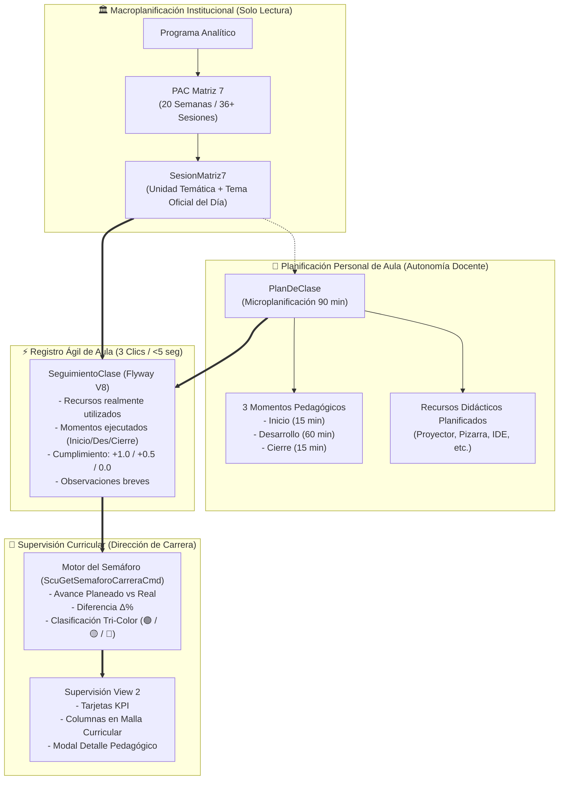

# Proposal: Seguimiento Ágil de Sesión Docente y Semáforo Curricular de Carrera

**Sistema Integral de Seguimiento Académico (SISA 2.0) — UNITEPC**  
**ID de Cambio:** `14-seguimiento-clase-docente-y-semaforo-carrera`  
**Fecha:** *30 de Octubre de 2026*  
**Autor:** *Diseñador de Producto Técnico (sdd-proposer)*  
**Hito:** *Presentación Institucional ante Vicerrectorado y Direcciones de Carrera*

---

## 1. Resumen Ejecutivo y Problema de Negocio

### 1.1 Contexto y Desconexión Operativa
En el modelo académico de la Universidad Técnica Privada Cosmos (UNITEPC), la excelencia de la formación por competencias descansa en dos pilares: la **planificación curricular** (Programa Analítico, PAC Matriz 7 y Plan de Clase) y la **ejecución efectiva en el aula**.

Sin embargo, el diagnóstico del estado operativo actual revela una **desconexión crítica entre lo planificado y lo verificado**:

1. **Sobrecarga y Fricción Administrativa en el Docente (`ROLE_DOCENTE`)**:
   - Al terminar la jornada de clase o registrar la asistencia física en la Pestaña 5 (`#tab-asistencia`), el docente carece de un mecanismo simple y ágil para asentar qué ocurrió didácticamente en la sesión.
   - Forzar al docente a llenar formularios burocráticos extensos provoca omisión sistemática del registro. Se requiere un mecanismo de **registro ágil en aula en máximo 3 clics (o menos de 5 segundos)** que aproveche los datos ya planificados y permita confirmar la sesión con valores por defecto.

2. **Ceguera Curricular en la Dirección de Carrera (`ROLE_DIR_CARRERA`, `ROLE_DIR_ACADEMICA`, `ROLE_ADMIN`)**:
   - El módulo de supervisión curricular actual (`view2`) únicamente fiscaliza el estado formal de aprobación documental de las carpetas (`APROBADO`, `EN_REVISION`, `OBSERVADO`).
   - La Dirección no dispone de visibilidad en tiempo real sobre el **ritmo de avance cronológico**. Al encontrarse la gestión académica en la **Semana 13 de 20** (a fecha 30 de octubre de 2026), la autoridad desconoce qué docentes avanzan según el cronograma oficial ($65\%$ planeado) y quiénes presentan desfases severos que pongan en peligro la cobertura temática o los hitos evaluativos.

3. **Confusión entre Macroplanificación y Microplanificación**:
   - En ocasiones, se confunde la **Macroplanificación Institucional** (Unidad Temática y Tema oficial del día normados en el PAC Matriz 7 por la Dirección de Carrera) con la **Planificación Personal de Aula** (la autonomía del docente para seleccionar recursos didácticos y estructurar los momentos didácticos de 90 minutos: Inicio 15', Desarrollo 60', Cierre 15').

### 1.2 La Solución Propuesta
Este cambio instituye una plataforma integral de doble propósito:
- **Para el Docente**: Un panel ágil de **Seguimiento de Sesión** integrado directamente en la Pestaña 5 de la Carpeta Docente (`view1`). Al seleccionar la sesión del horario, el sistema contrasta visualmente la Macroplanificación (oficial) vs la Planificación Personal de Aula, pre-tilda los recursos y momentos planificados, y permite consolidar la clase con calificación de cumplimiento (+1.0 / +0.5 / 0.0) en un solo clic.
- **Para la Dirección de Carrera**: Un **Módulo de Semáforo Curricular de Carrera** integrado en el espacio de supervisión (`view2`), provisto de un algoritmo tri-color (🟢 Verde, 🟡 Amarillo, 🔴 Rojo) fundamentado en la diferencia entre el Avance Real de aula y el Avance Planeado institucional, incorporando detección preventiva de cátedras sin microplanificación y un modal de auditoría pedagógica longitudinal.

---

## 2. Historias de Usuario

### HU-DOC-01: Registro Ágil de Clase en Aula en 3 Clics
- **Como** docente de cátedra (`ROLE_DOCENTE`),
- **Quiero** registrar la ejecución didáctica de mi clase en un panel ágil dentro de la misma pantalla donde tomo lista, en menos de 5 segundos y con un máximo de 3 clics,
- **Para** certificar el avance de mi materia sin incurrir en fricción burocrática ni retrasar la salida del aula.

### HU-DOC-02: Diferenciación Clara entre Macroplanificación y Microplanificación de Aula
- **Como** docente de cátedra (`ROLE_DOCENTE`),
- **Quiero** ver en tarjetas visualmente diferenciadas el Tema Oficial del día normado institucionalmente (Matriz 7) y mis propios momentos didácticos y recursos planificados (Plan de Clase),
- **Para** tener absoluta certeza sobre los límites de la normativa oficial de cátedra y mi autonomía pedagógica en el aula.

### HU-DOC-03: Verificación Rápida de Momentos Pedagógicos y Recursos Empleados
- **Como** docente de cátedra (`ROLE_DOCENTE`),
- **Quiero** marcar mediante casillas interactivas qué momentos pedagógicos se ejecutaron (Inicio 15', Desarrollo 60', Cierre 15') y qué recursos didácticos se emplearon efectivamente,
- **Para** contar con evidencias objetivas de desempeño didáctico ante supervisiones académicas y justificar eventualidades de aula.

### HU-DIR-01: Supervisión Curricular Preventiva con Semáforo Institucional
- **Como** Director de Carrera (`ROLE_DIR_CARRERA`) o Autoridad Académica (`ROLE_DIR_ACADEMICA`, `ROLE_ADMIN`),
- **Quiero** disponer de una pestaña de "Semáforo de Avance" con tarjetas KPI consolidadas (asignaturas en 🟢 Al Día, 🟡 Atención, 🔴 Crítico) y columnas de avance comparativo en la malla curricular,
- **Para** identificar de forma temprana los desvíos temáticos antes de los exámenes finales y coordinar planes de nivelación académica con los docentes.

### HU-DIR-02: Detección Inmediata de Asignaturas sin Plan de Clase
- **Como** Director de Carrera (`ROLE_DIR_CARRERA`),
- **Quiero** que el sistema marque automáticamente con alerta 🔴 **Rojo Crítico** a cualquier asignatura que carezca de Plan de Clase estructurado,
- **Para** exigir el cumplimiento inmediato de la microplanificación didáctica como requisito indispensable para validar las horas de cátedra.

### HU-DIR-03: Auditoría y Detalle Pedagógico de Cátedra
- **Como** Director de Carrera (`ROLE_DIR_CARRERA`),
- **Quiero** abrir un modal de "Detalle Pedagógico" desde cualquier fila del semáforo para consultar el porcentaje de cumplimiento de momentos (Inicio/Desarrollo/Cierre), histograma de recursos utilizados y notas de retroalimentación de cada sesión,
- **Para** realizar un acompañamiento pedagógico constructivo y cualitativo durante las reuniones de seguimiento docente.

---

## 3. Delimitación de Alcance (Strict Scope)

```
┌────────────────────────────────────────────────────────────────────────────────────────┐
│                                   ALCANCE DEL CAMBIO 14                                │
├─────────────────────────────────────────────┬──────────────────────────────────────────┤
│ ✅ IN-SCOPE                                 │ ❌ OUT-OF-SCOPE                          │
├─────────────────────────────────────────────┼──────────────────────────────────────────┤
│ 1. Migración Flyway V8 y tabla              │ 1. Modificaciones a la tabla             │
│    seguimientos_clases.                     │    asistencias_estudiantes o lógica      │
│ 2. Entidad JPA SeguimientoClase y           │    del cálculo del 80% (Change 12).      │
│    Enums EstadoCumplimiento / ColorSemaforo.│ 2. Modificaciones al esquema relacional  │
│ 3. Repositorio con agregaciones SQL nativas │    externo de SEA Core.                  │
│    optimizadas (cero problema N+1).         │ 3. Modificación de los motores de        │
│ 4. Servicios Backend y REST Controller:     │    exportación POI a Excel (Change 13).  │
│    /api/v1/seguimiento/sesion               │ 4. Flujos de reprogramación horaria      │
│    /api/v1/seguimiento/materia/{codigo}     │    o cambios de aula en SEA.             │
│    /api/v1/seguimiento/semaforo/carrera/{id}│ 5. Creación de nuevos roles de usuario   │
│ 5. Panel de Seguimiento en Pestaña 5        │    (se utilizan roles existentes).       │
│    (Docente Workspace - View 1).            │ 6. Registro de evaluaciones sumativas    │
│ 6. Pestaña Semáforo de Avance, KPIs y       │    o carga de actas de notas finales.    │
│    Malla Curricular (Dirección - View 2).   │                                          │
│ 7. Modal de Detalle Pedagógico de Cátedra.  │                                          │
│ 8. Semillas SQL representativas en V8       │                                          │
│    (Verde, Amarillo, Rojo) para la demo.    │                                          │
└─────────────────────────────────────────────┴──────────────────────────────────────────┘
```

### 3.1 In-Scope (Dentro del Alcance)
1. **Base de Datos y Persistencia Transaccional**:
   - Creación de la migración `V8__seguimiento_clases_y_semaforo_avance.sql`.
   - Tabla `seguimientos_clases` con columnas: `id`, `sesion_matriz7_id` (FK nullable), `materia_codigo`, `carrera_codigo`, `docente_ci`, `fecha_ejecucion`, `tipo_clase`, `comision`, `tema_oficial`, `tema_ejecutado`, `recursos_planificados` (JSONB), `recursos_utilizados` (JSONB), `momento_inicio_cumplido` (boolean), `momento_desarrollo_cumplido` (boolean), `momento_cierre_cumplido` (boolean), `estado_cumplimiento` (VARCHAR), `cumplimiento_score` (DECIMAL 3,2: 1.0, 0.5, 0.0), `observaciones_docente` (TEXT), índices compuestos y restricciones de integridad.
   - Carga de semillas SQL con datos de prueba realistas para la carrera de Ingeniería de Sistemas (Gestión II-2026, Semana 13), representando asignaturas en los tres estados del semáforo.

2. **Capa Backend (`sisa-backend`)**:
   - Entidad JPA `SeguimientoClase`, mapeada a la tabla `seguimientos_clases`.
   - Enumeraciones `EstadoCumplimientoTema` (`TOTALMENTE_CUMPLIDO`, `PARCIALMENTE_CUMPLIDO`, `NO_CUMPLIDO`) y `ColorSemaforo` (`VERDE`, `AMARILLO`, `ROJO`).
   - Repositorio Spring Data JPA `SeguimientoClaseRepository` con queries nativas agregadas (`GROUP BY materia_codigo`) para cálculo masivo de semáforo en $<20\text{ ms}$.
   - Comando transaccional `ScuSaveSeguimientoClaseCmd`: Guarda o actualiza el seguimiento y actualiza concurrentemente el estado de `PlanDeClase` a `EJECUTADO` si corresponde.
   - Comando de cálculo `ScuGetSemaforoCarreraCmd`: Calcula las métricas pedagógicas por materia y el reporte consolidado de carrera.
   - Controlador REST `ScuSeguimientoController` con endpoints seguros bajo `@PreAuthorize`.

3. **Capa Frontend Docente (`sisa-frontend` - `view1`)**:
   - Integración del panel interactivo **"Seguimiento de Sesión"** en la Pestaña 5 (`#tab-asistencia`).
   - Sincronización automática con el selector de sesiones oficiales `#asistencia-sesion-select`.
   - Tarjetas contrastadas:
     * 🏛️ **Macroplanificación Institucional** (Unidad de Aprendizaje, Tema oficial del día, Semana/Sesión según Matriz 7 - Solo lectura).
     * 👤 **Planificación Personal de Aula** (Recursos didácticos planificados, Momentos Inicio 15', Desarrollo 60', Cierre 15' según Plan de Clase).
   - Checkboxes de recursos planificados y checklist de los 3 momentos pedagógicos.
   - Selector interactivo de cumplimiento con botones visuales: `TOTALMENTE CUMPLIDO (+1.0)`, `PARCIALMENTE CUMPLIDO (+0.5)`, `NO CUMPLIDO (0.0)`.
   - Campo para notas rápidas de aula y botón principal de guardado ("Guardar Seguimiento").

4. **Capa Frontend Supervisión (`sisa-frontend` - `view2`)**:
   - Selector de filtro **"Semáforo de Avance"** en la barra de herramientas de supervisión curricular.
   - **Cinta de KPIs Tri-Color**: Contadores visuales de asignaturas en 🟢 Al Día, 🟡 Atención y 🔴 Crítico, junto con el % de Avance Promedio de la carrera.
   - Modificación dinámica de la tabla de materias en cada acordeón semestral para exhibir las columnas de semáforo:
     * Avance Planeado (%)
     * Avance Real (%)
     * Diferencia ($\Delta\%$)
     * Badge de Estado del Semáforo
     * Botón de Auditoría / Detalle
   - Modal institucional de **Detalle Pedagógico de Cátedra** (`#modal-supervision-seguimiento-detalle`):
     * Desglose porcentual de cumplimiento de momentos pedagógicos (Inicio, Desarrollo, Cierre).
     * Nube/lista de recursos didácticos utilizados.
     * Historial de sesiones registradas con sus temas, fechas, puntajes y observaciones del docente.

5. **Paridad de Arquitectura Angular**:
   - Interfaces TypeScript tipadas en `scu-seguimiento.model.ts`.
   - Métodos en el servicio `career-oversight.http.ts` para consulta y persistencia REST.
   - Manejadores en `app-controller.js` con soporte de caché en `localStorage` (estrategia Cache-Aside 0ms).

### 3.2 Out-of-Scope (Fuera del Alcance)
- Modificación de la toma de asistencia física de los estudiantes (`asistencias_estudiantes`), que permanece desacoplada bajo la regla del 80% (Change 12).
- Creación de nuevos formularios POI para exportación a Excel (el alcance se centra en la visualización web y auditoría digital en vivo).
- Gestión de sustituciones de docentes o asignación de suplencias.
- Modificación de estructuras de base de datos fuera de SISA 2.0 (por ejemplo, bases de datos centrales de SEA Cochabamba).

---

## 4. Enfoque Técnico y Pedagógico

### 4.1 Modelo Conceptual: Jerarquía y Flujo de Datos



### 4.2 Modelo Matemático del Semáforo de Avance

Para cualquier materia $M$ con un total de $N_{total}$ sesiones programadas en la gestión (típicamente $36$ teóricas o $40$ teórico-prácticas):

1. **Avance Planeado ($\%$)**:
   Determinado por la semana activa en el calendario institucional $W_{actual} \in [1, 20]$:
   $$\text{Avance Planeado} = \left( \frac{W_{actual}}{20} \right) \times 100\%$$
   *Para la fecha de corte institucional (30 de octubre de 2026, Semana 13):*
   $$\text{Avance Planeado}_{\text{Semana 13}} = \left( \frac{13}{20} \right) \times 100\% = 65.0\%$$

2. **Avance Real ($\%$)**:
   Calculado a partir de la sumatoria ponderada de puntajes de las sesiones ejecutadas en aula:
   $$\text{Puntaje Total} = \sum_{i=1}^{K} \text{Score}_i$$
   Donde cada sesión aporta:
   - `TOTALMENTE_CUMPLIDO`: $+1.0$ punto.
   - `PARCIALMENTE_CUMPLIDO`: $+0.5$ puntos.
   - `NO_CUMPLIDO`: $0.0$ puntos.

   Por lo tanto:
   $$\text{Avance Real} = \left( \frac{\text{Puntaje Total}}{N_{total}} \right) \times 100\%$$

3. **Diferencia Porcentual ($\Delta \%$)**:
   $$\Delta\% = \text{Avance Real} - \text{Avance Planeado}$$

4. **Reglas de Clasificación Tri-Color**:
   - 🟢 **VERDE (Al Día / En Calendario)**:
     $$\Delta\% \ge -10.0\%$$
     *Indica ejecución normal al ritmo planificado o con desfase operativo mínimo tolerable ($\le 2$ sesiones).*
   - 🟡 **AMARILLO (Atención / Riesgo Moderado)**:
     $$-25.0\% \le \Delta\% < -10.0\%$$
     *Alerta institucional: Desfase de entre 2 y 4 sesiones respecto al calendario; requiere seguimiento de la Dirección.*
   - 🔴 **ROJO (Crítico / Desfase Grave o Sin Microplanificación)**:
     $$\Delta\% < -25.0\% \quad \lor \quad \text{tienePlanClase} = \text{false}$$
     *Alerta crítica: Retraso superior a 4 sesiones ($>25\%$) **o ausencia total de Plan de Clase**. Requiere intervención prioritaria de la Dirección de Carrera.*

### 4.3 Experiencia de Usuario: Flujo de Registro en 3 Clics

El diseño de interacción para el docente minimiza radicalmente la carga cognitiva:

```
[ PASO 1: Clic en Selector de Sesión ]
  El docente abre el dropdown "#asistencia-sesion-select". El sistema auto-detecta la fecha
  actual (o selecciona la sesión oficial del día). Los datos oficiales (Unidad y Tema Matriz 7)
  y personales (Recursos y Momentos del Plan de Clase) se auto-cargan inmediatamente.
  Por defecto:
    - Todos los recursos planificados aparecen tildados.
    - Los 3 momentos (Inicio 15', Desarrollo 60', Cierre 15') aparecen tildados.
    - El estado se preselecciona en "TOTALMENTE CUMPLIDO (+1.0)".

[ PASO 2: Ajuste Opcional (Si hubo imprevistos) ]
  Si la clase no se completó íntegramente: 1 clic en "PARCIALMENTE CUMPLIDO (+0.5)"
  o desmarcar "Cierre (15 min)". (Si la clase fue normal, este paso se omite).

[ PASO 3: Clic en "Guardar Seguimiento" ]
  Un solo clic en el botón verde. La sesión se persiste vía REST en la BD y en LocalStorage.
  Feedback visual inmediato: Badge verde "Sesión Registrada (Score: 1.0)".
```

---

## 5. Áreas del Sistema Afectadas

| Componente | Archivo(s) | Acción / Responsabilidad |
|:---|:---|:---|
| **Base de Datos** | `sisa-backend/src/main/resources/db/migration/V8__seguimiento_clases_y_semaforo_avance.sql` | Creación de la tabla `seguimientos_clases`, índices y semillas para la demo. |
| **Dominio Backend** | `bo.edu.unitepc.sisa.domain.model.SeguimientoClase`<br>`bo.edu.unitepc.sisa.domain.enums.EstadoCumplimientoTema`<br>`bo.edu.unitepc.sisa.domain.enums.ColorSemaforo` | Entidad JPA y enums de dominio. |
| **Repositorio** | `bo.edu.unitepc.sisa.domain.repository.SeguimientoClaseRepository` | Métodos de consulta y agregaciones agrupadas por materia. |
| **DTOs Backend** | `GuardarSeguimientoClaseRequest`<br>`SeguimientoClaseDto`<br>`SemaforoMateriaDto`<br>`SemaforoCarreraReporteDto` | Contratos REST para registro y supervisión. |
| **Servicios Backend** | `ScuSaveSeguimientoClaseCmd`<br>`ScuGetSemaforoCarreraCmd` | Lógica de negocio, persistencia transaccional y cálculo matemático del semáforo. |
| **API REST** | `bo.edu.unitepc.sisa.api.controller.ScuSeguimientoController` | Endpoints `/api/v1/seguimiento/**` bajo `@PreAuthorize`. |
| **Vista Docente (HTML)** | `sisa-frontend/src/app/app.component.html` (View 1, Tab 5) | Panel de Seguimiento de Sesión con tarjetas contrastadas (Macro vs Micro). |
| **Vista Supervisión (HTML)**| `sisa-frontend/src/app/app.component.html` (View 2) | Tab "Semáforo de Avance", tarjetas KPI tri-color, columnas de avance y modal de detalle pedagógico. |
| **Lógica Frontend (JS)** | `sisa-frontend/src/assets/app-controller.js` | Funciones de auto-población, interacción de 3 clics, renderizado del semáforo y modal. |
| **Servicios Angular** | `sisa-frontend/src/app/core/services/career-oversight.http.ts` | Clientes HTTP tipados para consumo de la nueva API. |
| **Modelos Angular** | `sisa-frontend/src/app/core/models/scu-seguimiento.model.ts` | Tipado TypeScript para DTOs de seguimiento y semáforo. |

---

## 6. Criterios de Aceptación

### CA-01: Auto-Población Inteligente y Registro en 3 Clics (Docente)
- [ ] Al seleccionar una sesión en `#asistencia-sesion-select`, el panel de Seguimiento de Sesión debe cargar automáticamente el Tema Oficial de la Matriz 7 y los recursos/momentos del Plan de Clase correspondiente.
- [ ] Por defecto, los 3 momentos pedagógicos (Inicio 15', Desarrollo 60', Cierre 15') y los recursos planificados deben aparecer tildados.
- [ ] Por defecto, el botón de estado de cumplimiento debe encontrarse activo en `TOTALMENTE CUMPLIDO (+1.0)`.
- [ ] Si la clase se ejecutó normalmente, el docente debe poder completar el registro pulsando un único botón ("Guardar Seguimiento"), logrando un tiempo total de interacción $\le 5$ segundos.

### CA-02: Diferenciación Visual Nítida Macro vs Microplanificación
- [ ] La tarjeta de **Macroplanificación Institucional** debe mostrar de forma prominente el badge `"🏛️ Oficial Matriz 7 (Dirección de Carrera)"` y presentar la Unidad Temática y el Tema del Día como campos de solo lectura.
- [ ] La tarjeta de **Planificación Personal de Aula** debe mostrar el badge `"👤 Microplanificación (Plan de Clase)"` y contener los controles interactivos de recursos utilizados, momentos ejecutados y notas breves.

### CA-03: Persistencia y Actualización de Estado de Plan de Clase
- [ ] El envío del formulario a `POST /api/v1/seguimiento/sesion` debe persistir el registro en la base de datos con HTTP 201 Created (o HTTP 200 OK en caso de actualización).
- [ ] Al registrarse un seguimiento con `TOTALMENTE_CUMPLIDO` o `PARCIALMENTE_CUMPLIDO`, el backend debe actualizar el estado del `PlanDeClase` asociado a `EJECUTADO`.
- [ ] El frontend debe reflejar el estado registrado sin necesidad de recargar la página.

### CA-04: Cálculo y Visualización del Semáforo Tri-Color en Supervisión
- [ ] En `view2`, al seleccionar el filtro "Semáforo de Avance", la tabla de asignaturas debe mostrar: Avance Planeado (%), Avance Real (%), Diferencia ($\Delta\%$) y el Badge Tri-Color:
  - 🟢 **Verde**: Materias con $\Delta\% \ge -10\%$.
  - 🟡 **Amarillo**: Materias con $-25\% \le \Delta\% < -10\%$.
  - 🔴 **Rojo**: Materias con $\Delta\% < -25\%$ o materias sin `PlanDeClase`.
- [ ] La cinta superior de KPIs debe totalizar con exactitud matemática el conteo de asignaturas en cada color y el promedio general de avance de la carrera.

### CA-05: Penalización Obligatoria por Falta de Plan de Clase
- [ ] Si una materia no posee ningún `PlanDeClase` registrado en el sistema, el motor de semáforo debe forzar su estado a 🔴 **Rojo Crítico**, mostrando el distintivo explicativo `"Falta Plan de Clase"`, con independencia de si se registraron asistencias o no.

### CA-06: Modal de Auditoría y Detalle Pedagógico
- [ ] Al pulsar el botón "Ver Detalle" en cualquier materia del semáforo, debe abrirse el modal `#modal-supervision-seguimiento-detalle` mostrando:
  - Resumen de cumplimiento de momentos: % Inicio (15'), % Desarrollo (60'), % Cierre (15').
  - Resumen de recursos didácticos utilizados.
  - Tabla cronológica de todas las sesiones registradas con sus temas, fechas, estado y notas del docente.

### CA-07: Resiliencia y Carga Rápida (0ms Cache-Aside)
- [ ] Al acceder a la vista de supervisión, los datos consolidados del semáforo deben renderizarse de inmediato utilizando la caché local de `localStorage` si existe, mientras la petición REST actualiza en segundo plano sin desplazamiento de scroll.

---

## 7. Métricas de Éxito para la Presentación Institucional

Para la demostración ante Vicerrectorado y Direcciones de Carrera programada para el día de mañana, el cambio se considerará un éxito rotundo al cumplir las siguientes métricas:

| Métrica | Meta Cuantitativa | Método de Verificación en Demo |
|:---|:---:|:---|
| **Velocidad de Registro Docente** | $\le 5$ segundos ($\le 3$ clics) | Demostración en vivo en Pestaña 5: Selección de sesión y guardado con 1 clic. |
| **Tiempo de Respuesta del Semáforo** | $< 200\text{ ms}$ | Carga del endpoint `/api/v1/seguimiento/semaforo/carrera/CARSIS` para ~50 asignaturas. |
| **Demostración de los 3 Colores** | 100% de cobertura tri-color | Visualización en vivo en la malla de Sistemas: Materias en Verde (ej. Programación I), Amarillo (ej. Base de Datos I), y Rojo (ej. Cálculo I por desfase, y Sistemas Operativos por falta de Plan de Clase). |
| **Fidelidad Pedagógica** | 100% de coincidencia con PAC | El tema oficial de la sesión mostrada al docente coincide exactamente con la Matriz 7 aprobada. |
| **Cero Regresiones** | 0 fallos colaterales | La toma de asistencia de estudiantes (Regla del 80%) y la navegación entre roles continúan operando con normalidad. |

---

## 8. Gestión de Riesgos y Mitigaciones

| Riesgo Identificado | Severidad | Mitigación Implementada |
|:---|:---:|:---|
| **Resistencia docente por percepción de sobrecarga** | Alta | **Auto-población y valores por defecto**: Todo el formulario viene listo con la sesión de hoy y los 3 momentos tildados; el docente solo presiona "Guardar" a menos que deba registrar un incidente. |
| **Degradación de rendimiento por cálculo masivo (N+1)** | Media | **Agregaciones SQL directas**: El backend utiliza consultas con `GROUP BY materia_codigo` y `COUNT`/`SUM` en una sola pasada a la base de datos, eliminando bucles iterativos. |
| **Desfase entre calendario SEA y sesiones Matriz 7** | Media | La entidad `SeguimientoClase` registra la tupla de coordenadas de clase (`materia_codigo`, `fecha_ejecucion`, `comision`) y vincula a `sesion_matriz7_id` con clave foránea opcional (`ON DELETE SET NULL`), permitiendo registrar sesiones de recuperación. |
| **Falta de conectividad temporal en aula** | Baja | El frontend almacena temporalmente el seguimiento en `localStorage` y lo sincroniza con la API REST en cuanto se restablece la comunicación. |

---

## 9. Plan de Contingencia y Rollback

Si surgieran incompatibilidades o anomalías imprevistas durante la validación:
1. **Rollback de Base de Datos**: Ejecutar el script inverso de migración eliminando la tabla `seguimientos_clases`. Dado que las tablas previas (`sesiones_matriz7`, `planes_clase`, `asistencias_sesiones`) no son alteradas en su esquema estructural, los datos de asistencia y planificación quedan intactos.
2. **Rollback de Código**: Revertir los cambios en `app.component.html`, `app-controller.js` y en el backend mediante control de versiones (`git checkout`).
3. **Compatibilidad Asegurada**: El módulo de asistencia estudiantil opera de manera desacoplada de la tabla `seguimientos_clases`, garantizando que la operación administrativa de control de alumnos nunca quede interrumpida.

---

## 10. Conclusión y Recomendación

El presente cambio resuelve de raíz la deuda histórica de seguimiento curricular en aula de UNITEPC, dotando a la institución de una herramienta moderna, ágil y pedagógicamente rigurosa.

Con la aprobación de este documento de propuesta (`proposal.md`), el cambio queda formalmente listo para su paso a la **Fase de Especificación y Diseño Técnico (`spec.md` y `design.md`)**.
